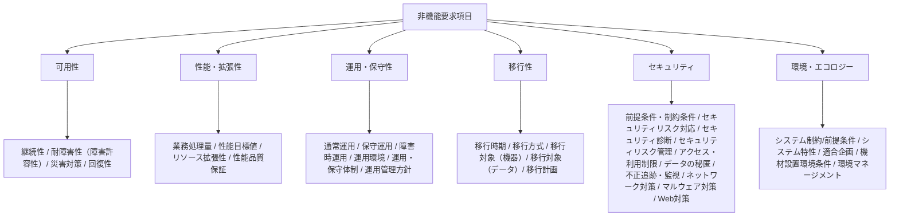
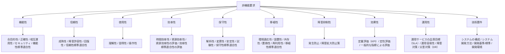
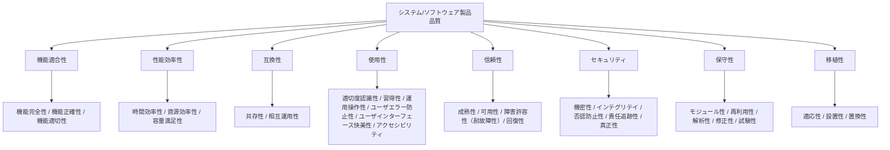

# Appendix: 非機能の類似用語と非機能フレームワーク

非機能は品質特性・アーキテクチャ特性・イリティなどとも呼ばれ、それぞれ出所と定義が異なる。
非機能フレームワークには IPA 非機能要求グレード、JUAS、ISO/IEC 25010、デジタル社会推進標準ガイドラインがある。
出典は [Appendix](about.md) (CC BY 4.0) で、OKF の形式に合わせて分割、変更している。

## 非機能に類似する用語

非機能と同じような意味でよく使われる用語に「品質特性」や「アーキテクチャ特性」などがある。

- **非機能**  
  機能以外の特性を包括的に指す伝統的な呼び方である。
- **品質特性**  
  ISO/IEC 25010 のソフトウェア品質モデルに代表される考え方で「明示的ニーズまたは暗黙のニーズを満たすためのソフトウェア製品の能力」と定義されている。
- **アーキテクチャ特性**  
  「[ソフトウェアアーキテクチャの基礎](https://www.oreilly.co.jp//books/9784873119823/)」（Mark Richards、Neal Ford 著、島田浩二 訳）の中で、「ドメインによらない、設計に関する考慮事項をあきらかにするもの」「設計の構造的な側面に影響を与えるもの」「アプリケーションの成功に不可欠な重要なもの」と定められている。
- **イリティ**  
  可用性（Availability）、信頼性（Reliability）、保守性（Maintainability）など「-ility」で終わる特性を総称して「イリティ」と呼ぶ。

## 非機能フレームワーク

### IPA 非機能要求グレード

IPA（情報処理推進機構）が公開する「非機能要求グレード」は、システム基盤に対する発注者要求の「見える化」を目的に策定されたフレームワークで、ユーザーと開発者の間で非機能要求の認識が食い違うことを防ぐため、検討すべき項目を網羅的にリストアップしそれぞれの要求レベルを段階的に示しているのが特徴である。  
非機能要求項目は次の6つの大項目に分類され、その下に35の中項目、118の小項目、238のメトリクス（評価指標）が階層的に整理されている。

> [!TIP]
> **現場での活用における注意点**
>
> 本グレードは長らく国内のデファクトスタンダードとして活用されているが、IPAにおける該当事業（更新・保守）は既に終了している。
>
> - [非機能要求グレード本体（日本語版）使用条件 | アーカイブ | IPA 独立行政法人 情報処理推進機構](https://www.ipa.go.jp/archive/digital/iot-en-ci/jyouryuu/hikinou/ent03-b-1.html)
>
> そのため、記載されている技術前提やメトリクスが、最新のクラウドアーキテクチャや開発手法の実態と合致しない部分も存在する。あくまで検討の漏れを防ぐためのベースラインと割り切り、AI要件など最新の技術トレンドに合わせてプロジェクト独自の要件へカスタマイズすることが不可欠であり、それが腕の見せ所である。

### JUAS 非機能要求仕様定義ガイドライン

JUAS（日本情報システム・ユーザー協会）が2008年に発行した「非機能要求仕様定義ガイドライン」は、IPA 非機能要求グレードと並んで国内でよく参照される。「ユーザー（発注者）視点」「検証可能性の重視」を特徴とし、非機能要件230項目について「確認すべき項目 / 確認すべきプロセス / 検証方法 / 必要なドキュメント」を整理している点が、要求レベルの提示に重きを置く IPA とは立脚点が異なる。大分類は次の10項目で、後述する ISO/IEC 9126（ISO/IEC 25010 の前身）の品質特性を下敷きに、ユーザー視点で再構成したものとなっている。  
ただし、2008年発行という時期もあり、クラウドサービスの普及やセキュリティインシデントの多様化など、近年のシステム開発のアプローチを必ずしも反映していない点には留意が必要である。

### ISO/IEC 25010 製品品質モデル

ISO/IEC 25010 はソフトウェアおよびシステムの品質モデルを定義する国際規格で、SQuaRE（Systems and software Quality Requirements and Evaluation）シリーズの中核をなす。ISO/IEC 9126 と ISO/IEC 14598 を統合した規格として2011年に発行され、2023年11月に大きな改訂が行われた（ISO/IEC 25010:2023）。 最新版の製品品質モデルは次の9つの品質特性で構成される。各品質特性はさらに副品質特性に細分化される。  
2011年版から大きく変わった点として、「使用性（Usability）」が「相互作用性（Interaction Capability）」に、「移植性（Portability）」が「柔軟性（Flexibility）」（移植性はその副特性に位置づけ）に再編され、新たに「安全性（Safety）」が独立した品質特性として追加された。

※図は2023年大改定前のものである。

### デジタル社会推進標準ガイドライン（群）

デジタル庁が策定する政府情報システムの整備・管理に関する政府共通ルールで、デジタル庁発足以前から内閣官房によって「デジタル・ガバメント推進標準ガイドライン」として運用されてきたものを継承・改称している。要件定義書に記載すべき非機能要件として、次の項目を定めている。

- ユーザビリティ及びアクセシビリティ
- システム方式
- 規模
- 性能
- 信頼性
- 拡張性
- 上位互換性
- 中立性
- 継続性
- 情報セキュリティ
- 情報システム稼働環境
- データマネジメントに関する事項
- テスト
- 移行
- 引継ぎ
- 教育
- 運用
- 保守
