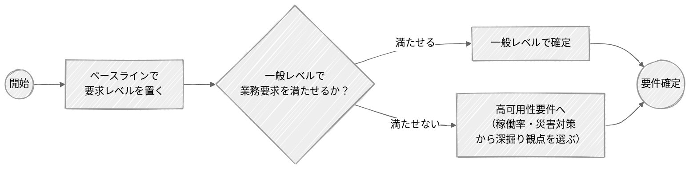

# 可用性要件の進め方と一般レベル

可用性は、まずベースラインで要求レベルを置き、一般レベルで業務要求を満たせるかで2段階に判断する。
一般レベルは標準構成で満たし実績で妥当性を確かめる。ミッションクリティカル性などが高ければ高可用性要件へ進む。
出典は [可用性](about.md) (CC BY 4.0) で、OKF の形式に合わせて分割、変更している。

## 可用性要件の進め方

可用性をどこまで作り込むかは、時間・費用・業務要求のバランスで決める。すべてのシステムで精緻な設計が要るわけではない。判断は2段階で行う。まずベースラインで要求レベルを置く。それで業務要求を満たせるなら一般レベルで確定し、満たせないなら高可用性要件へ進む。

## 一般レベルの可用性要件

多くのシステムにとって、可用性は特別に作り込む対象ではなく、標準的な作り方で十分に満たせる。ここでは、そうしたケースでの決め方を示す。ここで足りると判断できれば、次の[高可用性要件](high-availability-uptime.md#高可用性要件)には進まず、要件を確定してよい。

一般レベルでは、次の3ステップで要件を確定する。

1. **要求レベルを置く**  
   ベースライン（IPA 非機能要求グレードなら社会的影響の大きさに応じた3つのモデルシステム：ほとんどない / 限定される / 極めて大きい）から選ぶ（→ 第一部 [STEP6 ベースラインの設定](how-steps-preparation.md#step6-ベースラインの設定)）。停止しても影響が社内にとどまる、あるいは軽微な業務（社内の情報共有ツールなど）なら、社会的影響が「限定される」システムに当たる。この場合、稼働率でいえば 99.5〜99.9％ が1つの目安になる（相場観の詳細は[可用性とは](availability-basics.md#可用性とは)を参照）。
2. **標準構成で満たす**  
   冗長化（クラウドならマルチ AZ、オンプレなら機器の二重化）、単一障害点の排除、バックアップとリストアの整備。クラウドのマネージドサービスを素直に組めば、多くはこの水準に収まる。"特別に作り込む"のではなく、"標準から外さない"レベルである。
3. **実績で妥当性を確かめる**  
   数値ありきで決めず、実績と突き合わせる。現行システムがあれば稼働実績と障害履歴を振り返り、「実際どれくらい止まり、業務はどれだけ困ったか」を確認する（→ 第一部 [STEP2 ビジネスコンテキストの理解](how-steps-preparation.md#step2-ビジネスコンテキストの理解)・[Who章：現行システムの運用者](who-agrees.md)）。新規なら類似システムの水準を拠り所にする。

顧客との合意も、このレベルでは重くない。「業務への影響は限定的なので、標準構成で稼働率○％程度を目標にします」と確認する程度でこと足りる。停止の痛みを丁寧に引き出したり、コストと水準の綱引きをしたりといった重い合意形成は、可用性が重要ドライバとなるケース（次章）で行う。

一方、次のいずれかに当てはまるなら、一般レベルで止めず[高可用性要件](high-availability-uptime.md#高可用性要件)へ進む。ただし、費用・合意形成・設計構築の負担は相応に増える。

| 判断基準                                     | 例                                                            |
| :------------------------------------------- | :------------------------------------------------------------ |
| ミッションクリティカル性が高い               | 決済、認証基盤、社会インフラ、祖業・基幹業務システム          |
| 事業側と構築側の期待値に大きなギャップがある | 「24時間365日絶対に止めるな」が技術的・予算的に非現実的な水準 |
| 過去に重大な障害・訴訟・信用失墜の実績がある | 同種システムで重大インシデントを起こした経験がある            |
| 妥当なベースラインが存在しない               | 前例のない新規事業、類似システムが社内外に無い                |
| 規制・コンプライアンス要求がある             | 重要インフラ15分野、金融、医療などの法令・ガイダンス上の要求  |
| 契約上の罰則・損害賠償リスクがある           | SLA 未達時に違約金や契約解除条項が存在する                    |

迷う場合は、まず"止まったときの痛み"の大小をざっくり掴んで見極めるとよい。
