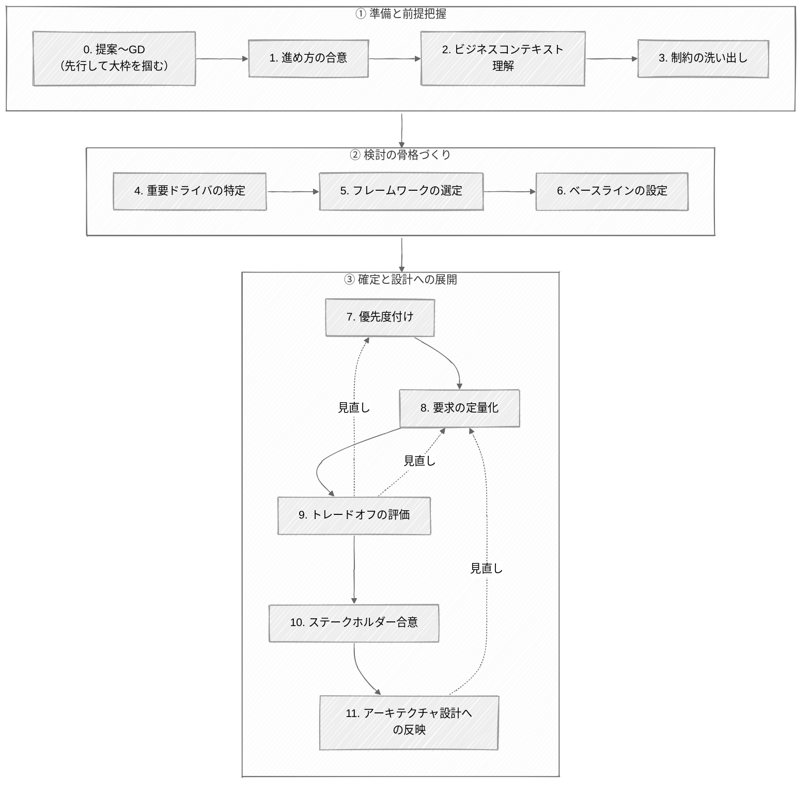

# 非機能要件定義の手順 (準備と骨格づくり)

提案〜グラウンドデザインで大枠を掴み、ビジネスコンテキストと制約を押さえてから、重要ドライバを特定する。
フレームワークは網羅性チェックの道具として使い、ベースラインを仮置きして個別調整の出発点にする。
出典は [はじめての非機能要件 第一部 全体プロセス編](about.md) (CC BY 4.0) で、OKF の形式に合わせて分割、変更している。

## 手順

非機能要件定義では「膨大な項目の網羅性をどう担保し、合意するか」が難しい。すべてを頭から均等に合意しようとすると時間が足りないので、メリハリをつけて段階的に進める必要がある。

以下に、非機能要件を定義するための思考の順序を示す。提案〜グラウンドデザインで大枠を先行して掴み（[STEP0](#step0-提案グラウンドデザイン先行して大枠を掴む)）、要件定義フェーズ以降で各ステップを通して具体化・確定していく。ただし一方通行ではなく、後段の検討や検証の結果を受けて前段へ戻り、見直しながら固めていく（図の見直し矢印）。

### STEP0. 提案〜グラウンドデザイン（先行して大枠を掴む）

- 重要ドライバに関連しそうなビジネス上の関心事や大枠の予算・体制といった方針レベルを粗く押さえる（→ [When章](when-to-agree.md)）
- 予算・方針を決める意思決定層を中心に、主要な利害関係者を特定・巻き込む（→ [Who章](who-agrees.md)）

### STEP1. 進め方の合意

要件定義フェーズの入口として、このフローチャートにあるような進め方そのものを関係者と合意する。

### STEP2. ビジネスコンテキストの理解

非機能要件定義の着手前に、対象とするシステムがビジネス上どのような意味を持ち、どのような前提のもとで何を達成したいのかを明確に理解することが重要である。ビジネスコンテキストを理解せずに定義された非機能要件は判断軸を欠き、妥当性を問われたとき根拠が示せない。

具体的には、次のような観点を押さえておきたい。

| 観点                       | 具体例                                                                                                                                                                                                                                   |
| :------------------------- | :--------------------------------------------------------------------------------------------------------------------------------------------------------------------------------------------------------------------------------------- |
| ビジネスゴール             | このシステムで事業として何を成したいか。「新規事業で顧客数を一気に伸ばす（攻め）」「既存業務のコストを削る（守り）」「老朽システムを刷新し、スピードと保守性を取り戻す」など。攻めか守りかで、可用性・性能・拡張性への投資姿勢が変わる。 |
| ビジネス上のクリティカル度 | 止まったとき事業にどれだけ響くか。「決済・受発注のように、停止が即・売上と信用の毀損に直結する基幹業務」か「社内の情報共有のように、多少の停止は許容される業務」か。                                                                     |
| ユーザー像と利用規模       | 社内数百名の業務利用か、不特定多数の toC 数百万規模か（精緻な数値は [STEP8](how-steps-agreement.md#step8-要求の定量化) で定量化する）。                                                                                                  |
| コストやスケジュール感     | 予算・納期がどの程度タイトか。潤沢か、厳しい上限があるか。                                                                                                                                                                               |
| 新規構築か現行刷新か       | 刷新なら、現行の実績値・障害履歴が使える（→ [Who章「現行システムの運用者」](who-agrees.md)）。また、既知の課題の解消が焦点になる。新規なら、拠り所となる実績がなく、構築コストと見込み効果のバランスから水準を起こす。                   |

これらは非機能要件定義に着手する段階である程度明確になっていることが多く、関係者間の共通のメンタルモデルとなる。

### STEP3. 制約の洗い出し

ビジネスコンテキストを理解したら、次に「すでに存在し、変更できない制約」を早期に洗い出す。[What章](what-is-nfr.md)で触れたとおり、制約はビジネス制約と技術制約に分かれる。そのうち予算・スケジュール・体制などのビジネス制約は [STEP2](#step2-ビジネスコンテキストの理解) で大枠を把握しているとする。ここでは、後から発覚すると手戻りの大きい技術・規程系の制約を中心に押さえる。

なお制約の出所は、非機能要件とは別の担当者であることも多い（→ [Who章](who-agrees.md)）。

#### 採用技術の事前決定が無いかの確認

教科書的には「非機能要件を定義した後に、それを満たすアーキテクチャや採用技術（例: AWS、Java、PostgreSQL など）を選ぶ」のが理想とされる。しかし実態としては、業界や組織の標準化戦略、既存ライセンス、ベンダーの都合などにより、要件定義の開始時点でコアの技術スタックやミドルウェア（例: JP1 など）が既に決まっているケースが多い。これらは議論の余地のない前提条件となり、後で発覚すると手戻りになるため、初期にこうした縛りがないかを確認する。

> [!TIP]
> **既存技術スタックという"暗黙の制約"**
>
> 明文化された言語・フレームワークの縛りがなくても、既存システムとの整合そのものが事実上の制約になる。周囲がすべて Java なのに、ある部分だけ Python や Go を採ると、運用・保守・要員確保の負荷が上がり、選びにくい。ここには非対称性がある。**既存スタックを踏襲する場合、説明を省略できるが、そこから外れる選択には「なぜそれを選ぶのか」の説明責任が生じる**。この差を意識しておきたい。
>
> 新しい技術を試す組織の許容度（予算）は有限である。そのため、顧客組織に馴染みのない技術を導入する場合は、あれもこれもと広げず、効果の大きい領域に戦略的に絞り、前述の説明コストも織り込んだうえで可否を検討する。

<!-- 前の注記と分ける -->

> [!TIP]
> **ベンダーロックイン**
>
> 「特定ベンダーにロックインしたくない」「採用は GA 版に限る」「なるべくマネージドや SaaS に寄せたい」といった方針は、明文化されないまま技術選定を縛る、隠れた制約になりやすい。永続性（EOL リスク）への許容度も含め、組織のスタンスとして早期に確認しておく。
>
> ただし、ロックインの回避が無条件で良いことではない。移植性を追えば、マネージドサービスがもたらす保守性・セキュリティ・スピードを手放し、逆にすれば依存は深まる。いずれもトレードオフであり、避けたいという考えを絶対要求にせず、便益と天秤にかけて必要な範囲を見極める（→ 心得「過剰品質を避ける」）。

#### 規定ドキュメントの確認

顧客組織内に次のような規定ドキュメント（ガイドライン・ポリシー）が存在するかどうかが、その後の検討作業量を大きく左右する。

- クラウド構築ガイドライン（CCoEなどが策定した標準ルール）
- 全社セキュリティポリシー
- システム運用標準基準書

これら規定ドキュメントの有無でアプローチが変わる。

- **ある場合**: 準拠が絶対条件となる。ゼロから非機能要件を考えるのではなく、「規定を遵守した上で、今回のシステム特有の要件をどう上乗せするか」という差分のアプローチをとる。
- **ない場合**: パブリッククラウドのベストプラクティス（AWS Well-Architected Frameworkなど）や、業界標準の基準を拠り所としてアーキテクチャ設計のベースラインを構築する。

### STEP4. 重要ドライバの特定

まず、このシステムで何を最優先するのかという方向を固め、そこからアーキテクチャ設計を左右する重要ドライバへ具体化する。関係者を集めて重点的に議論するのは、この重要ドライバである。それ以外の項目はベースライン（[STEP6](#step6-ベースラインの設定)）や書面確認に委ねて、メリハリをつける。

#### システムのコンセプトを固める

重要ドライバを決めるために有効な問いは、「このシステムのコンセプトは何か？」である。ビジネスコンテキスト（[STEP2](#step2-ビジネスコンテキストの理解)）を踏まえてこの問いに答えることで、各要件を仮説として立てる際の "どちらへ寄せるか" の指針になる。答えは、例えば次のようなものである。

- 「EC セールのピークに耐える、性能・拡張性ファースト」
- 「絶対に障害で使えない時間を許容できない、可用性ファースト」
- 「運用・拡張のしやすさを最優先」
- 「とにかく情報流出を許さない、セキュリティファースト」
- 「コストをできる限り抑えたい」

コンセプトが定まっていると、要件どうしが競合したときの寄せ方が決まり（例: セキュリティファーストなら、性能と競合したらセキュリティを優先）、トレードオフの初期判断が速くなる（→ 心得「全てはトレードオフである」）。

#### アーキテクチャ設計に効く粒度まで掘る

コンセプトは「性能が大事」で止めず、アーキテクチャ設計の分岐に直結する具体的なレベルまで掘り下げる。ここが曖昧だと、設計フェーズで手戻りになる。

- **性能ファースト** → 処理の非同期化をどこまで許容するか（同期の即時応答が必須か、非同期・結果整合で許容されるか）
- **可用性ファースト** → どこまでの障害を無停止で耐えるか（マルチ AZ 冗長以上の、マルチリージョン / DR まで要るか）
- **セキュリティファースト** → マルチテナントの分離レベルをどこまで求めるか（論理分離で足りるか、DB・インスタンスレベルの物理分離まで要るか）

### STEP5. フレームワークの選定

非機能要件の項目は多岐にわたるため、ゼロから洗い出すのではなく、業界標準の「フレームワーク」をベースラインとして活用することが一般的である。詳細は [Appendix: 非機能フレームワーク](appendix-terms-and-frameworks.md#非機能フレームワーク) を参照。

以下の手順で、検討の出発点とするフレームワークを選ぶ。

1. **既存フレームワークの有無を調査する**  
   顧客（もしくは自社）の組織内で、既に慣習的に利用されているフレームワークがあることも多い。そのため、まずはゼロベースで選定するのではなく、既存資産の流用から始めるのが現実的である。
2. **ドメインのデファクトスタンダードを基準に置く**  
   対象システムが属するドメインにおいて、所与の出発点として扱われるフレームワークがある場合はそれをベースに置く。例えば、国内の一般的な業務システムであれば「IPA 非機能要求グレード」や「ISO/IEC 25010」、政府系システムであれば「デジタル社会推進標準ガイドライン（群）」が該当する。
3. **システムの特性に合わせて足りない観点を補強する**  
   定めたベースを盲目的に採用するのではなく、システムの性質を踏まえて観点をブラッシュアップすることが腕の見せ所である。例えば「IPA 非機能要求グレード」はシステム基盤に特化しているため、エンドユーザー視点やアプリケーション視点（ユーザビリティ、アクセシビリティ、テスタビリティ、オブザーバビリティなど）をカバーしていない。システムの特性上これらが重要な意味を持つ場合は、「ISO/IEC 25010」などから観点を追加で取り込むか、独自項目として補強する。

ここで強調しておきたい。フレームワークは、大きな抜け漏れを防ぐための補完的な道具であって、それに沿って項目を上から埋めていくための台帳ではない。よくある罠は、項目が並んでいるとつい頭から順に埋めたくなり、消化することが目的化してしまうケースである。本来は、本当に重要な要件を見落とさないよう、検討の抜けを点検する網羅性チェックとして用いる。優先順位づけの主役はシステム固有の重要ドライバ（→ [STEP4](#step4-重要ドライバの特定)）に据える。

### STEP6. ベースラインの設定

個別の要件レベルを議論する前に、拠り所となる要求レベルのベースラインを仮置きする。ベースラインがないまま項目ごとに議論すると、ゼロから1つずつ妥当性を問うことになり、空中戦になりやすい。

ベースラインには、既存・類似システムの非機能要求や、フレームワーク（[STEP5](#step5-フレームワークの選定)）が用意する標準モデルを使う。IPA 非機能要求グレードなら、社会的影響の大きさに応じた3つのモデルシステム（ほとんどない / 限定される / 極めて大きい）が用意されている。[STEP4](#step4-重要ドライバの特定) で見極めたコンセプト・重要度に最も合うものを選ぶ作業が、これに当たる。

ただし、こうした標準モデルは粒度が粗く、対象システムの実態と噛み合わないことも多い。あくまで初期値・網羅チェックと割り切り、そのまま当てはめない。ベースラインをもとに、システムの性質を踏まえて必要な部分を個別に調整していく。
