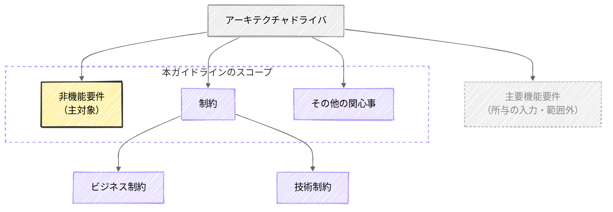

# 非機能要件とは何か

非機能は、機能を横断する関心事であり、どの程度かを定量的に問う特性である。
本ガイドラインは、アーキテクチャドライバのうち非機能要件を主対象とし、重要な要件の見極め・定量化・合意を扱う。
出典は [はじめての非機能要件 第一部 全体プロセス編](about.md) (CC BY 4.0) で、OKF の形式に合わせて分割、変更している。

## 非機能とは

機能と非機能の違いを整理すると、次の通りである。

| 区分   | 説明                                               | ECサイトでの例                                                                                                                             |
| :----- | :------------------------------------------------- | :----------------------------------------------------------------------------------------------------------------------------------------- |
| 機能   | システムの具体的な振る舞いやロジックそのもの       | ・商品一覧を取得する ・商品を購入する                                                                                                      |
| 非機能 | その機能がどのような品質で提供されるかを支える特性 | ・【性能】注文の確定結果がすぐ返ってくる ・【可用性】アクセスが多いときもダウンせず購入できる ・【セキュリティ】通信内容が第三者に漏れない |

非機能には、機能と対比した次の2つの性質がある。

- **横断的である**: 個々の機能に一対一で紐づかず、システム全体を横断する関心事である。そのため、画面や機能の洗い出しからは抜け落ちやすい
- **どの程度を問う**: 機能が「実現できる / できない」という二値であるのに対し、非機能は「どれだけ速いか」「どれだけ止まらないか」という度合いを問う。だからこそ、要件は定量的に表現する必要がある

> [!TIP]
> **非機能に類似する用語**
>
> 「非機能」は「品質特性」「アーキテクチャ特性」「イリティ」などとも呼ばれる。各呼称の定義の違いは [Appendix: 非機能に類似する用語](appendix-terms-and-frameworks.md#非機能に類似する用語) を参照。

<!-- 前の注記と分ける -->

> [!NOTE]
> **参考**
>
> [非機能テストを記号接地する](https://future-architect.github.io/articles/20260617a/)

## 非機能要件の位置づけ

システムのアーキテクチャは、いくつかの要因によって方向づけられる。こうした要因をアーキテクチャドライバと呼び、非機能要件はその代表的なひとつである。  
アーキテクチャドライバは次の要素から構成される。

非機能要件以外の要素は次の通りである。

- **主要機能要件**  
  アーキテクチャや技術選定、ひいてはインフラ構成やコストに影響を与えるユースケースを指す。実現のためにシステムの構造が大きく左右される機能が該当する。一見単純に見える機能でも、アーキテクチャを規定するのであれば含まれる。
  - **例1: 巨大ファイルのアップロード:** アプリサーバーを経由する通常のアップロードではメモリやタイムアウトに乗り切らないため、S3への署名付きURL方式を採ることが多い。するとリクエストがアプリを通らず従来の同期的なウィルスチェックが効かなくなるため、アップロード後にS3イベントで非同期スキャンを走らせる仕組みや隔離用バケット、専用のネットワーク経路・IAM/バケットポリシーを別途設計する必要が生じ、インフラ構成とコストに波及する。
  - **例2: リアルタイムな通知:** 都度リクエストを投げるHTTPでは要件を満たせず、WebSocket などの常時接続が必要となると話が大きくなる。各接続を保持するステートフルな構成や、スケールアウト時のセッション共有やメッセージ配信のためのPub/Sub基盤、WebSocketに対応したロードバランサーまで含めた設計が必要になる。
- **制約**  
  機能要件や非機能要件を実現するうえでの前提条件であり、次の2つに分けられる。
  - **ビジネス制約**: プロジェクトの予算やスケジュール、体制、社内規程、コンプライアンス要件など
  - **技術制約**: 使用する環境（CSP やオンプレ）、言語、フレームワーク、ライブラリの制約やセキュリティポリシーなど
- **その他の関心事**  
  チームメンバーのスキル、組織内のナレッジ、技術の採用実績、プロジェクト規模などが該当する。

### 本ガイドラインのスコープ

本ガイドラインは、アーキテクチャドライバのうち非機能要件を主対象とする。各要素の扱いは次の通りである。

| 要素           | 分類     | 本ガイドラインでの扱い                               |
| :------------- | :------- | :--------------------------------------------------- |
| 非機能要件     | 主対象   | 定義する成果物。                                     |
| 制約           | 考慮対象 | 非機能要件を左右する前提として、洗い出し・考慮する。 |
| その他の関心事 | 〃       | 〃                                                   |
| 主要機能要件   | 対象外   | 入力として参照するに留め、定義自体は範囲外とする。   |

## 非機能要件定義とは

本ガイドラインが対象とする「非機能要件定義」とは、単に品質特性の項目を一覧化する作業ではない。ビジネスの文脈や機能要件、既存の制約を入力・前提として踏まえたうえで、次の3つを行っていく営みである。

1. システムにとって本当に重要な非機能要件（またはアーキテクチャドライバ）を見極める
2. 曖昧な期待を定量的で検証可能な要件へ変換する
3. 関係者間で合意する

限られたコストと期間の中でトレードオフを見極め、何を優先し、何を諦めるかを関係者と合意することが重要である。
