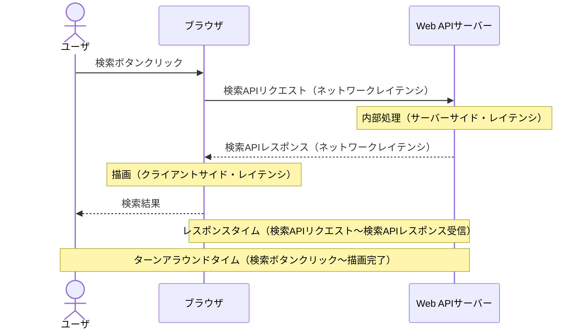

# 負荷の状態と性能指標

負荷は「大きさ」と「予測可能性」で分類し、何を負荷とするかを具体的に明示する。
性能指標は処理時間とスループットが代表で、同時処理数 = スループット × 処理時間 (リトルの法則) の関係にある。
出典は [はじめての性能テスト](about.md) (CC BY 4.0) で、OKF の形式に合わせて分割、変更している。

## 負荷の状態

システムの負荷状態は、通常時、ピーク時、スパイク時という「負荷の大きさ」による分類と、想定内の負荷、想定外の負荷という「予測可能性」による分類で整理されることが多い。

重要なのは、対象となるシステムの負荷状態を適切にパターン化し、関係者間で共有することである。例えばピーク時を想定内と考える人がいる一方で、ピーク時は通常時とは異なるのだから想定外と考える人がいるなど、解釈がばらつきやすいためである。パターンに応じて性能テストとしての合格基準や対応方針も変わり得るため丁寧にすり合わせる必要がある。

負荷の状態は、一般的な例として次のように分類できる。

| 負荷の大きさ                                         | 予測可能性      | 例                                                  |
| :--------------------------------------------------- | :-------------- | :-------------------------------------------------- |
| 通常時（日常的に発生する平均的な負荷）               | 想定内          | 平日10:00\~17:00 平均500リクエスト/秒               |
| ピーク時（週末や夜間など定期的に訪れる最大の負荷）   | 想定内          | 毎月1日8:00\~9:00 平均2000リクエスト/秒             |
| スパイク時（非常に短期間において急激に発生する負荷） | 想定内 / 想定外 | 年2回の大型セール開始後10分間 最大5000リクエスト/秒 |

これはあくまで一例である。スパイクといっても、SNSでの拡散やDDoS攻撃などによる予測不可能なスパイクもあれば、ブラックフライデーのようなセールによる、ある程度予測可能なスパイクも存在する。また、通常時やピーク時といわれる中にもいくつかのパターンが存在し得る。システムの特性に応じてパターンを見極め、定義することが望ましい。

> [!TIP]
> **負荷という用語**
>
> システムにとっての負荷とは「システムの処理リソースを消費する要因」のことである。この負荷は実行時に発生する動的な負荷と常に存在する静的な負荷に分類できる。
>
> - **動的負荷**
>   動的な負荷とは、実行時に発生し、終われば消える負荷を指す。これはさらに「頻度」と「規模」に分けて考えられる。
>   - 頻度：アクセス数やリクエスト数
>   - 規模：1回あたりにやりとりされるペイロードサイズ/ファイルサイズ
> - **静的負荷**
>   静的な負荷とは、実行の有無にかかわらず、システムが常に抱えている負荷を指す。主にデータベースに蓄積されているデータ量が挙げられる。
>
> このようにシステムに「負荷をかける」といってもいくつかの解釈がある。Web APIによるオンライン処理であればアクセス数を増やすことを意味し得るし、ファイルを処理するバッチ処理であればファイルサイズを大きくすることを意味し得る。性能テストの文脈で **「負荷」という言葉を使うときは、その解釈が揺れないよう具体的に何を意味するのかを明示することが重要** である。

## 性能指標

システムの性能を測る指標として代表的なものは「処理時間」と「スループット」である。  
単純に「システムの性能が2倍改善された」といっても、処理時間が改善されたのか、スループットが改善されたのかで、その意味は異なる。そのため、両者の違いを正確に理解する必要がある。

### 処理時間

処理時間とは、ある処理の開始から終了までに要した時間のことである。  
この処理時間は、レイテンシ、レスポンスタイム、ターンアラウンドタイムなど、さまざまな用語で表現される。ここではフロントエンドとバックエンドが分離した一般的なWebアプリケーションのオンライン処理を例として、処理時間がどのように定義されるのかを説明する。



> [!TIP]
> **用語定義の難しさ**
>
> 注意すべきなのは、これらの用語には一意的な定義が存在しない点である。
> 文脈に応じて同じ意味で使われることもあれば、違う意味として区別されることもあり、さらに人やツールによって解釈が異なることも珍しくない。そのため、性能テストを計画・実行するにあたっては、これらの用語そのものに頼ることなく **「どの地点からどの地点までの処理時間を指しているのか」という定義を関係者間で共通認識として持つことが必要** である。

#### レイテンシ

レイテンシとはデータの転送や処理における「遅延」や「待ち時間」を表す。レイテンシが高いという場合は遅延が大きく、低いという場合は遅延が小さいことを意味する。

ネットワークの文脈では、データが送信元から送信先に到達するまでにかかる時間（参考: <https://aws.amazon.com/jp/what-is/latency/>）のことを指す。ネットワークレイテンシの計測においては、クライアントがリクエストを送信し、サーバーからレスポンスを受信するまでにかかるラウンドトリップ時間（RTT: Round Trip Time）などが用いられる。

一方でSREの文脈では、レイテンシという言葉は単なるネットワークの遅延にとどまらず、サービスがリクエストを受けてからレスポンスを返すまでにかかる時間全体を指す指標として扱われる。また、この文脈でのレイテンシは計測するポイントによってその意味合いが異なる。

- **サーバーサイド・レイテンシ**  
  サーバー上で計測できるレイテンシ。サーバーがリクエストを受け取ってからレスポンスを返却するまでの内部の処理時間を指す。
- **クライアント・レイテンシ**  
  クライアント（ブラウザやアプリ）上で計測できるレイテンシ。ネットワーク遅延や画面描画を含めた、ユーザーが実際に体感する遅延に近い指標を指す。

#### レスポンスタイム / ターンアラウンドタイム

レイテンシに似た用語として、レスポンスタイムとターンアラウンドタイムがある。  
レスポンスタイムとターンアラウンドタイムはISO/IEC 25023で時間効率性を表す指標として登場する。一般的に、レスポンスタイムとは、ユーザーやシステムがリクエストを与えてからレスポンスが返るまでの時間を指すのに対し、ターンアラウンドタイムとは一連の処理の開始から完了までの時間を指す。

リクエスト・レスポンスを伴う処理においては基本的に「レスポンスタイム \< ターンアラウンドタイム」となる。例えばブラウザからWebページを要求する処理の場合は、Webサーバーにリクエストを投げてからレスポンスとしてWebページが返却されるまでの時間がレスポンスタイムとなる。さらにそこからブラウザがWebページをレンダリングしてユーザーに表示するまでを含めた時間がターンアラウンドタイムとなる。

> [!TIP]
> **バッチ処理における処理時間**
>
> 複数のバッチ処理を束ねたJOBフローからなるバッチ処理における処理時間は次の通りである。この例ではバッチ処理はワンショットタスクとしてコンテナで起動され、各バッチ処理はワークフローエンジンによってオーケストレーションされる。この場合、コンテナ管理サービスにコンテナの起動依頼を投げてから、対象のコンテナが終了するまでをバッチ単位のターンアラウンドタイムと呼ぶ。そして、全てのバッチ処理の開始から終了までをJOBフロー全体のターンアラウンドタイムと呼ぶ。
>
> ```mermaid
> sequenceDiagram
>     participant W as ワークフロー
>     participant E as コンテナ管理（ECS）
>     participant A as バッチ処理A（Fargate）
>     participant B as バッチ処理B（Fargate）
>     W->>E: 起動依頼
>     E->>A: コンテナ起動
>     W->>E: 状態確認
>     E-->>W: 完了
>     Note over W,E: バッチ処理A ターンアラウンドタイム
>     W->>E: 起動依頼
>     E->>B: コンテナ起動
>     W->>E: 状態確認
>     E-->>W: 完了
>     Note over W,E: バッチ処理B ターンアラウンドタイム
>     Note over W,B: 全体ターンアラウンドタイム
> ```

### スループット

スループットとは単位時間あたりの処理量を表す。  
処理時間が「1つの処理に何秒かかるか」という応答性の指標であるのに対し、スループットは「秒間どれだけの処理をこなせるか」という処理能力の指標である。スループットは、何を測定対象とするかに応じて異なる単位で計測される。

#### リクエスト・スループット

オンライン処理において、もっとも一般的に用いられるスループットの指標であり、1秒あたりに処理できるリクエスト数を意味するRPS（Requests Per Second）という単位で表される。  
TPS（Transactions Per Second）という単位も同じような意味で利用される。ただし、複数のリクエストを束ねる業務処理単位としてのトランザクションを明確に指す場合のみTPSを用いることが望ましい。

#### メッセージ・スループット

メッセージキューを介した非同期処理においては、単位時間あたりに処理できるメッセージ数（Messages Per Second）などがスループットの単位として用いられる。  
プロデューサーの視点に立つと、秒間どの程度のメッセージをキューに送信できるか、コンシューマーの視点に立つと、秒間どの程度のメッセージを処理しきれるかを表す。

#### バッチ・スループット

バッチ処理においては、単位時間あたりに処理できるデータ件数（1000万件/時間）やデータサイズ（10GB/時間）がスループットの単位として用いられる。  
バッチ処理を制御するワークフローエンジンがある場合、その視点では単位時間あたりに処理できたタスクやJOB数がスループットとなる。

> [!TIP]
> **処理時間とスループットの関係**
>
> 処理時間とスループットには[リトルの法則](https://ja.wikipedia.org/wiki/%E3%83%AA%E3%83%88%E3%83%AB%E3%81%AE%E6%B3%95%E5%89%87)といわれる関係性がある。
>
> ```txt
> 同時処理数 = スループット × 処理時間
> ```
>
> スループットと同時処理数は似て非なる概念である。
> 例えば、システムの同時処理数が4の状況において、各リクエストが2秒で処理されている場合、スループットは 4 / 2 \= 2 RPSとなる。
>
> ```mermaid
> gantt
>     title リトルの法則（同時処理数 = スループット × 処理時間）
>     dateFormat X
>     axisFormat %S秒
>     section 同時処理
>     処理1（2秒） :0, 2
>     処理2（2秒） :0, 2
>     処理3（2秒） :0, 2
>     処理4（2秒） :0, 2
> ```
