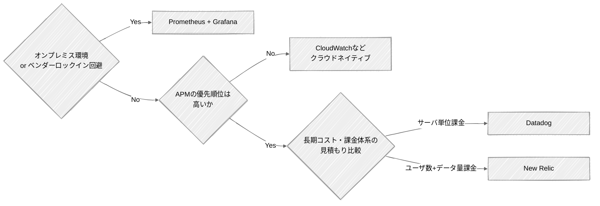

# モニタリングツールの選定

原則として本番運用で使うツールをそのまま性能テストでも使い、APMの要否と課金体系で選定する。
APMが不要なら CloudWatch、必要なら Datadog か New Relic、ベンダーロックイン回避なら Prometheus を選ぶ。
出典は [はじめての性能テスト](about.md) (CC BY 4.0) で、OKF の形式に合わせて分割、変更している。

## モニタリングツールを選定する

モニタリングツールは、性能テスト中のシステムの挙動を可視化し、ボトルネックの特定や改善検証を支える基盤となる。原則として、本番運用で利用するツールをそのまま性能テストでも使用する。性能テストで得た知見（各メトリクスの平常値、注意すべき閾値など）を、そのまま本番運用の監視設計に引き継げるためである。

選定においては、APMの要否、および外部からの監視の許容可否が大きな基準となる。APMの優先順位が低い場合は、CloudWatch等クラウドネイティブのモニタリングツールで十分である。

APMの優先順位が高い場合、あるいは後からAPMが必要になった場合は、DatadogかNew Relicの導入を検討する（補足: 2024年にAmazon CloudWatch Application SignalsがGAとなり、OpenTelemetryと組み合わせてAPMを実現できるようになったが、未検証のため割愛する）。両者の大きな違いは課金体系であり、Datadogがサーバー単位の課金となるのに対し、New Relicはユーザー数と取り込みデータ量での課金となる。基本的にはシステムサイズ（サーバー数）と運用保守体制規模には正の相関があると考えられるため、機能豊富かつ学習コストの低いDatadogを第一選択肢とする。ただし、見積もりの結果として長期的にNew Relicの方が安価となる場合は、その選択もありえる。

なお、オンプレミス環境の場合やベンダーロックインを避けたい場合はPrometheusを選択する。

各ツールの比較は次の通りである。

|                          | CloudWatch                                                                                                    | Datadog                                                                                                                                                                                     | New Relic                                                                                                      | Prometheus \+ Grafana                                                                                                                          |
| :----------------------- | :------------------------------------------------------------------------------------------------------------ | :------------------------------------------------------------------------------------------------------------------------------------------------------------------------------------------ | :------------------------------------------------------------------------------------------------------------- | :--------------------------------------------------------------------------------------------------------------------------------------------- |
| 提供元                   | AWS                                                                                                           | Datadog                                                                                                                                                                                     | New Relic                                                                                                      | OSSコミュニティ                                                                                                                                |
| 説明                     | AWS標準のモニタリングツール。 インフラ構築の必要がなく、追加設定無しで使用可能。                              | インフラからアプリ性能まで直感的なUIで統合監視できる、SaaS型オブザーバビリティの現在のデファクトスタンダード。 クラウド・オンプレミス問わず、エージェントを一つ入れるだけで設定が完了する。 | アプリケーション内部の遅延やエラーの特定（APM）において非常に高い分析力を持ち、Datadogと双璧をなすSaaSツール。 | OSSモニタリングツールの代表格。 Kubernetesの監視においては世界標準となっており、ベンダーロックイン回避の優先度が高い場合は有力な選択肢となる。 |
| 形態                     | クラウドネイティブ                                                                                            | SaaS                                                                                                                                                                                        | SaaS                                                                                                           | OSS                                                                                                                                            |
| インフラメトリクス監視   | ✅️ AWSリソースは設定不要                                                                                      | ✅️ コンテナ/OSレベルまで詳細                                                                                                                                                                | ⚠️\~✅️ APMよりだが十分可能                                                                                     | ✅️ k8s/コンテナの標準                                                                                                                          |
| アプリケーション性能監視 | ⚠️ X-Ray連携。専用ツールに劣る                                                                                | ✅️ 導入が容易で強力                                                                                                                                                                         | ✅️ APMの老舗。非常に詳細                                                                                       | ⚠️ 別途OpenTelemetry等が必要                                                                                                                   |
| 分散トレーシング         | ⚠️\~✅️ X-Rayにて対応                                                                                          | ✅️ APMとシームレスに連携                                                                                                                                                                    | ✅️ APMとシームレスに連携                                                                                       | ⚠️ 別途Jaeger/Tempo等が必要                                                                                                                    |
| ログ監視                 | ✅️ CloudWatch Logsで一元管理可能                                                                              | ✅️ 検索が高速だが保管料注意                                                                                                                                                                 | ⚠️\~✅️ データ取り込み枠を消費                                                                                  | ⚠️ 別途Loki等の構築が必要                                                                                                                      |
| ユーザー体験監視         | Synthetics等で対応                                                                                            | ✅️ ユーザーの画面操作まで録画可                                                                                                                                                             | ✅️ 詳細なフロントエンド監視                                                                                    | ❌️ OSS単体では非対応                                                                                                                           |
| 外部連携                 | ⚠️\~✅️ログフィルターを介してLambdaを発火可能。 プリセットがあるわけではないので、コード作成の手間は発生する。 | ✅️ 800以上の連携プリセット                                                                                                                                                                  | ✅️ 多数の連携プリセット                                                                                        | ⚠️\~✅️ OSSのプラグインが豊富だが手動設定                                                                                                       |
| マルチクラウド           | ❌️ 基本的にAWS専用                                                                                            | ✅️ AWS, GCP, Azure対応                                                                                                                                                                      | ✅️ AWS, GCP, Azure対応                                                                                         | ✅️ 構成次第でどこでも可能                                                                                                                      |
| オンプレミス             | ⚠️                                                                                                            | ✅️                                                                                                                                                                                          | ✅️                                                                                                             | ✅️ 閉域網・オフライン環境も可                                                                                                                  |
| 導入コスト               | ✅️ AWS環境ならエージェント不要                                                                                | ⚠️\~✅️ エージェント1つで一括収集 直感的なGUI。学習コスト最低                                                                                                                                | ⚠️ エージェント導入が必要 高度な分析にはNRQLの学習要                                                           | ❌️ \~ ⚠️ 各種Exporterの構築・設計が必要（PromQLという独自言語が必須）                                                                          |
| 価格                     | 従量課金 メトリクス数、ログデータ量                                                                           | ホスト/コンテナ数 ＋ 機能ごとの従量課金 マイクロサービス化等でサーバー/コンテナ台数が増えると高騰                                                                                           | ユーザー数(画面を見る人) ＋ 取り込みデータ量 監視画面を見るエンジニア・関係者の人数が増えると高騰              | 無料 (OSS) ※サーバーインフラ代のみ                                                                                                             |
| ユースケース             | APMの優先順位が低い場合                                                                                       |                                                                                                                                                                                             |                                                                                                                | 外部との通信がしにくい閉域網での統合監視                                                                                                       |
