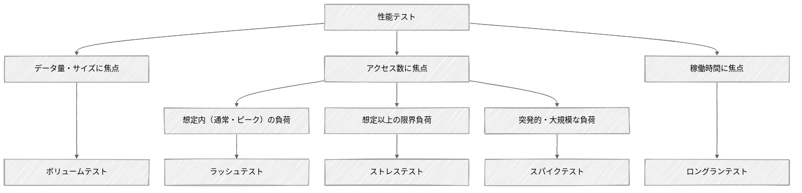

# 性能テストの概要と進め方

性能テストは非機能テストの一種であり、実施条件と目的に応じてボリューム・ラッシュ・ストレス・スパイク・ロングランの5つに分類する。
工程はテスト計画・テスト準備・テスト実行・チューニング・レポーティングの5ステップからなり、PDCAを回して精度を高める。
出典は [はじめての性能テスト](about.md) (CC BY 4.0) で、OKF の形式に合わせて分割、変更している。

## 性能テストの位置づけ

システムにおける「性能」とは、そのシステムがいかに効率よく安定して処理をこなせるかの能力である。性能テストとはさまざまな条件のもとで、この能力を評価するプロセスである。  
性能はシステムにおいて「機能」ではなく「非機能」といわれる特性であり、性能テストは非機能テストの一種である。非機能テストには性能テストのほか、アクセシビリティテスト、ユーザビリティテスト、セキュリティテスト、運用テストなどがある。

## 性能テストの分類

性能テストは、その実施条件と目的にもとづいていくつかの種別に分類できる。  
前提として、性能テストの分類について一意的なものはない。さらに言えば性能テストという言葉自体も解釈に揺れがあり、負荷テストと同等の意味で使われることもあれば、負荷テストとは異なるテストを意味することもある。  
本ガイドラインにおいては、性能に関するあらゆるテストを包括する概念として「性能テスト」という言葉を使用し、その実施条件や目的に応じて5つに分類する。

- **ボリュームテスト**  
  システムに対して大量のデータ（巨大なファイルやデータベースの大量レコードなど）を与え、どのように動作するかを確認するテストを指す。同時アクセス数の負荷ではなく、純粋な「データ量」や「データサイズ」に焦点を当て、仕様で定められた限界データ量を処理する能力があるかを検証する。
- **ラッシュテスト（負荷テスト）**  
  システムに対して通常時、ピーク時に想定される負荷（同時アクセス数）をかけ、処理時間やスループットといった性能指標が要件や目標値を満たすことを確認するテストを指す。
- **ストレステスト（限界テスト）**  
  システムが想定している以上の負荷（同時アクセス数や処理データ量）に対してどのように動作するかを確認するテストを指す。通常時、ピーク時の負荷を超えた場合のアプリケーションの動作を検証するとともに、システムがどれだけの負荷をサポートできるかを判断する。
- **スパイクテスト**  
  システムが突発的かつ大規模なトラフィック（同時アクセス数）の増加に対して、正常に動作するか、その後定常状態に戻るかを確認するテストを指す。例えば有名アーティストのチケット販売やブラックフライデーのようなECキャンペーンなど、例外的なトラフィック量を伴う可能性があるシステムにおいて有用なテストである。
- **ロングランテスト（耐久テスト）**  
  システムに対して一定の負荷を長時間（数時間〜数日間）かけ続け、システムが安定して動作するかを確認するテストを指す。主に、長時間の稼働によってリソースの容量に問題が発生しないこと（例. メモリリークが発生しないか、DBコネクションやスレッドプールが枯渇しないか）を確認する。

> [!TIP]
> **性能テストのそのほかの分類**
>
> 前述の通り、性能テストの分類や位置づけは、参照するガイドラインや書籍によって異なる。ここでは参考として、ソフトウェアテスト分野における代表的な3つの文献で定義されているテストカテゴリを紹介する。
>
> [**ISTQB/JSTQB（Foundation Level Specialist シラバス 性能テスト担当者）**](https://jstqb.jp/dl/JSTQB-SyllabusFoundation-PTSpecialist_Version2018.J01.pdf)
>
> ISTQB/JSTQBの「Foundation Level Specialist シラバス 性能テスト担当者」は、ISTQB/JSTQBが2018年にリリースしたシラバスであり、性能テストの専門家向けに国際標準の基礎知識を体系化したものである。当シラバスでは、性能テストをあらゆる性能関連のテストを包括する用語と位置づけた上で、テストの目的に応じて8つのカテゴリに分類している（カッコ内の英語は [原文](https://astqb.org/assets/documents/ISTQB-CTFL-PT-Syllabus-2018.pdf) の記載にもとづく）。
>
> - **性能テスト（Performance Testing）**: システムやコンポーネントがさまざまな負荷にさらされたときの性能（応答性）に焦点を当てたあらゆるタイプのテストを含む包括的な用語
> - **負荷テスト（Load Testing）**: 同時使用ユーザーやプロセスによって生成される、予想される現実的な負荷レベルの増加に対応するシステムの能力を確認するテスト
> - **ストレステスト（Stress Testing）**: 想定された限界に達した、あるいは限界を超えたピーク負荷や、リソースの可用性が低下した状況において、システムが処理する能力を確認するテスト
> - **拡張性テスト（Scalability Testing）**: 現在指定されている性能要件に違反することなく、将来的なシステム成長（ユーザー数やデータ量の増加など）に対応する能力を判断するテスト
> - **スパイクテスト（Spike Testing）**: 突然のピーク負荷に対してシステムが正しく応答し、その後、定常状態に戻る能力を確認するテスト
> - **耐久テスト（Endurance Testing）**: 長期間の運用における安定性に焦点を当て、時間経過による性能低下や故障（メモリリークなど）がないかを検証するテスト
> - **コンカレンシーテスト（Concurrency Testing）**: 特定のアクションが同時に発生する状況（例. 多数のユーザーによる同時ログインなど）がシステムに与える影響を確認するテスト
> - **キャパシティテスト（Capacity Testing）**: 規定の性能目標を満たしつつ、システムがどれだけのユーザー数やトランザクション数をサポートできるかを判断するためのテスト
>
> [**The Art of Software Testing**](https://a.co/d/0afdP1XG)
>
> The Art of Software Testing（ソフトウェア・テストの技法）は、1979年に初版が発行されたソフトウェアテスト分野の名著である。当書籍ではシステムテストを15のカテゴリに分類しており、そのうち4つが性能に関するテストとして定義されている。
>
> - **性能テスト（Performance Testing）**: 特定の負荷においてプログラムがレスポンス要件やスループット要件を満たすかを確認するテスト
> - **ボリュームテスト（Volume Testing）**: プログラムに通常時よりも大量のデータを与えた状態での挙動を確認するテスト
> - **ストレステスト（Stress Testing）**: プログラムに通常時よりも大きな負荷（短期間に発生するアクティビティ）をかけた状態での挙動を確認するテスト
> - **ストレージテスト（Storage Testing）**: プログラムが、システム（メモリ）および物理（ディスク）の両方におけるストレージ（記憶領域）の要件を正しく管理できているかを確認するテスト
>
> [**Performance Testing Guidance for Web Applications**](<https://learn.microsoft.com/en-us/previous-versions/msp-n-p/bb924357(v=pandp.10)>)
>
> Performance Testing Guidance for Web ApplicationsはMicrosoftが2007年に作成した、Webアプリケーションの性能テストを体系的に実施するための包括的なガイドブックである。当ガイドブックでは性能テストを4つのカテゴリに分類している。
>
> - **性能テスト（Performance Test）**: 速度、スケーラビリティ、安定性を判断または検証するテスト
> - **負荷テスト（Load Test）**: 通常時およびピーク時の負荷条件におけるアプリケーションの動作を検証するテスト
> - **ストレステスト（Stress Test）**: 通常時やピーク時の負荷を超えて限界まで追い込まれた際のアプリケーションの動作を検証するテスト
> - **キャパシティテスト（Capacity Test）**: パフォーマンス目標を満たしつつ、システムがどれだけのユーザー数やトランザクション数をサポートできるかを判断するためのテスト

## 性能テストのステップ

性能テストは、単にツールで負荷をかけるだけの作業ではない。計画から始まり、環境構築、実行、そして結果のレポーティングに至るまで、一連のプロセスを経て効果を発揮する。  
本ガイドラインでは、性能テストの工程を以下の5つのステップに分けて解説する。

1. **テスト計画**  
   テストの目的、目標値、完了基準、スケジュールなど、テストを実施するための計画を立案する。
2. **テスト準備**  
   テスト計画にしたがってテスト実施に必要な環境やスクリプトを準備する。
   具体的には、環境構築、データ準備、テストシナリオの作成などが挙げられる。
3. **テスト実行**  
   システムに負荷をかけ、各種性能指標を測定する。
4. **チューニング**  
   テスト実行中に取得したログやメトリクスからボトルネックを特定し、改善した上で再テストを実施する。
5. **レポーティング**  
   一連のテストの実行結果を評価し、システムが本番運用に耐えられるかを報告する。
   あわせて、将来的な拡張性や残存するリスクについても明文化する。

なお、これらのステップは一度実施して終わりではない。各ステップを繰り返し行き来し、PDCAサイクルを回しながら精度を高めていくことが重要である。
