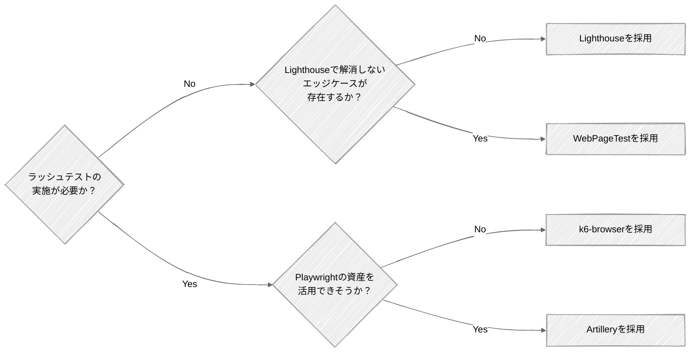

# 画面の性能テスト: 検証ツール

画面の性能検証ツールは、ラッシュテストの要否や既存資産 (k6・Playwright) の有無で選ぶ。
ボリュームのみなら Lighthouse、ラッシュも必要なら k6-browser を第一候補とする。
出典は [Appendix](about.md) (CC BY 4.0) で、OKF の形式に合わせて分割、変更している。

## 性能検証ツール

画面の性能検証では、サーバーのレスポンスタイムだけでなく、ブラウザ上でのレンダリングやユーザー操作の体感速度を測定する必要がある。

画面性能指標として推奨しているLCPとINPを測定できるツールを選定する。

決定木で分岐する各ツールについて、適用場面と選定理由は次の通りである。

- **[Lighthouse](https://github.com/GoogleChrome/lighthouse)**  
  ボリュームテストのみを実施する場合に使用し、単機能レベルでのLCP、INPのスコア化を推奨する。[WebPageTest](https://www.webpagetest.org/)や[sitespeed.io](https://www.sitespeed.io/)でも同様の計測はできる。ただし手軽さではLighthouseが一歩抜きん出ている。問題の切り分けや対策もLighthouse単体で十分実施できる。
- **WebPageTest**  
  Lighthouse単体では解消しないエッジケースが存在する場合に、利用を検討する。
- **[k6-browser](https://grafana.com/docs/k6/latest/using-k6-browser/)**  
  ボリュームテストに加えラッシュテストを実施しなければならない場合の第一候補とする。業界標準かつバックエンドテストとの統合が容易である。既にバックエンドの性能テストでk6を使用している場合は、導入コスト・維持コストの低減に繋げやすい。
- **Artillery**  
  k6を使用しておらず、かつPlaywrightの資産・知見を活用できそうな場合に、使用を検討する。ただし、性能テスト用のケースと通常のテストケースが完全一致することは実際には多くない。

各ツールの特徴を比較すると次の通りである。

|                    | Lighthouse                                                                         | WebPageTest                                                                                                                                                          | sitespeed.io                                                                     | k6-browser                                                         | Artillery                                                                                                                                                                |
| :----------------- | :--------------------------------------------------------------------------------- | :------------------------------------------------------------------------------------------------------------------------------------------------------------------- | :------------------------------------------------------------------------------- | :----------------------------------------------------------------- | :----------------------------------------------------------------------------------------------------------------------------------------------------------------------- |
| 提供元             | Google                                                                             | Catchpoint                                                                                                                                                           | OSSコミュニティ                                                                  | Grafana Labs                                                       | Artillery Software                                                                                                                                                       |
| 説明               | Chromeで実行できる単体レベルの画面性能検証においてはデファクトスタンダードなツール | Webサービス経由で利用でき、実機と実回線でテストできる本格的な解析ツール                                                                                              | Dockerベースで動作し、継続的なパフォーマンスモニタリングと自動化に特化したツール | k6にChromium制御を組み込んだツール                                 | Playwrightをスケール起動できるNode.js製のフルスタック負荷テストツール                                                                                                    |
| ライセンス         | Apache 2.0                                                                         | Polyform Shield 1.0.0                                                                                                                                                | MIT                                                                              | AGPL-3.0                                                           | MPL-2.0                                                                                                                                                                  |
| 実行方法           | Chrome DevTools / CLI / Node.js API                                                | Webサービス / プライベートインスタンス / API                                                                                                                         | CLI / Docker                                                                     | CLI / Docker / k6 Cloud / Kubernetes                               | CLI / Docker / Artillery Cloud / AWS Fargate                                                                                                                             |
| 対応端末           | ⚠️ PC                                                                              | ✅️ PC・モバイル実機（US/EU/Asiaなどの粒度で実行ロケーションを選択できる他、5G/3Gなど回線を選ぶこともできる）                                                         | ⚠️ PC（エミュレート）                                                            | ⚠️ PC（エミュレート）                                              | ⚠️ PC（エミュレート）                                                                                                                                                    |
| 対応ブラウザ       | ⚠️ Chromeのみ                                                                      | ✅️ Chrome / Safari / Firefox / Edge                                                                                                                                  | ✅️ Chrome / Safari（macOSのみ） / Firefox / Edge                                 | ⚠️ Chromium（Chrome, Edge）系                                      | ✅️ Chrome / Safari / Firefox / Edge                                                                                                                                      |
| LCP/INP計測        | ✅️ 可能                                                                            | ✅️ 可能                                                                                                                                                              | ✅️ 可能                                                                          | ✅️ 可能                                                            | ✅️ 可能                                                                                                                                                                  |
| レポーティング     | ✅️ 100点満点のスコアと色分けで非エンジニアにも直感的                               | ⚠️ 詳細なウォーターフォール図中心の専門家向けUI                                                                                                                      | ✅️ Grafana連携により美しいレポート画面を生成可能                                 | ✅️ Grafana連携により美しいレポート画面を生成可能                   | ⚠️ Cloud版または外部ツールでの整形が必要（v2.0.22からCLIのHTML出力機能が削除されており、視覚化にはArtillery Cloudへ生データの送信またはGrafanaなど外部ツール連携が必要） |
| 性能対策立案       | ✅️ 具体的な改善策をTODO形式で提示                                                  | ⚠️ 課題の発見・ボトルネックの特定まで                                                                                                                                | ✅️ Lighthouseなどの評価エンジンを内包                                            | ❌️ 測定結果の提示まで                                              | ⚠️ 課題の発見・ボトルネックの特定まで                                                                                                                                    |
| CIへの組み込み     | ✅️ 公式のLighthouse CI (LHCI)がある                                                | ⚠️ 可能だが大量実行は有料のAPIプランが必要                                                                                                                           | ✅️ CI/CDパイプラインへの統合を前提に設計されており容易                           | ✅️ GitHub Actionsなどの公式アクションが豊富であり容易              | ✅️ GitHub Actionsなどの公式アクションが豊富であり容易                                                                                                                    |
| ラッシュテスト対応 | ❌️ なし                                                                            | ❌️ なし                                                                                                                                                              | ❌️ なし                                                                          | ✅️ 可能                                                            | ✅️ 可能（k6がネイティブで動くのに対し、ArtilleryはNode.jsで稼働する分負荷を掛ける側のリソース効率は劣る）                                                                |
| 導入コスト         | ✅️ Chromeがあれば即時利用可能                                                      | ⚠️ Web上の公開テストは即時利用可能だがプライベート環境構築は手間                                                                                                     | ⚠️ Docker・Grafanaなどの知識が必要                                               | ⚠️ シナリオ作成と実行環境準備が必要                                | ⚠️ シナリオ作成と実行環境準備が必要                                                                                                                                      |
| 価格               | ✅️ 無料                                                                            | ⚠️ APIの大量利用やプライベート環境構築などのPro機能は有料                                                                                                            | ✅️ 無料                                                                          | ✅️ ツール自体は無料、実行環境の費用は発生                          | ⚠️ ツール自体は無料、実行環境やSaaS版の費用は発生                                                                                                                        |
| GitHubスター数     | 29.9k                                                                              | 3.2k                                                                                                                                                                 | 5.0k                                                                             | 29.4k（2026.3時点ではk6本体に統合されており、k6のスター数を記載）  | 8.9k                                                                                                                                                                     |
| ユースケース       | コストを掛けずに画面性能検証を行いたい場合                                         | Lighthouseでは解決しない性能問題の原因を分析したい場合 / 自社プロダクトと競合プロダクトの速度を比較したい場合 / 一連のユーザージャーニーでボトルネックを探りたい場合 | CIで継続的に性能を確認したい場合                                                 | バックエンドの性能テストでk6を利用しており、高負荷を再現したい場合 | Playwrightを利用しており、高負荷を再現したい場合                                                                                                                         |
