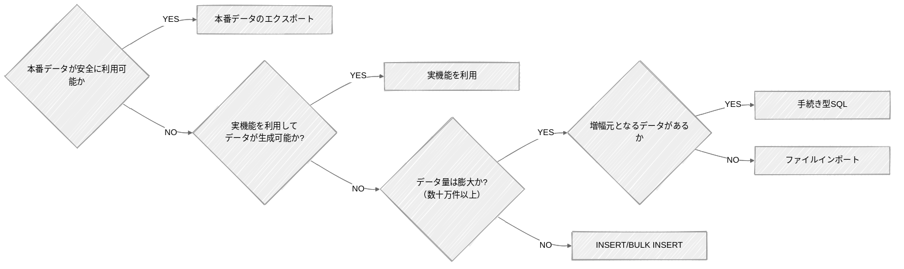

# テスト準備: データの用意

大量データは作成方法をフローで選び、投入前にインデックスや制約を外すなどの事前準備で効率化する。
件数だけでなくカーディナリティ・スキュー・関連テーブルの比率を本番に近づけ、実行計画の乖離を防ぐ。
出典は [はじめての性能テスト](about.md) (CC BY 4.0) で、OKF の形式に合わせて分割、変更している。

## データを用意する

システム諸元として算出したデータ量にもとづき、テスト環境にデータを投入する。  
ここではリレーショナルデータベース（Amazon Aurora PostgreSQL）にデータを投入することを想定して、考慮すべきポイントをいくつか示す。

### データの作成方法

性能テストとして利用するデータは、トランザクションデータをはじめ、そのデータ量は膨大になる可能性がある。  
数百万件、数千万件のデータとなると、単純にINSERT文を発行するだけでは莫大な時間がかかってしまうため、データをどのように作成（増幅）するか工夫が必要となる。データの作成方法は次のフローで判断すると良い。

#### 本番データのエクスポート/インポート

本番環境のデータをエクスポートし、それをテスト環境にインポートして利用できる場合、データの再現度という観点では一番正確なアプローチとなる。  
ただし、本番環境のデータには個人情報やそれに類する秘匿情報が含まれている可能性があり、扱いは慎重にならなければならない。

セキュリティポリシー上、根本的に本番環境のデータの持ち出しが認められていない場合も多い。また、仮にポリシーがなかったとしても秘匿性の高い情報をそのままテスト環境で利用するのは論外である。次のいずれかに該当する場合にのみ、本番データの利用を検討することが望ましい。

- 秘匿性の高い情報を除外・マスクした上でエクスポートできる、セキュアにデータを利用できる仕組みがある
- 根本的に秘匿性の高いデータを含まない

#### ファイルインポート

データをCSV形式などのファイルで用意し、データベースの機能を用いて一括でロードするアプローチとなる。  
Amazon Aurora PostgreSQLを利用している場合、① psql の \\copy コマンドを利用する方式と ② [aws_s3 拡張機能](https://docs.aws.amazon.com/ja_jp/AmazonRDS/latest/UserGuide/USER_PostgreSQL.S3Import.InstallExtension.html)を利用する方式の2つがある（補足: PostgreSQL標準のCOPYコマンドも同様の機能を提供するが、DBサーバーローカルのファイルを読み込んでロードする仕組みのため、Amazon Auroraでは使用できない）。

|                    | \\copy コマンド                                | aws_s3 拡張機能                               |
| :----------------- | :--------------------------------------------- | :-------------------------------------------- |
| ファイルの配置場所 | psqlクライアント                               | Amazon S3                                     |
| 実行主体           | psqlクライアント                               | Aurora エンジン（内部処理）                   |
| 転送速度           | ネットワーク帯域に依存                         | 高速                                          |
| セットアップ       | 不要（psql による接続のみ）                    | 必要（IAMロール, バケット, 拡張機能の有効化） |
| 安定性             | クライアント \~ データベースの接続断で中断する | データベース内部処理のため安定している        |
| 圧縮ファイル       | \-                                             | gzip形式を解凍できる                          |

#### 手続き型SQL（PL/pgSQL）

データベース内部で完結して大量のレコードを直接生成するアプローチとなる。  
アプリケーションプログラムからSQL文を繰り返し発行する方法と比較して、アプリケーションとデータベース間の通信回数が抑えられるため、効率的に処理できる。例えばあるユーザーのデータを100万人分に増やすというように増幅元となるデータが存在し、そのデータの主キーを変えながら繰り返し増幅していくようなケースでは非常に有効な手段となる。

#### INSERT / BULK INSERT

アプリケーションプログラムやスクリプトから、標準的なSQL文を用いてデータを投入するアプローチとなる。  
SQL文の解析やネットワークのオーバーヘッドが大きいため、大量データの投入には不向きである。データが小規模（多くて数万件まで）な場合や、複雑なロジックを通してSQL文を生成しながらデータを正確に作成したいケースにおいて利用することが望ましい。

#### 実機能を利用

データ投入のためのツールやスクリプトを新規に用意せずとも、システムが持つ実機能を利用してデータを作成できる場合がある。  
例えばバッチ処理によってオンライン処理で参照するデータが生成されるもの（例. I/Fファイルの集信）や、その逆でオンライン処理の実行によりデータが生成されるもの（例. 実行履歴などのトランザクションデータ）などが考えられる。このような場合、既存の実機能が利用できないか、まず検討すると良い。既存機能では時間が膨大にかかる、柔軟にデータが用意できないといった制約がある場合は、データ投入用の機能を用意する。

### 大量データ作成時の事前準備

数百万件から数千万件規模の大量データを効率的に作成するために、事前準備として効果的な手法は次の通りである。

- **インデックスを一時的に削除する**  
  インデックスを張ったままだとデータの投入ごとに更新処理が走り、書き込み負荷が増大する。
  PKインデックスを含めてデータ投入前にインデックスを削除しておき、全てのデータ投入が完了した後でインデックスを再作成する
- **外部キー制約を削除する**  
  投入される各レコードに対して参照整合性のチェックが実施されるのを防ぐ。
  インデックスと同様、全てのデータ投入が完了した後で外部キー制約を再作成する
- **データベースのスペックを増強する**  
  大量データの投入にあたっては、CPUやメモリをはじめ、特に書き込みIOPSがボトルネックになる。
  データ投入時のみインスタンスタイプをスケールアップし、投入後に元に戻す
- **autovacuumを停止する**  
  大量データの投入中は `VACUUM` が頻繁にトリガーされ、不要なI/Oを消費する。
  作業中は `VACUUM` を停止し、投入完了後に手動で `ANALYZE` と `VACUUM` を実行する。

### データパターンの考え方

データを準備するにあたって、単にレコード件数を揃えるだけでなく、どのような分布や属性を持つデータを用意するかを検討しなければならない。  
不適切なデータパターンでテストを実施すると、インデックスが適切に利用されなかったり、実行計画が本番環境と大きく乖離したりすることで、正しい評価を行えなくなる恐れがある。

データパターンを検討するにあたって考慮すべきポイントは次の通りである。

- **カーディナリティ（多重度）**  
  カーディナリティとはカラムに含まれるユニークな値のバリエーションのことである。
  例えばユーザーの属性として「出身の都道府県」があるとき、カーディナリティは47（都道府県）となるようにデータを作成する必要がある。
  全都道府県を作成するのが面倒だからといって、全て関東の1都6県だけにしてはならない。
- **スキュー（偏り）**  
  スキューとは特定のキーへのデータの集中や分布の偏りのことである。
  特にインデックスが設定されているカラムや、パーティションキーとして利用しているカラムにおいては、適切な偏りを心がける。
  先ほどの都道府県の例では、カーディナリティが47であっても、特定の県だけが全体の99％を占めていたり、全ての比率が均等であったりしてはならない。
  出身の都道府県であれば、人口統計にもとづきその比率が決定されることが望ましい。ほかにも履歴などのトランザクションデータは日付を持つことが一般的だが、特定の日付にデータが偏ることは望ましくない。
- **関連テーブルの比率**  
  関連テーブルの比率とは、親テーブル/子テーブルや交差テーブルなど1:NやN:Nの関係性を持つテーブルのレコード件数比のことである。
  この比率が実態と乖離すると、結合処理時にメモリ上に展開されるデータ量やループ処理の回数が変わり、実行計画が変わり得る。
