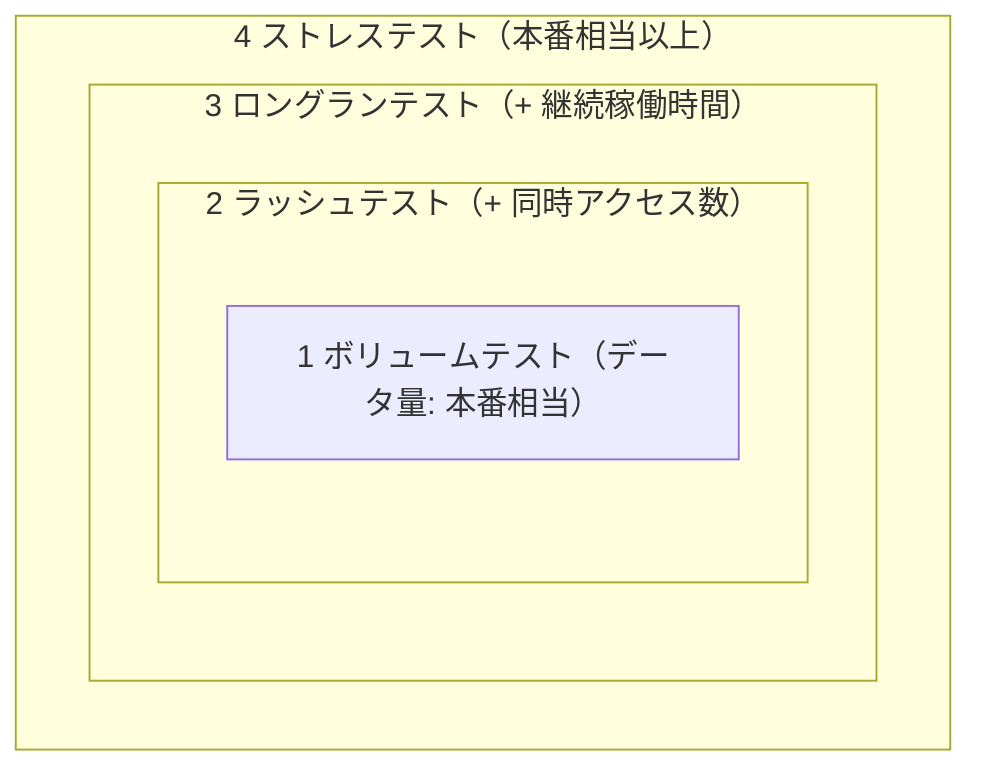

# テスト計画: テストの段取りと完了基準

観点を「データ量」→「データ量 × 同時アクセス数」→「+ 継続稼働時間」と段階的に広げ、ボリューム → ラッシュ → ロングラン → ストレスの順で進める。
各テストには何をもって完了とするかの基準を明確に定める。
出典は [はじめての性能テスト](about.md) (CC BY 4.0) で、OKF の形式に合わせて分割、変更している。

## テストの段取りと完了基準を定める

テストの目的を達成するためにどのテストをどの順序で実施するかを定める必要がある。  
多くのケースに適用できる進め方として、先述した[性能テストの分類](overview.md#性能テストの分類)をベースに「1. ボリュームテスト」「2. ラッシュテスト」「3. ロングランテスト」「4. ストレステスト」の順序で進めていくアプローチを推奨する（補足: スパイクテストについては割愛するが、システムにスパイク性がある場合は、ストレステストと合わせてスパイクテストを実施する形が望ましい）。

テストの観点を「データ量」から「データ量 × 同時アクセス数」そして「データ量 × 同時アクセス数 × 継続稼働時間」と段階的に変化させていくことで効率の良いテストが実現できる。各テストにおける負荷条件とテスト単位は次の通りである。

|                | ボリュームテスト | ラッシュテスト | ロングランテスト | ストレステスト |
| :------------- | :--------------- | :------------- | :--------------- | :------------- |
| データ量       | 本番相当         | 本番相当       | 本番相当         | 本番相当以上   |
| 同時アクセス数 | 1                | 本番相当       | 本番相当         | 本番相当以上   |
| 継続稼働時間   | \-               | 数十分         | 数時間 \~ 数日   | 数十分         |
| テスト単位     | 機能単位         | シナリオ単位   | シナリオ単位     | シナリオ単位   |

なお、各テストは目的に対応させて、何をもって完了とするかの基準を明確に定める必要がある。
