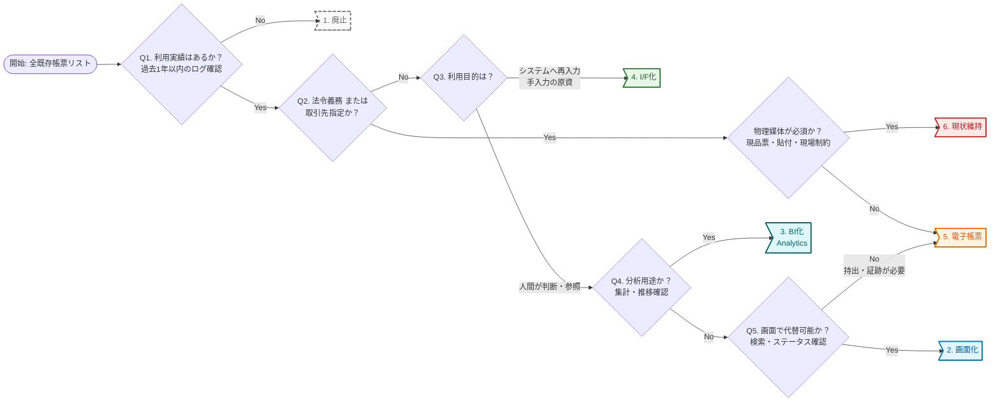

# 既存帳票への対応と移行

既存帳票は全量を棚卸しし、利用実績に基づき定量的に移行方針を判断する。現行踏襲を正としない。
移行方針は廃止、画面化、BI化、I/F化、電子帳票、現状維持から選ぶ。対外帳票は取引先との調整が必要で、段階的移行を検討する。
出典は [帳票設計ガイドライン](about.md) (CC BY 4.0) で、OKF の形式に合わせて分割、変更している。

## 既存帳票への対応

システムのリプレースなど既存帳票が存在する場合は、業務プロセスを見直す機会と捉えられる。また、安易に現行踏襲とせず、今の時代に合った方針とすることが否定されることはまずない。一方で取引先との都合や法的制約などで一律不要・一律電子化にはできないため、見極めが重要である。

棚卸しの推奨は以下の通り。

- 既存帳票の棚卸しを実施し全量を把握する
  - 設計書、ソースコード解析、ワークフローエンジン、実行ログなどから、信頼性がある帳票一覧を作成する
- 現行通りを正とせず、ログや利用実績・印刷実績に基づき定量的に判断する
  - 「使うかもしれない」という定性的な意見だけを根拠としない。生成しても誰も参照・印刷・ダウンロードしていない帳票は断捨離する

洗い出した帳票について、以下のいずれかの移行方針を決定する。

1. 廃止: 利用実績がない、または代替手段が既にある場合。移行対象外とする
2. 画面化: 参照頻度は高いが、証跡としての重要度は低い場合。ダッシュボードや検索画面化する
3. BI化: 分析用途であればBIにデータ連携して見てもらう
4. I/F化: 後続システムへの入力として使われている場合は、帳票にする必要はない
5. 電子帳票: 法的要件、または対外的な証跡として必須の場合。現行が紙であれば、PDFやHTML帳票化を検討
6. 現状維持: 既存の出力形式に従う

判定フローは以下のイメージである。

特に、取引先に対して出力している場合は必ず調整が必要であり、商流によってはかなり難しい現実がある。その場合は、それが制約で現状維持となることも珍しくなく、当然でもある。

切り替えの大方針の推奨は以下の通り。

- 内部利用の帳票は原則「画面化」「BI化」を検討する
  - 社内稟議、月次報告、在庫確認など、社内で完結する業務は、原則として帳票を作成せず、ワークフローシステムやダッシュボードへ移行する。情報のリアルタイム性と検索性を優先し、DX化を促進する
- 隠れ帳票への対応
  - システム外で運用されているExcelマクロ、AccessといったEUC（エンドユーザーコンピューティング）へのシステム化要件を含めると工数が膨大になることが多い。原則としてシステム移行対象外とし、CSV/Excelなどのデータソース提供に留め、ユーザー責任とするといった線引きを最初に議論する
- 取引先との紙帳票からの電子化は「段階的移行」を検討する
  - B2B取引において、流通BMSや全銀EDIシステムのような標準化されたデータ交換基盤への移行が理想であるが、取引先がいる話であるため調整は困難である
  - 当面は現行踏襲を受け入れ、中長期的な視点で徐々に改善していく。現/新の並行稼働など移行計画も、取引先と調整する
