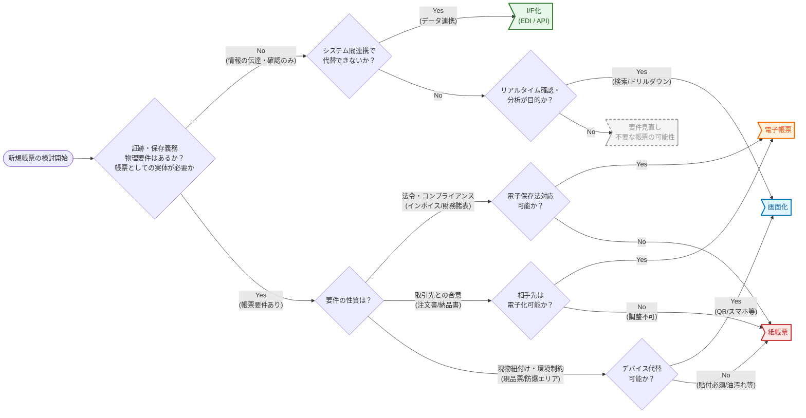

# 新規帳票を作るかの判断基準

帳票は一度定着すると変更や廃止が難しいため、安易に新規作成しない。作らない、I/F 化、画面化、帳票化の順で検討する。
法令・コンプライアンス、取引先との合意、現物との紐付け、デバイス利用が難しい場合は、逆に帳票化を考える。
出典は [帳票設計ガイドライン](about.md) (CC BY 4.0) で、OKF の形式に合わせて分割、変更している。

## 新規帳票の作成についての判断基準

新規サービス開発や既存業務のデジタル化で帳票出力を求められる場合は多い。しかし、一般的に帳票は一度定着すると業務プロセスと密接に絡み合い、後になっての変更や廃止が困難になる。そのため、帳票を安易に新規作成することは避けるべきである。

帳票化は以下の優先順で考える。

1. **作らない**: その帳票は本当に必要か考える。念のために用意しておく程度であれば作成しない
2. **I/F化**: システム間連携（EDI、API）で完結できないか考える。人間を介在させずシステムに直接渡す方が業務効率は高まる
3. **画面化**: リアルタイムな確認や分析が目的であれば、静的な帳票よりも、検索・ドリルダウンできるBIツールや管理画面化を検討する
4. **帳票化**: 上記いずれも適用できない場合に初めて、帳票としての設計を考える

以下の条件/要件の場合は、逆に帳票化を考える。

- 法令・コンプライアンス要件
  - 法律や公的なガイドラインにより、特定の様式での保存・交付が義務付けられている場合
  - 例: インボイス、領収書、財務諸表
  - 判断: 紙ではなく電子データ（PDF等）での保存を第一に検討する
- 取引先との合意
  - 企業間や顧客との取引内容を確定させ、言った言わないのトラブルを防止するための「契約」としての性質を持つ場合
  - 例: 注文書、契約書、納品受領証
  - 判断: 相手先の受け入れ体制に依存する。自社が電子化を望んでも、取引先が紙や特定フォーマットを要求する場合、ビジネス継続の観点から帳票化が必要となる
- 現物との紐付け
  - 「モノ」と情報の移動を同期させる必要がある場合
  - 例: 配送伝票、現品票、ピッキングリスト、入館証
  - 判断: デバイス（タブレット等）の持ち込みが困難な現場や、荷物に貼付する必要がある場合は、物理的な紙帳票が最適解となる
  - ※入館証はQRコード化しつつスマホ画面で代替するなど、技術的な回避策があるかも検討の余地がある
- デバイス利用が難しい場合
  - 工場など油で汚れるような環境や、防爆エリアや手袋などでタッチパネル操作が不可などの場合

判定フローは以下のイメージである。

> [!TIP]
> **BCP（事業継続計画）と帳票の役割**
>
> 高度に統合されたシステムは効率的だが、災害やランサムウェア被害などによるシステムダウン時には、その依存性の高さが仇となる。この際、「ローテクな帳票」が最後の砦として機能するケースがある。
>
> - 独立したデータの実体化: PDFやExcel/CSVとして出力された帳票は、基幹システムが停止しても、ローカルPCや標準的なビューアがあれば閲覧・加工・情報伝達ができる
> - 縮退運転の許容: 例えば受注システムが全停止した場合でも、直近の「注文一覧Excel」や「在庫表CSV」があれば、電話やメールベースでの手動受注対応（つまりオフライン業務）へ切り替えられる
>
> 平時の効率化だけでなく、有事の際に「どのデータがあれば “最低限の業務” を継続できるか」を考慮し、あえてCSVやExcelといった汎用的な形式での出力を、BCP対応機能の一部として組み込む判断も必要である。

<!-- 前の注記と分ける -->

> [!TIP]
> **業務プロセスにおける「紙」の功罪**
>
> 「紙の帳票」が業務フローに介在することは、基本的に非効率と見なされる。
>
> - **ロケーションの制約**: 物理的な紙はその場に行かないと確認できないため、リモートワークと相性が悪い。郵送や社内便のリードタイムが発生し、業務スピードも遅くなる
> - **見やすさの代償**: 紙はデバイス不要で即座に閲覧でき、一覧性や視認性も高い。しかし検索性と再利用性が低い
> - **目視チェックの負荷**: 紙の目視チェックは、疲労や熟練度の差によるミスが起こり得る。OCRを使えばAIエージェントによるチェックもできるが、それであれば最初から電子化しておけばよい
>
> 最終的に紙の形式で保存する必要がある場合は別として、そうでない場合は紙の持つ局所的な見やすさだけではなく、業務プロセス全体かつ将来的なAIによる自動化を見据えて未来像を描くべきである。
