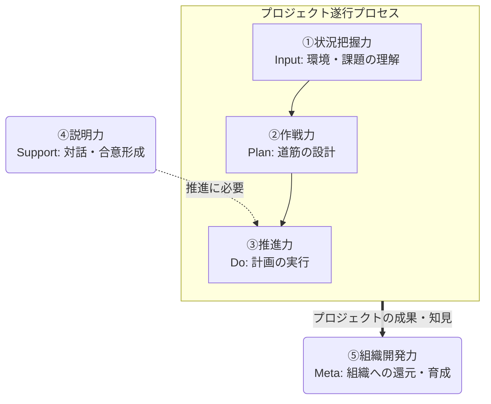

# ソフトスキルの定義とスキル体系

ソフトスキルとは、アーキテクトがハードスキルを組織やビジネスの文脈で発揮し、プロジェクトを成功へ導くために必要な、対人関係・思考・行動の汎用的な能力である。
スキルは状況把握力、作戦力、推進力、説明力、組織開発力の5分類にまとめ、各項目をレベル1 (認識)、レベル2 (実践)、レベル3 (指導) で定義する。
出典は [ソフトスキルガイドライン](about.md) (CC BY 4.0) で、OKF の形式に合わせて分割、変更している。

## ソフトスキルとは

本ガイドラインにおいて「ソフトスキル」とは、アーキテクトが技術的な専門性（ハードスキル）を組織やビジネスの文脈で最大限に発揮し、プロジェクトを成功へ導くために必要な、対人関係・思考・行動に関わる汎用的な能力と定義する。ハードスキルとソフトスキルは、車輪の両輪である。

## アーキテクトに期待されること

優れたアーキテクチャを設計できたとしても、それを顧客やチームに納得させ、実行に移せなければ、ビジネス価値は生まれない。  
本ガイドラインでは、（シニアな）アーキテクトに大きく以下のような振る舞いが期待されるとする。

- 営業活動
  - 商談の場で自社の技術力・開発力などの特徴・ケイパビリティ・魅力を伝えること
  - 技術的な課題、悩み事項への助言、相談に応え建設的に議論できる
- プロジェクトにおける技術的な意思決定を主体的に行える「リーダーシップ」を取ること
  - 難しい課題に対して、道筋を立てられる
  - 不確実性が高い状況においても、仮説ベースであるべき技術方針を検討、提案できる
- プロジェクトリーダー視点で、技術領域を任せられる
  - 例えば、非機能要件定義や主要技術の選定などを、契約事項やスケジュールを意識して自律的に推進できる
  - 非機能要件に対して、どのような要件を重視しトレードオフを鑑みて選定したか、利害関係者に対して説明責任を持つ
  - プロジェクトとして自社への期待値を理解して、何を押さえておくべきか把握している
- 前に出て、合意形成に向けた決定事項を作れる
  - 両者が気になる観点を理解し納得できる着地点を見出す。よっぽどのことがなければ決定事項はひっくり返らない
  - 分かりやすい説明ができることや、論理的かつ伝わりやすく資料化できる
- チームの開発生産性の最大化
  - 開発の仕組みや運用ルールを考え、技術面での意思決定をしチームを主導できる
  - 品質や生産性をどのように向上させるか作戦を考え、実行する
  - 開発計画の策定やタスク化を行い、技術面でのリスクマネジメントを取る
  - アーキチームのチームマネジメントとタスクマネジメントを行う
- 育成
  - 若手にナレッジトランスファーし、自身は別の領域を切り開き貢献する
- 技術ブランディング
  - 技術的な発信はプロジェクトリーダーにはできない。外部へ発信し魅力を伝える

なお、ここではアーキテクトがプロジェクト管理の全てを行うのではなく、プロジェクトリーダー（PL）と協力して推進に当たることを想定している。マネジメントなどは必要に応じてPLに補助を求められる。一方、技術的な意思決定などのリーダーシップはPLでは難しいため、アーキテクトが責任を持って行うべきである。また、開発チーム（アーキチーム）などのサブユニットのマネジメントは、アーキテクトが行うことを想定している。

## ソフトスキル要素

アーキテクトがコンサルタントとしてプロジェクト業務で活躍するために必要なソフトスキルを、以下の5分類でまとめる。

1. 状況把握力
2. 作戦力
3. 推進力
4. 説明力
5. 組織開発力

それぞれの関係性は以下。

なお、思考法（ロジカルシンキング、デザインシンキング、クリティカルシンキング）やメタスキル（キャッチアップ能力、好奇心、成長意欲など）は5つ全てに共通する基盤として位置づけられ、直接スキル定義としての記載はしない。

## スキルレベル

大分類ごとにスキルを定義する。レベルは以下の定義とする。

1. レベル1: 【認識】重要性や基本的な概念を理解している。上位者や他のメンバーの指示・サポートがあれば、その役割の一部を担える状態。アーキテクトとしてまず押さえておくべきレベル
2. レベル2: 【実践】独力で標準的なレベルの業務を遂行できる。状況に応じて適切な手法を選択し、安定した成果を出せる状態。シニアなアーキテクトが到達すべきレベル
3. レベル3: 【指導】卓越した知見を持ち、他者を指導・育成できる。または、組織標準となる新しい手法や仕組みを生み出し、周囲に影響を与えている状態。通常のアーキテクトの枠組みを超えたステージを目指す場合に必要となるレベル

全てレベル2以上を必須とするものではない。得意分野に応じて濃淡がありつつ、苦手領域でもレベル1を維持することでチームとして補完し合える状態を想定する。

また、一部の項目では「-」としている。これはPLと役割が強く重複することと、アーキテクトに対して過剰な要求レベルに見え、萎縮してしまうことに配慮してオミットしたことを示している。もちろん、「-」であってもこのレベルに達すれば強い武器になるため、不要と断じているわけではない。
