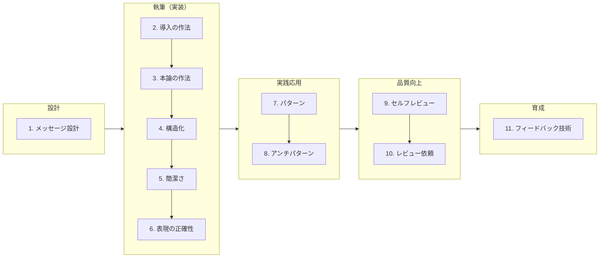

# テクニカルライティングガイドラインの出典と適用範囲

`docs/technical-writing/` の文書は、フューチャー株式会社の [テクニカルライティングガイドライン](https://future-architect.github.io/arch-guidelines/documents/forTechnicalWriting/) を元にしている。
対象は、専門概念を構造化し、判断に足る情報を示して意思決定を推進するためのライティング技術である。

## 出典とライセンス

- 原文: [テクニカルライティングガイドライン](https://future-architect.github.io/arch-guidelines/documents/forTechnicalWriting/technical_writing_guidelines.html) (フューチャー株式会社、[future-architect/arch-guidelines](https://github.com/future-architect/arch-guidelines))
- ライセンス: [CC BY 4.0](https://creativecommons.org/licenses/by/4.0/deed.ja)
- 作成者: 真野隼記、Tiffany Chan、高瀬陸、内堀航輝、宮崎将太、小橋昌明、亀井隆徳、戸井田拓斗、武田大輝、清水雄一郎、赤坂優太、澁川喜規、長谷川寛人
- レビュアー: 辻大志郎

### 原文からの変更点

- 1つの文書を、責務ごとに複数の文書に分けた。
- 各文書に OKF の frontmatter と、冒頭の要約を足した。
- VitePress の記法 (`<page-title/>`、`::: tip` などのコンテナ、見出しの `{#id}`) を、GitHub の Markdown の記法 (`> [!TIP]` など) に置き換えた。
- 原文の章へのリンクを、分割後の文書へのリンクにした。このリポジトリに取り込んだ他のガイドラインへのリンクは、その docs/ の文書へのリンクにした。取り込んでいないガイドライン (AWS、Terraform、データマネジメント、Git ブランチフロー) へのリンクは、原文のサイトの URL にした。
- 原文の図 (画像) を mermaid の図、または図の内容を説明する文章に書き直した。フロー・対比・ステップ・フローチャート・V 字のフィードバック図は mermaid にし、ラベルのないツリーやサイクルの例、ベン図、グラフ、バブルチャート、比較表の例の画像は、写っている文字を含めて文章にした。
- 原文の `index.md` (はじめに) にある本書の構造の mermaid 図は、この「位置づけ」の節に移した。
- リンクの書き方の例にある、行き先が空のリンク (`[こちら]()`、`[API認証の設定手順]()`) は、行き先を `https://example.com` にした。空のリンクは Markdown の検査で失敗するため。例の主眼はリンクの文字なので、意味は変わらない。

## 位置づけ

原文の「はじめに」から、規約として意味のある内容を原文のまま残す。

テックリードやアーキテクトにとって、どれだけ優れた設計案を描けても、関係者に伝わり実行されなければ価値を生まない。そのため、純粋なIT技術力と並んで「説明力」が重要である。

報告や提案などの実務において、第一報の多くはドキュメントやチャットを通じた文章（ライティング）である。構造化された簡潔な文章は、受け手の時間を奪わず正確な情報を伝達し、非同期での合意形成を促進する。

本ガイドラインが扱うのは、情緒的な散文や単なる文章の作法ではない。専門概念を構造化し、判断に足る情報を示し意思決定を推進するための技術である。

**本ガイドラインで扱う文書の前提** 次のように多岐を想定している。その文章のコンテキストごとに求められる期待や文量が異なるが、なるべく一般的に適用できる事項から紹介している。

- **日常的なコミュニケーション**: チャットメッセージ、コミットメッセージ
- **プロジェクトの推進・合意形成**: 提案書、報告書、設計書
- **不特定多数への技術発信**: 技術ブログ、雑誌の記事、書籍

本ガイドラインは、ソフトウェア開発のライフサイクルになぞらえた構造となっている。実際の目次はフラットな章立てだが、概念的には以下の5つのフェーズを辿るように構成されている。

1. **設計**
   - 書き出す前に読み手との期待値を合わせ、伝えるべきメッセージと文脈を定義する
2. **執筆（実装）**
   - **導入の作法**: 情報の非対称性を埋め、読み手がスムーズに本論へ入れるよう前提を整える
   - **本論の作法**: PREPやSTARなどの型を用い、結論や状況から述べて意思決定や理解を促す
   - **構造化:** 複雑な情報を直感的に伝えるため、箇条書きや表の使い分け、論理的な構造に応じた図解パターンを活用する
   - **簡潔さ:** 相手の時間を奪わず正確に伝達するため、一文一義の徹底や冗長な表現の削減など、情報密度を最大化させる
   - **表現の正確性:** 読み手の認知負荷を下げ、誤解を防ぐための正しい用語選択や、認識を揃えるための具体例の適切な使い方を扱う
3. **実践応用**
   - 実務ですぐに使える型（パターン）や、アンチパターンを紹介する
4. **品質向上**
   - セルフレビューやレビュー依頼の方法を押さえる
5. **育成**
   - 他者の文章をレビューし、チーム全体の書く力を育てるためのフィードバック技術を学ぶ

[ソフトスキルガイドライン](https://future-architect.github.io/arch-guidelines/documents/forSoftSkill/softskill_guidelines.html)でも、4つ目のスキル分類を「説明力」とした。

## 適用範囲と前提条件

- **対象スコープ**
  - チャットメッセージやコミットメッセージなどの日常的なコミュニケーション、提案書・報告書・設計書などプロジェクトの推進・合意形成のための文書、技術ブログや記事・書籍など不特定多数への技術発信を対象とする
  - その文章のコンテキストごとに求められる期待や文量は異なるため、なるべく一般的に適用できる事項から適用する
- **前提条件**
  - 設計案の提示と、それらの評価観点を提供することを主目的とする。必ず従うことは求めていない

## 免責事項

原文の免責事項を引用する。

> [!WARNING]
>
> - 有志で作成したドキュメントである。フューチャーには多様なプロジェクトが存在し、それぞれの状況に合わせて工夫された開発プロセスや高度な開発支援環境が存在する。本ガイドラインはフューチャーの全ての部署 / プロジェクトで適用されているわけではなく、有志が観点を持ち寄って新たに整理したものである
> - 相容れない部分があればその領域を書き換えて利用することを想定している。プロジェクト固有の背景や要件への配慮は、ガイドライン利用者が最終的に判断すること。本ガイドラインに必ず従うことは求めておらず、設計案の提示と、それらの評価観点を利用者に提供することを主目的としている
> - 掲載内容および利用に際して発生した問題、それに伴う損害については、フューチャー株式会社は一切の責務を負わないものとする。掲載している情報は予告なく変更する場合がある
