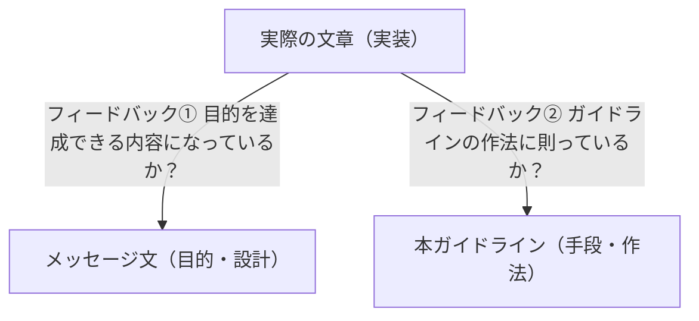

# フィードバック技術

「成果物の完成」と「書けるように育成」のどちらに軸足を置くかを自覚し、相手と合意する。
実際の文章の前にメッセージ文と見出しを書いてもらい、文章・メッセージ文・ガイドラインの V 字の繋がりに着目してフィードバックする。
出典は [テクニカルライティングガイドライン](about.md) (CC BY 4.0) で、OKF の形式に合わせて分割、変更している。

テクニカルライティングを問わず文章一般に言えることだが、書き手が独力でうまく書けるようにはなることは稀である。本人の努力が必要なのはもちろんだが、他者からの効果的なフィードバックも欠かせない。

ここでは、フィードバックする側のスタンスと3つのテクニックについて説明する。

## 「成果物の完成」と「書けるように育成」のバランス

フィードバックする側は、「成果物を仕上げる」ことと「書けるように育てる」ことという、異なる2つの目的に同時並行で向き合う。

フィードバックする側の姿勢として大切なのは、「いま自分はどちらにどれくらいの軸足を置いているのか？」ということを自覚し、相手と合意しておくことである。どちらを重視するかという点に優劣はなく、「自覚的になっていること」と「相手との間に共通認識ができていること」が重要である。

「成果物を仕上げる」ことと「書けるように育てる」ことでは目的が異なるので、フィードバックの方法も変わってくる。

| スタンス       | 目的                   | フィードバック方法                                                         |
| :------------- | :--------------------- | :------------------------------------------------------------------------- |
| デリバリー重視 | 成果物の品質や納期優先 | 誤字や不適切な表現を直接修正する。その後に意図や理由をフィードバックする。 |
| 育成重視       | 書き手のスキル向上     | 違和感の理由を伝え、できる限り本人に考えさせることに時間を使う。           |

自覚や共通認識が欠けると、フィードバックする側と相手の双方のメンタルを削ることになってしまう。

## テクニック①: 実際の文章の前にメッセージ文を書いてもらう

実際の文章を書く前に、その文章の設計図にあたる「メッセージ文」を書くということを習慣化させる。メッセージ文は次の3点を表現した文のことである。詳細は本ガイドラインの「[メッセージ設計](message-design.md)」を参照すること。

1. 何の件について
2. だれに
3. 何をしてほしい / どう感じてほしい

> [!NOTE]
> **例: 「アクセス権限制御のために新しくユーザーグループが必要」を伝えたいメッセージ文**
>
> メッセージ文は「アクセス権限について相談」ではなく「◯◯画面のアクセス制御について、顧客のAさんに、管理用のユーザーグループを新規に払い出してほしい」となる。
>
> - **❌ NG:** アクセス権限についての相談
> - **❌ NG:** 新規払い出しの依頼
> - **✅ OK:** ◯◯画面のアクセス制御について、顧客のAさんに、管理用のユーザーグループを新規に払い出してほしい。

メッセージ文は、その文章によって達成したい目標とも言える。  
実際の文章が実装だとすると、メッセージ文はそれに先立つ設計である。

### 読み手の行動として書く

メッセージ文は、「払い出してほしい」のように「読み手の」行動として書くことが重要である。  
普通は、「アクセス権限について相談」や「新規に払い出してもらうよう依頼」のように、「書き手の」行動として書いてしまいがちである。

その文書によって達成したい目標は、（書き手ではなく）読み手の行動や思考を引き出すことのはずである。  
したがって、メッセージ文は「読み手の」行動として書くことが重要である。

> [!NOTE]
> **例: 読み手の行動として書く**
>
> - ❌ **NG**（書き手の行動となり不十分）
>   〇〇画面のアクセス権限について相談したい。
> - ✅ **OK**（読み手の行動となっている）
>   〇〇画面のアクセス制御について、顧客Aさんに、管理用ユーザーグループの新規払い出しを承諾してほしい。

### 脳内想像ゲームを防ぐことができる

メッセージ文には、書き手が「フィードバックする側の正解を当てるゲーム」に陥るのを防ぐという効果がある。

- **メッセージ文がない場合（基準点がレビュアーの脳内）**
  - 書き手は、指摘を受けながら「レビュアーは何を望んでいるのか？」を推測し続けることになり、メンタルが消耗する。なにより「うまく書けるようになる」ことにつながらない
- **メッセージ文がある場合（基準点が外部に共有されている）**
  - 「このメッセージ（ゴール）を達成するために、今の文章は最適か？」という**共通の評価基準**を見ながら、両者が協力して文章を改善できる

> [!NOTE]
> **フィードバックの始め方**
>
> 実際の文章（実装）を見る前に、まずはメッセージ文（設計）を確認する。このゴール設定で合っているか？ という合意が取れてから細部をレビューすることで、大幅な手戻りを回避できる。
>
> - **❌ NG例:** 最初に実際の文章を見てあれこれ言う。
> - **✅ OK例:** 実際の文章の前にメッセージ文を見る。まず、メッセージ文についてフィードバックする。

## テクニック②: メッセージ文から見出しを作ってもらう

メッセージ文が書けると、そこから見出し（アウトライン）を作ることができる。実際の文章を書く前に、メッセージ文と何をどの順序で書くべきかという見出しまで認識あわせができると、それらを基準点にして効果的なフィードバックができる。

### 読み手の疑問を先回りする

メッセージ文は「読み手へのお願い」である。もし、このメッセージ文をそのまま読み手に伝えたとしたら、相手の頭にはどのような疑問が浮かぶか想像させてみる。その疑問への回答こそが、ドキュメントに含めるべき内容となる。読み手からすると、自身の疑問に対して回答されてその疑問が解決すると、「わかった、やりましょう」となるはずだからである。

- メッセージ
  - 顧客のAさんに「管理用ユーザーグループを新規に払い出してほしい」と直接伝える
- 読み手が抱くと思われる疑問（推測）
  - なぜやらなきゃいけないの？
  - いつまでにやらなきゃいけないの？
  - どうやってやるの？

### 疑問を見出しに変換する

読み手が抱く疑問を体言止めに変換すると、それがドキュメントの見出しになる。

| 疑問                 | 見出し     |
| -------------------- | ---------- |
| なぜ必用なのか？     | 依頼の背景 |
| いつまでにやるのか？ | 実施期限   |
| どうやってやるの？   | 作業手順   |

このように、メッセージ文を書いて「読み手にやってほしいこと」を明確にすると、文章の構成も決まってくる。

実際の文章に対して直接フィードバックする前に、メッセージ文と見出しに対してフィードバックする。そうすると、「設計」の段階でつまづいているのか、「実装」の部分でつまづいているのかがはっきりするので、効果的なフィードバックになる。

> [!TIP]
> **見出しのブラッシュアップ方法**
>
> 出てきた見出しを、本ガイドラインの「[本論の作法](main-body.md)」にしたがってチェックしてみるとさらに効果的である。

## テクニック③: 実際の文章・メッセージ文・本ガイドラインのV字でフィードバックする

メッセージ文を導入することによって、フィードバックとは「実際の文章」を頂点にして「メッセージ文」「ガイドライン」との間で作られるV字のうち、どの辺は繋がっていてどの辺は途切れているかを、書き手に伝える行為だと言い換えられる。

> [!NOTE]
> **例: 「繋がり」に着目した具体的なフィードバックコメント**
>
> - **メッセージ文（目的）とのズレを指摘する**
>   - **❌ NG :** 「この文章、よくわからないよ」
>   - **✅ OK:** 「この文章は、◯◯と読めるけど、それってメッセージ文で狙っていることと合っている？」
> - **ガイドライン（作法）とのズレを指摘する**
>   - **❌ NG:** 「ガイドラインのとおり書いて」
>   - **✅ OK:** 「この文章の◯◯の部分は、ガイドラインの◯◯という部分に沿ってないから直してね」

### フィードバックする側の役割

書くという行為は、実際は書いたものを読んでなおすことの繰り返しである。しかし、書き手が自分自身の文章を「客観的な読み手の視点」で読むことは慣れないと難しい。

フィードバックする側の役割は、解像度の高い0番目の読み手として、「その文章が読み手にどう映るか」を報告することである。書き手はレビューを通じて読み手の視点を疑似体験し、次第に「読み手に伝わる解像度」を自分の中へインストールできるようになる。

> [!NOTE]
> **例: フィードバックではないもの**
>
> - ❌️**NG**: 「わかりにくい」「ガイドライン読んでから書いて」
>   - 読み手にどう映るかの情報が含まれないので、改善のヒントが含まれない
> - ❌️**NG**:「わかりやすかった」「スッと入ってきた」
>   - 肯定的な反応であっても、メッセージ文やガイドラインとの繋がりが示されておらず、再現性が生まれない

これらのNG例は、フィードバックする側が読み手としての責務を放棄している、あるいは読み手としての力不足を露呈していると言える。フィードバックする側こそが、「解像度高く読める」読み手として鍛錬し、本ガイドラインを深く理解 / 実践できるようになる必要がある。
