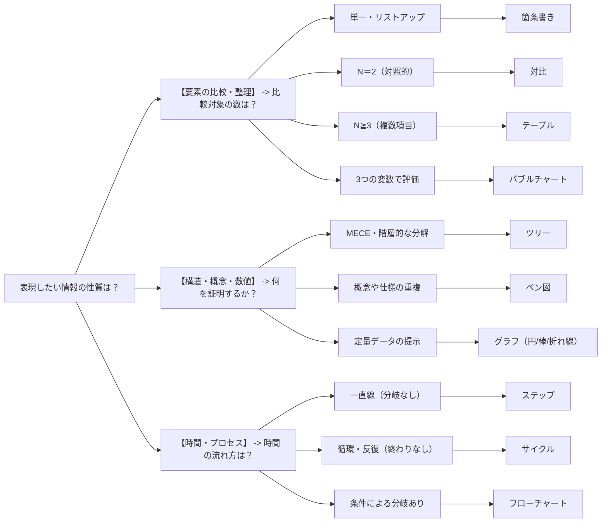

# 実践パターン

トレードオフや背景・不採用案を書き、要件レベル（Must/Should）や推奨・非推奨（Good/Bad）を明示し、本筋から逸れる詳細は Appendix に分離する。
情報の性質に応じて、箇条書き・対比・テーブル・ツリー・ベン図・グラフ・ステップ・サイクル・フローチャートなどの図解パターンを選ぶ。
出典は [テクニカルライティングガイドライン](about.md) (CC BY 4.0) で、OKF の形式に合わせて分割、変更している。

## トレードオフを必ず書く

コンサルタントやアーキテクトは、プロジェクトの方針やアーキテクチャに責任を負う。しかし、選択したアーキテクチャや方針には必ずメリットとデメリットの双方が存在する。
「なぜ他ではなく、これを選んだのか」という**判断のロジック**を、客観的なトレードオフを用いて説明可能にすることが重要である。
以下のように文章で説明するだけでなく、読み手の関心事を捉えテーブルなどを用いて対比構造やメリット・デメリット（Pros / Cons）を図解するとより効果的となる。

<!-- textlint-disable ja-technical-writing/no-mix-dearu-desumasu -->

- ❌ **NG**（結果のみ）  
  次期システムのインフラ環境には、Amazon Web Services（AWS）を採用する。
- ✅ **OK**（トレードオフの明示）  
  次期システムのインフラ環境には、クラウドサービスであるAmazon Web Services（AWS）を採用する。  
  オンプレミスと比較して初期の学習コストや通信のレイテンシ増加というデメリットはあるが、今後のトラフィック増減に対して柔軟にサーバーリソースを増減できる拡張性のメリットが、本プロジェクトの要件を上回ると判断したからである。

<!-- textlint-enable ja-technical-writing/no-mix-dearu-desumasu -->

## Appendix（付録）を使う

ドキュメントの本文に、結論に至る全プロセスを書き連ねる必要はない。読み手の関心事（コスト、リスク、期間など）を見極め、判断に必要なロジックのみをハイライトする。
本筋から逸れる議論の過程や詳細な補足データはAppendix（付録）に分離し、必要に応じて参照できるようにする。

- ❌ NG（全て本文に書く）  
  本文の途中に、検討した3つのライブラリの全機能比較表（数十項目）や、ローカル環境で実施したパフォーマンステストの生データログを何ページにもわたって記載する。
- ✅ OK（関心事で切り分ける）  
  本文では、「ライブラリAを採用する」という結論と、採用の決め手となった3つの重要な評価軸の比較サマリのみを記載する。  
  全項目の機能比較表やパフォーマンステストの詳細データは 「Appendix A: ライブラリ機能比較詳細」「Appendix B: パフォーマンステスト結果」 として末尾に分離し、詳細を知りたい担当者だけが参照できるようにする。

## 要件レベル （Must / Should） を提示する

設計規約やコーディング規約などのドキュメントでは、読み手に求めるアクションが `MUST（必ず守るべき制約）` なのか `SHOULD（推奨事項）` なのかを厳密に区別する。
例外を許容する場合は、必要に応じて具体例を示しながら「どのような条件を満たせば例外を適用できるのか」をあわせて明記する。
プロジェクトによっては、推奨事項として `WANT` や `RECOMMENDED` を使うケースもあるが要件レベルの表現についてはチーム内で一貫性を保つようにする。

- ❌ NG（強制力が曖昧）  
  APIのレスポンスタイムは短くすること。また、エラー時は適切なステータスコードを返すこと。
- ✅ OK（明確な区別と例外条件）  
  [MUST] APIのエラー発生時は、必ずHTTPステータスコード（4xx, 5xx）を用いてエラー種別を表現すること。  
  [SHOULD] APIのレスポンスタイムは、3秒以内となるように設計することを推奨する。ただし、大量のデータ集計を伴う日次レポート出力APIなど、即時性が求められない場合はこの限りではない。

> [!TIP]
> **RFC 2119 で定義されている要件レベル**
>
> インターネット技術の標準仕様であるRFCでは以下のキーワードで要件レベルを表すように規定されている。
>
> <!-- textlint-disable ja-technical-writing/max-comma -->
>
> > The key words "MUST", "MUST NOT", "REQUIRED", "SHALL", "SHALL NOT", "SHOULD", "SHOULD NOT", "RECOMMENDED", "MAY", and "OPTIONAL" in this document are to be interpreted as described in RFC 2119.
> >
> > [RFC 2119: Key words for use in RFCs to Indicate Requirement Levels](https://datatracker.ietf.org/doc/html/rfc2119)
>
> <!-- textlint-enable ja-technical-writing/max-comma -->

## 推奨・非推奨 （Good / Bad） を提示する

設計ガイドラインやセキュリティ標準などのドキュメントは、読み手の判断を助けるための文書である。
抽象的なルールの羅列に留めず、ユースケースに応じた具体的な `GOOD（推奨される設計/コード）` や `BAD（避けるべきアンチパターン）` をセットで提示する。

- ❌ NG（抽象的なルールのみ）  
  エラーメッセージは、ユーザーが次に何をすべきか分かるように親切に書くこと。
- ✅ OK（具体例のセット）  
  エラーメッセージは、ユーザーが次に何をすべきか具体的なアクションを提示すること。  
  **BAD**: 「パスワードがポリシーを満たしていません」  
  **GOOD**: 「パスワードは8文字以上で、英字と数字をそれぞれ1文字以上含めてください」

## 背景・制約や不採用案も記録する

議事録や報告書の主な目的は、事実の正確な記録と状況の共有である。しかし、単なる事実や決定事項の羅列であれば、AIの自動要約で十分である。
プロフェッショナルとして、決定に至った背景や制約、採用しなかった対向案も記録することで、将来のシステム改修時に重要な手がかりを残すことができる。
アーキテクチャの設計決定を記録するADR（Architecture Decision Record）は、まさにこの思想に基づいた手法である。

- ❌ NG（決定事項のみ）  
  日次バッチ処理の実行基盤として、クラウドのマネージドサービス（AWS Step Functions）を採用する。
- ✅ OK（背景と不採用案の記録）  
  **日次バッチ処理の実行基盤として、AWS Step Functionsを採用する。**  
  **背景・制約**: 運用チームの学習コストを抑えるため、自前でのサーバー管理が不要なフルマネージドサービスであることを最優先とした。  
  **不採用案**: OSSの「Apache Airflow」も有力な候補であったが、自前でのサーバー構築や定期的なバージョンアップの手間（運用コスト）が、現在のインフラ運用チームの要員体制では許容できないと判断し、今回は不採用とした。

## テンプレートの引き出しを持っておく

例えば報告書・設計書・非機能グレード表など、期待されるテンプレートがあるのであればそれを活用して時短で構造を決めて、中身の方に時間を割くようにする。ただし、官僚的にならないよう不要な項目は省くなど、過不足なく情報が伝えられるよう心がける。

型をどれだけ引き出しに入れておけるかが、質の高い文章を効率よく生産するうえでのポイントとなる。毎回、ロジカル・シンキングの原理原則からボトムアップで作成するのは労力がかかりすぎる。また、型がないと、AIに文章を作らせるままでアウトプットの品質が安定しない、ということにもなりかねない。

### 最小限のメッセージの型を覚える

業務上の「他者に行動を促す」か「自分の行動の許可を得る」メッセージを送信する場合、メッセージの型を覚えておくと便利である。

> [!NOTE]
> **例: `[型]  = (依頼事項や確認事項）＋ その意図`**
>
> - ✅️ **OK**（行動を促したい場合）
>   @member 機能Aを参考に、機能Bの実装を進めてください。来週から機能Cの実装を進めたいからです。
>
> - ✅️ **OK** （許可を得たい場合）
>   @leader 明日の13時から、打ち合わせの時間を入れさせてください。タスクAの進め方について確認したいです。

他にも、以下のように5W1Hなどを参考に、追加したパターンも引き出しに持っておくと良い。

- `[型]  = （依頼事項）+ 意図 + 期日 + エスカレーション条件（XXが無理そうならXXまでにコメントください）`

## 論理構造と図解パターン

情報の性質に応じた適切な論理構造とその図解パターンを選択すると、複雑な概念を直感的に理解させることができ、情報の抽象化と具象化の往復を円滑にできる。

一般的に認知されている整理パターンを紹介する。



<!-- textlint-disable ja-technical-writing/no-mix-dearu-desumasu -->

- **箇条書き**  
  初歩的ではあるものの、箇条書きは基礎的な情報整理に有用である。  
  情報の受け手からしても、散文で書かれているよりも視認性が高まり、要素の数が一目でわかるメリットがある。
  スライドにおいては、デフォルト機能の箇条書きを使うよりも、種々のオブジェクトやアイコンを配置することでより視認性を上げることができる。箇条書きした結果、対象が同質である場合は対比・マトリックスに変化させることで、より論理構造を明確化させることもできる。
- **対比（変化）**  
  対比は2つの対照的な要素を並置し、その差異あるいは変化を強調する際に有用である。  
  現行システムと次期システム、あるいは現状（AsIs）とあるべき（To-Be）といった比較がこれに該当する。対比スライドを設計する際は、縦軸または横軸に明確な比較項目を設け、読み手の視線が左右に往復しながら情報の差異を抽出できるように配置する。この際、情報の重要度に応じて文字の大きさや色にコントラストをつけることで、情報の優先順位を明示することが肝要である。

  ```mermaid
  flowchart LR
    asis["As-Is"] --> tobe["To-Be"]
  ```

- **テーブル**  
  比較対象が3つ以上になる場合は、テーブル型と呼称する。  
  前述した対比の要素がN個に増えるだけではあるものの、判断要素が対比より多くなることが大きな違いとなる。テーブルの場合は情報が肥大化しやすいので、比較した結論を◯/×/△で表現したり、背景色を変えることで認知負荷を下げることがコツである。

  （図: 比較表の例。縦軸に項目A〜項目D、横軸にコスト・スピード・品質を並べ、各セルを ◯／△／× で評価する。項目A はコスト◯・スピード△・品質×、項目B はコスト△・スピード◯・品質△、項目C はコスト×・スピード×・品質◯、項目D はコスト◯・スピード◯・品質◯）

  > [!TIP]
  > **バブルチャート**
  >
  > 主要な評価要素が３つ程度であり、他段階の変化を視覚的に示したい場合はバブルチャートも有用である。
  > バブルチャートでは、縦軸と横軸によるマトリックス的なポジショニングに加え、円（バブル）の大きさという3つ目の変数を同時に表現できる。
  > （図: バブルチャートの例。横軸が「時間」、縦軸が「効果」で、右上ほど時間と効果が大きい位置に3つの円を配置する。円の大きさ＝コストを表し、右上の円が最も大きい）

- **ツリー**  
  問題の分解や組織構造を図示する場合はツリー型を用いることもできる。  
  ツリー型は上位概念から下位概念への流れるような論理性を提供でき、MECEさを示す説明にも有用である。スライド上では、左から右、あるいは上から下へと階層が深まるように配置し、視覚的な一貫性を保つことが求められる。

  （図: ツリー型の例。左端の1つのノードから右へ枝分かれし、3つの中間ノードがそれぞれ2つの末端ノードへ分岐する、ラベルのない階層構造の図）

- **ベン図**  
  ベン図はシステム間の互換性、業務範囲の重複、データの整理など、概念的な重なりを表現するのに適している。テクニカルな文脈では、各円のラベルを簡潔にし、重なり合う部分（インタフェースや共通仕様）に視線が向くよう配色を工夫する。  
  （図: ベン図の例。3つの円が互いに重なり合い、3つすべてが重なる中央部分が強調されている、ラベルのない概念図）
- **グラフ**  
  数値がある程度明らかな場合、グラフによる図示で視認性及び説得力を向上させることができる。  
  主要なグラフの使い分けは以下のとおり。
  - 円グラフ: 全体の割合を示したい場合
  - 棒グラフ: 数値同士の比較
  - 折れ線グラフ: 数値の遷移

  （図: グラフの例を3つ並べたもの。左から、全体の割合を示す円グラフ、数値を比較する棒グラフ、数値の遷移を示す折れ線グラフ）

- **ステップ**  
  一連のプロセスや手順を、順序立てて直線的に示す場合はステップ図として表すことができる。  
  目標到達までの道のりや、マニュアル的な作業手順を、順を追って1つずつ確実に理解させる。読み手に今はどの段階か、次は何をするかという見通しを与えることができる。フローチャートよりも単純な分岐を伴わない一直線の進行を表現する際に用いる。

  ```mermaid
  flowchart LR
    s1["1"] --> s2["2"] --> s3["3"] --> s4["4"]
  ```

- **サイクル**  
  PDCAサイクルやアジャイル開発のイテレーション、システムのライフサイクルなど、終わりがなく継続的に繰り返されるプロセスを円環状に配置するパターン。スライド化の場合は、循環の向きを明確に示し、認知負荷を下げる目的でサイクル要素は3\~6程度に留める。  
  （図: サイクルの例。4本の矢印が円環状につながり、時計回りに循環する様子を示す、ラベルのない図）
- **フローチャート**  
  業務手順、システム処理の流れ、意思決定の分岐などを、図形（ボックスや菱形）と矢印を用いて順序立てて表現する。複雑な手順や、「Aの場合はB、Cの場合はD」といった条件ごとの振る舞いを直感的に理解させることができる。  
  図表化の際は、人間の視線誘導に逆らわないよう、上から下、または左から右へ一貫した流れを作ること。

  ```mermaid
  flowchart TB
    a[" "] --> d{" "}
    d -->|Yes| y[" "]
    d -->|No| n[" "]
  ```

<!-- textlint-enable ja-technical-writing/no-mix-dearu-desumasu -->
