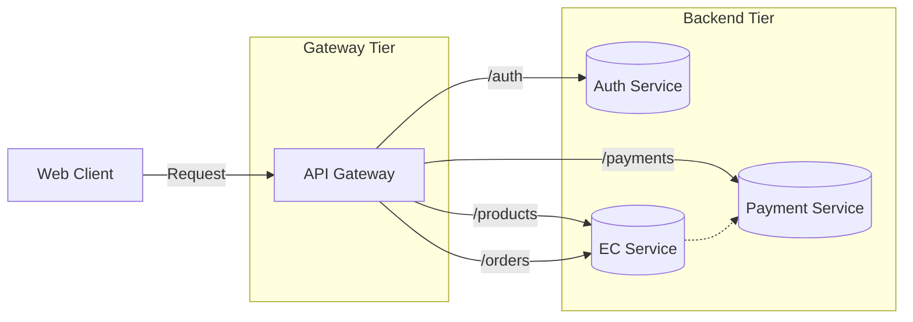

# Web API の非同期と API Gateway パターン

非同期化は非同期設計ガイドラインに従う。
API Gateway は薄い Gateway を基本とし、構成は単一型から検討してルーティング方式を選ぶ。
出典は [Web API設計ガイドライン](about.md) (CC BY 4.0) で、OKF の形式に合わせて分割、変更している。

## 非同期

Web APIの非同期化については[非同期設計ガイドライン](https://future-architect.github.io/arch-guidelines/documents/forAsync/async_guidelines.html)に従う。次のような観点がある。

- [非同期化の判断基準](https://future-architect.github.io/arch-guidelines/documents/forAsync/async_guidelines.html#非同期化の判断基準)
- [非同期の予約](https://future-architect.github.io/arch-guidelines/documents/forAsync/async_guidelines.html#予約)
- [非同期終了時の通知](https://future-architect.github.io/arch-guidelines/documents/forAsync/async_guidelines.html#通知)

## API Gatewayパターン

API Gatewayパターンとは、オブジェクト指向設計のファサードパターンのようにクライアントに対して、バックエンドの複数のWeb APIを束ねた1つの窓口を提供する設計パターンである。

主に以下の目的がある。

- **リクエストの集約とルーティング**
  - API Gatewayがリクエストを適切なマイクロサービスのWeb APIに振り分けるため、各サービスについての認知負荷を減らせる
- **サービス横断的な関心事を担う**
  - 認証・認可・レート制限・ロギング・モニタリング・キャッシュといった、共通機能を一括して担うことで統制を取りやすくする（マイクロサービスも自らのビジネスロジックに集中できる）
- **結合度を下げる**
  - バックエンドのサービス構成に変更があったとしても、API Gateway層で吸収することで、クライアント側への影響を最小限に抑えられる

> [!NOTE]
> **参考**
>
> - [API ゲートウェイ パターンと、クライアントからマイクロサービスへの直接通信との比較 - .NET | Microsoft Learn](https://learn.microsoft.com/ja-jp/dotnet/architecture/microservices/architect-microservice-container-applications/direct-client-to-microservice-communication-versus-the-api-gateway-pattern)
> - [API ゲートウェイパターン - AWS 規範ガイダンス](https://docs.aws.amazon.com/ja_jp/prescriptive-guidance/latest/modernization-integrating-microservices/api-gateway-pattern.html)

### API Gateway構成

API Gatewayを利用した構成案は複数存在する。

| 評価観点               | （1）単一型                                                                       | （2）分散型                                                   | （3）階層型                                                                        |
| ---------------------- | --------------------------------------------------------------------------------- | ------------------------------------------------------------- | ---------------------------------------------------------------------------------- |
| 概要                   | 全てのリクエストを単一のAPI Gatewayに集約しバックエンドサービスへ振り分けする構成 | サービス・チームなどの単位で独立したAPI Gatewayを配置する構成 | 共通機能を行うGateway（1層目）と各サービス固有の処理を行うGateway(2層目)の多段構成 |
| 構成のシンプルさ       | ✅️ 管理対象が1箇所で構成が単純                                                    | ❌️ 管理対象GWが増え、構成・運用が複雑化                       | ❌️ GWが多段になり、最も構成・運用が複雑化                                          |
| クライアントの認知負荷 | ✅️ エンドポイントが単一                                                           | ❌️ 機能毎に異なるエンドポイントを使い分ける必要がある         | ✅️ エンドポイントが単一                                                            |
| インフラ費用           | ✅️                                                                                | ❌️ 多段であるためコスト増要因                                 | ✅️                                                                                 |
| 性能(レイテンシ)       | ✅️                                                                                | ✅️                                                            | ❌️ 複数のゲートウェイを経由するため                                                |
| セキュリティ           | ✅️ 共通ポリシーを一括で適用でき、統制が容易                                       | ⚠️ 各GWで設定必要となり、静的解析などの仕組み化が必要         | ✅️ 1層目で共通統制、2層目個別対応、という役割分担で両立しやすい                    |
| 開発の柔軟性           | ❌️ 中央集権的で変更影響が大きく、開発ボトルネックになりやすい                     | ✅️ チーム/ドメイン毎に自律的に開発・デプロイ可能              | ✅️ 内部GWの自律性は分散型と同等                                                    |

推奨は以下の通り。

- システム向けのWeb API提供であれば、（1）を採用しても良い
- Webやモバイルのクライアント向けでかつ、複数マイクロサービス構成を取っている場合はAPI Gatewayを導入してレートリミットなどの仕組みを検討する
- バックエンドのサービス単位でレートリミットやキャッシュなどの設定が不要であれば、（1）を採用する
- もし、サービス固有の最適化が必要であれば、（2）または（3）を検討する。性能や費用観点で（2）から検討し、API Gateway数を減らすように最終的な保守運用を見据えた粒度で切り出す

### 責務範囲

API Gatewayにどこまで機能を持たせるか、検討の余地がある。API Gateway側にリクエスト・レスポンスの変換や、集約（アグリゲーション）を持たせると、BFF（Backend For Frontend）に近くなる。方針が無いと責務分けが不明瞭になり、保守運用性が低下する。

大きく、以下の2パターンの方針がある。

1. **薄いGateway**
   - 主にルーティングや認証・認可など、インフラに近い基本的な機能のみを担当させる考え
   - ビジネスロジックは極力バックエンドサービスに寄せる
2. **厚いGateway**
   - 薄いGatewayの機能に加え、リクエスト/レスポンスの変換・集約・共通的なビジネスロジックの一部実装も許容する考え

推奨は以下の通り。

- （1）を採用する
  - テスト容易性を考慮すると、API Gateway側に機能を持たせすぎると品質保証が難しくなるため
  - API Gatewayに機能を持たせすぎると、作業上のボトルネックになりやすいため
  - 機能実装先が複数あると判断が揺れやすく、影響度調査が難しくなりやすいため

### ルーティング設計

[API Gateway構成](#api-gateway構成) にある、単一型・階層型を採用した場合、クライアントに公開するURLのパス設計と、どのような規則性でルーティングするかを決める必要がある。

| 評価観点                          | （1）サービスベース                                                 | （2）リソースベース                                                               |
| --------------------------------- | ------------------------------------------------------------------- | --------------------------------------------------------------------------------- |
| 説明                              | バックエンドサービスの識別子 (サービス名など) をURLパスに含める方式 | リソース中心にURLを再設計し、バックエンドサービスを隠蔽する方式                   |
| 例                                | `/article-service/v1/articles/1/comments/1`                         | `/v1/articles/1/comments/1`                                                       |
| クライアントからのURL分かりやすさ | ⚠️ URLが冗長、直感的でない場合がある                                | ✅ 直感的で分かりやすいURLを提供しやすい                                          |
| バックエンド構成の隠蔽            | ❌ バックエンド構成がクライアントに公開される                       | ✅ バックエンド構成をクライアントから隠蔽できる                                   |
| 拡張性                            | ❌ サービス統廃合時にクライアント側URL変更が必要                    | ✅ バックエンド構成変更をゲートウェイで吸収でき、クライアント影響を限定的にできる |
| 設計コスト                        | ✅ ルーティング設定が比較的単純                                     | ❌ ルーティング設計・設定が複雑化しやすい                                         |
| 保守性                            | ✅ バックエンドサービスとの対応が明確                               | ⚠️ リソースとサービスの境界設計が必要、対応関係が複雑になる可能性                 |

推奨方針は以下の通り。

- 社内システムやパートナー向けAPIは、（1）サービスベースを採用する
  - 通常、そこまで多くのマイクロサービスが発生しないと考えるため、API利用者がバックエンドサービスをある程度意識しても問題ないと考える
- 公開APIや、マイクロサービス数が多く認知負荷増大を許容できない場合のみ、（2）リソースベースを利用する
  - 設計運用コストは高くなるが、API利用者にバックエンドの複雑さを隠蔽し、長期的に安定したインタフェースを提供しやすいため
