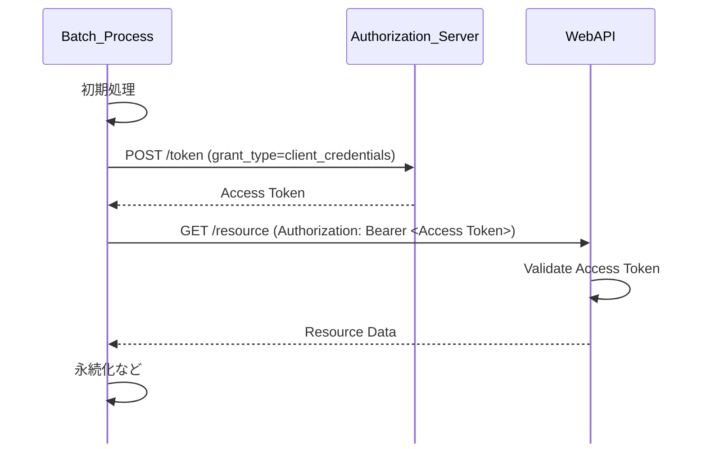
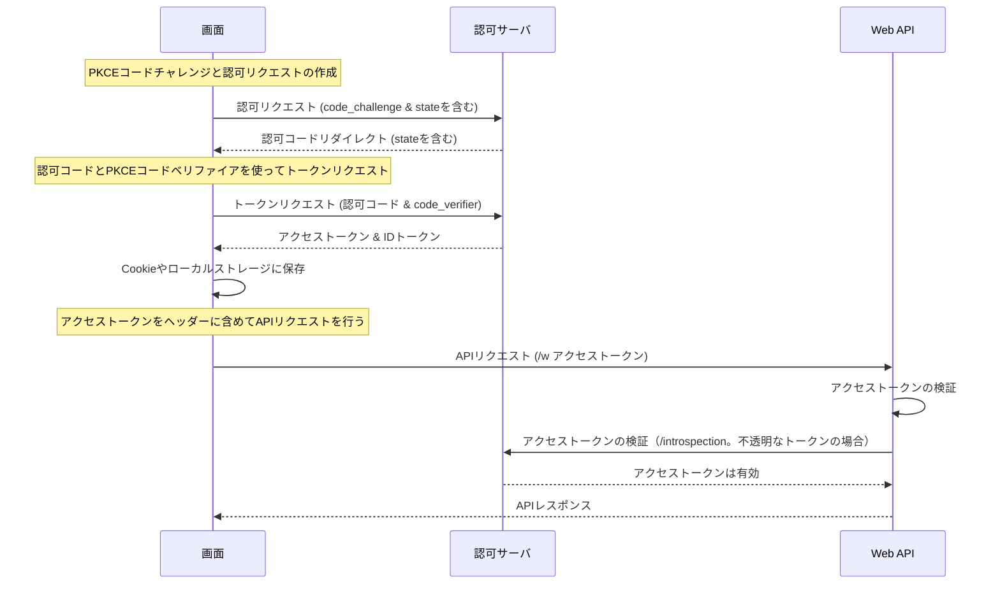
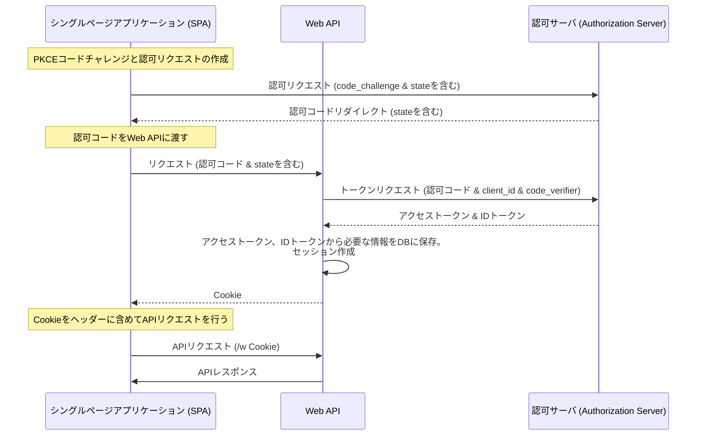
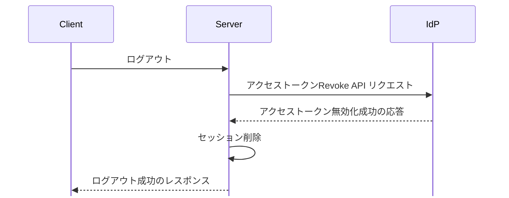

# Web API の認証と権限制御

システム間連携はクライアントクレデンシャルフロー、フロントエンドは認可コード+PKCE を用いる。
Web API 認証はセッショントークン方式を使い、ロール管理はアプリケーション側で持つ。
出典は [Web API設計ガイドライン](about.md) (CC BY 4.0) で、OKF の形式に合わせて分割、変更している。

## 認証

### システム間連携時のネットワークレベルの制御

対向システムからのバッチ処理などで、自システム側のWeb APIを公開する要件があるとする。

推奨は以下の通り。

- 可能であれば送信元IPで絞る（AWSのいうSecurity Groupを適切に設定する）

### システム間連携の認証フロー

対向システムからのバッチ処理などで、自システム側のWeb APIを公開する要件があるとする。Web APIの認証方式には以下が考えられる。1, 2, 3は別の技術であるため組み合わせることも可能だが、それぞれ対応コストがあるためどれか1つを選択する前提とする（無認証は許容しないポリシーであるとする）。

|                      | （1）APIアクセスキー                                                                 | （2）クライアントクレデンシャルフロー                                                        | （3）mTLS                                                            |
| :------------------- | :----------------------------------------------------------------------------------- | :------------------------------------------------------------------------------------------- | :------------------------------------------------------------------- |
| 説明                 | x-apikey ヘッダーでアクセスキーを連携する方式。API Gatewayが提供する機能の一部とする | 認可サーバーにクライアントID、クライアントシークレットを渡し、アクセストークンを取得する方法 | TLS相互認証のことで、クライアント証明書を用いる方式                  |
| 連携先から見た容易さ | ✅️ステートレスである                                                                 | ⚠️少し手順が複雑になる                                                                       | ⚠️クライアント証明書の読み込みが必須                                 |
| 処理性能             | ✅️仕組みが単純なため高い                                                             | ⚠️トークンの取得および検証分、不利と言える                                                   | ✅️大きなペナルティは無い                                             |
| セキュリティ         | ⚠️APIキー漏洩など不正利用のリスクが懸念                                              | ✅️アクセストークンには有効期限があるため、リスクが限定できる                                 | ⚠️クライアント証明書の漏洩には脆弱                                   |
| 監査                 | ✅️API Gatewayの機能に依存                                                            | ✅️IdP（認証基盤）側の仕組みに寄せることが可能                                                | ⚠️個別に作り込む必要がある                                           |
| スロットリング       | ✅️大体のAPI Gatewayでアクセス数制限が可能                                            | ❌️個別実装が必要                                                                             | ❌️個別実装が必要                                                     |
| インフラリソース     | ⚠️API Gatewayが増える                                                                | ✅️既存の仕組みに相乗りできる                                                                 | ⚠️相互認証のAPI Gatewayが増える                                      |
| 設計コスト           | ❌️APIキーとアクセストークンの2パターンの対応が必要                                   | ✅️アクセストークン方式に統一できる                                                           | ❌️APIキーとアクセストークンの2パターンの対応が必要                   |
| 運用コスト           | ✅️                                                                                   | ✅️                                                                                           | ❌️定期的に連携先に新しいクライアント証明書を配布し適用する運用が必須 |

2.クライアントクレデンシャルフローの処理例を下図に示す。

推奨は以下の通り。

- （2）を採用する
- もし、対向システム側で認可サーバーのアクセスが不可の場合は、（1）を検討する

> [!TIP]
> **バッチ処理でクライアントクレデンシャルフローを用いたWeb API呼び出しの是非**
>
> 自領域のシステムで稼働するバッチ処理については、Web API経由ではなく、直接DBを参照 / 更新すれば良い。Web API呼び出しによって生じるコスト増を防ぐためである。ビジネスロジックがWeb API側に存在しており、流用したい場合もあるが、しばしばバッチの性能劣化を招くことがあるため、非推奨とする。そのような場合の対応としては、ビジネスロジックを再利用可能なパッケージにするなどがある。

<!-- 前の注記と分ける -->

> [!TIP]
> **ユーザーごとにアクセス数制限を入れたい場合**
>
> （2）のクライアントクレデンシャルフローを採用したうえで、さらにユーザーごとにアクセス数制限を入れたい場合は、（1）APIアクセスキーを追加して制御することになる。

### フロントエンド認証フロー

Auth0やEntraIDなどのIdP（Identity Provider）を利用して認証する構成で、フロントエンドからWeb APIを呼び出す場合を想定する。

推奨は以下の通り。

- Authorization Code Flow with PKCE（認可コード+PKCE）を利用する

理由は以下の通り。

- Implicit Flowは非推奨である（参考: [OAuth 2.0 の Implicit grant 終了のお知らせ \- r-weblife](https://ritou.hatenablog.com/entry/2018/11/12/110613)）
- Client Credentials Flowはサーバーやバッチアプリケーションに向く方式であり、フロントエンド認証フローでは不適切である
- PKCE（Proof Key for Code Exchange）を認可コードフローに追加することで、セキュリティを高められるため

### Web API認証フロー

「フロントエンド認証フロー」によって、アクセストークンを取得できたとする。Web APIへの認証には大別して以下の2つの方式がある。各方式のフロー図を図1、図2に示す。

図1 （1）ベアラートークン方式

図2 （2）セッショントークン方式

|                     | （1）ベアラートークン方式                                                                                                                                                                                           | （2）セッショントークン方式                                                                                                                                                |
| :------------------ | :------------------------------------------------------------------------------------------------------------------------------------------------------------------------------------------------------------------ | :------------------------------------------------------------------------------------------------------------------------------------------------------------------------- |
| フロー図            | 図1（表の上）                                                                                                                                                                                                       | 図2（表の上）                                                                                                                                                              |
| 説明                | APIリクエスト毎にアクセストークンをAuthorizationヘッダーに含める方式。トークンの検証はIdP側のトークンイントロスペクションを利用（JWT形式のアクセストークンなら、IdPのJWKSで手元でも検証できる。下の注記を参照）     | 初回リクエストのみアクセストークンを利用し、以降はセッション管理（セッションIDをCookieに含めて送信）による認証を行う方式。セッション管理テーブルやキャッシュサーバーが必要 |
| 処理性能            | ⚠️不透明なトークンは、リクエストの度にトークンイントロスペクションAPIで確認が必要で不利。JWT形式のアクセストークンはJWKSで手元で検証でき、IdPへの問い合わせは不要。アクセストークンのデータサイズによっては多少不利 | ✅️IdPへの問い合わせが不要。ただしセッション管理にはKVSなど高速なストアが求められる                                                                                         |
| トークンの無効化    | ✅️IdPのリボケーションAPIで無効化が可能                                                                                                                                                                              | ✅️容易である                                                                                                                                                               |
| 再ログイン 必須期間 | ❌️IdP側のリフレッシュトークンが無効になるタイミングに依存する。例えば、リフレッシュトークンが無操作で最大48時間までしか保持できない場合、土日を挟むと再ログインが必須になるといった懸念がある                       | ✅️任意の調整が可能                                                                                                                                                         |
| IdPとの結合度       | ⚠️アクセス毎にIdPに依存                                                                                                                                                                                             | ✅️IdP依存箇所が最小限となる                                                                                                                                                |
| セキュリティ        | ⚠️アクセストークンをローカルストレージやCookieに保持する必要がある                                                                                                                                                  | ✅️アクセストークンはWeb API認証後に破棄可能であり、保持期間を最小化できる                                                                                                  |
| curlとの相性        | ✅️比較的容易                                                                                                                                                                                                        | ⚠️少し手順が複雑                                                                                                                                                           |
| ローカル開発環境    | ✅️容易                                                                                                                                                                                                              | ✅️容易                                                                                                                                                                     |

> [!NOTE]
> JWT 形式のアクセストークンは、毎回イントロスペクションを呼ばなくても、IdP の JWKS で署名、`iss`、`aud`（Cognito のアクセストークンは `client_id`）、`exp` を手元で検証できる（[RFC 9068](https://www.rfc-editor.org/rfc/rfc9068.html)、[RFC 8725](https://www.rfc-editor.org/rfc/rfc8725.html)）。上の表の（1）の「リクエストの度にイントロスペクションが必要」は、不透明なトークンの場合である。失効を期限の前に反映したいときは、トークンの寿命を短くするか IdP に問い合わせる。

推奨は以下の通り。

- （2）を利用する。ブラウザのアプリを持つ業務アプリでは、BFF がトークンを持ち、ブラウザにはセッションの Cookie だけを渡す形を、[RFC 10017](https://www.rfc-editor.org/rfc/rfc10017.html) 6.1 が strongly recommended とする。ブラウザがトークンを持つ（1）の形は、6.3.4.3 が not recommended とする。このリポジトリでは、Web Functions を OAC の後ろに置くと `Authorization` ヘッダーが SigV4 の署名に使われ、Bearer と両立しないことも理由になる（[ADR 0022](../adr/0022-better-auth-cookie-bff.md)）。特にIdPの制約で、リフレッシュトークンの有効期限が想定より短くなってしまう場合に、UX上、許容できない再ログイン操作などを強いてしまう点が大きい
  - セッションの発行については、[Cookie](security.md#cookie) 章を参考にする

> [!NOTE]
> **参考**
>
> - [SPA+Backend構成なWebアプリへのOIDC適用パターン \- r-weblife](https://ritou.hatenablog.com/entry/2024/10/22/153014) で記載されている、「2. BEがRSとなる場合」が本節の前提である
> - [サーバーレスなユーザー認証認可の考慮事項と実践的プラクティス紹介 / slsdays-tokyo-2024 \- Speaker Deck](https://speakerdeck.com/slsops/slsdays-tokyo-2023-3cd5886a-cee0-425b-821f-f4cd3230e1e0?slide=40)
> - [Token Revocation (RFC 7009)はなぜ重要か？ \#API \- Qiita](https://qiita.com/yo-tabata/items/7559a7c9069ee5c167f5)

### ログアウト

ログアウトする際は、IdP側のRevoke APIでアクセストークンを無効化すべきである。  
以下に処理フローの例を示す。

## 権限制御

### ロール管理

ユーザーのIDとロールの紐づけを、IdP（Identity Provider）に持たせるか、アプリケーション側で持たせるかという設計判断がある。

|               | （1）IdP管理                                                                                                  | （2）アプリケーション管理                                                              |
| :------------ | :------------------------------------------------------------------------------------------------------------ | :------------------------------------------------------------------------------------- |
| 説明          | IdP側でユーザーのアカウントと、ロールを一緒に管理する方法。IDトークンにカスタムトークンを取得できるようにする | IdPとアプリケーション側でアカウントを二重で保持し、ロールはアプリ側で紐づける方法      |
| 処理性能      | ✅️IdPサービスに機能配置を寄せられる分、負荷が低い可能性                                                       | ✅️ロール紐づけを行う処理分は不利だが、キャッシュなどで緩和可能                         |
| 拡張性        | ⚠️IdPのロールモデルがアプリケーションのニーズに適合しない場合、調整コストが高い                               | ✅️ IdPに依存することなく、アプリケーション内で一貫したロール管理とアクセス制御が行える |
| データ 整合性 | ✅️IdP側に寄せることで整合性が保ちやすい                                                                       | ⚠️IdPとアプリ側の多重管理となるため、整合性を保持する工夫が必要                        |
| 保守性        | ⚠️ロール管理について、IdPとアプリ側で切り分け対象が増えるため、学習コストが必要                               | ✅️アプリケーション側に閉じ、他の機能と大差ないメンタルモデルが適用可能                 |

推奨は以下の通り。

- （2）を採用する
  - IdP側のロール管理と、アプリケーション側の要求のライフサイクルは通常異なるため、機能配置として分離する
  - 例えば、4/1の部署移動の情報更新がいつどのように反映されるかについて、アプリケーション側はビジネス領域に沿った固有の要件があるが、IdPがそれに沿ってくれるとは限らない
  - IdPは情シスにとっても重要情報であるため、アプリケーション要件に合わせて、ロールの追加や粒度変更といった対応は、頻繁に行えるとは限らないため
