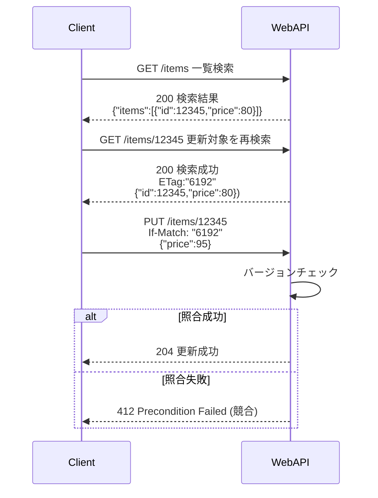
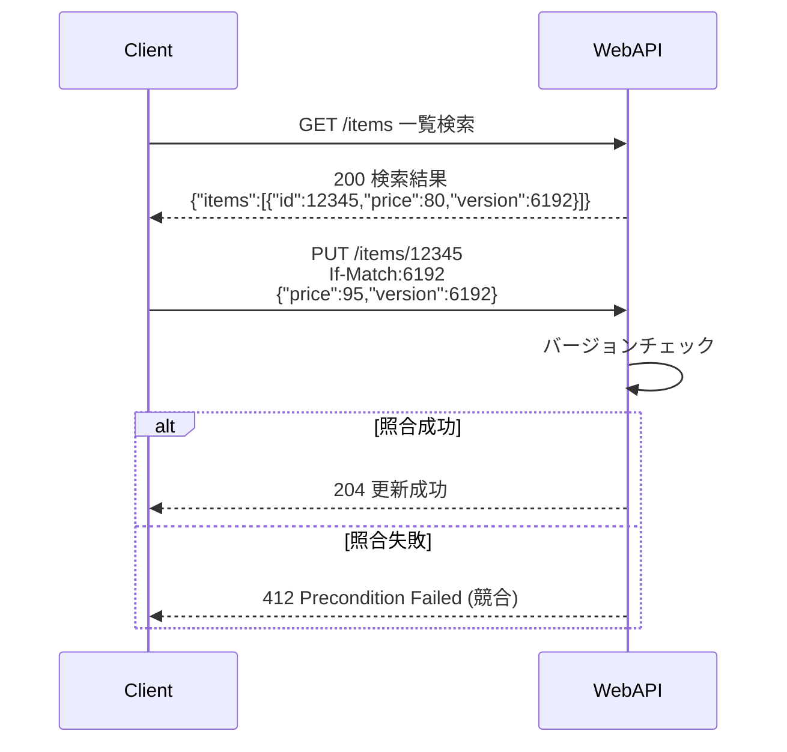
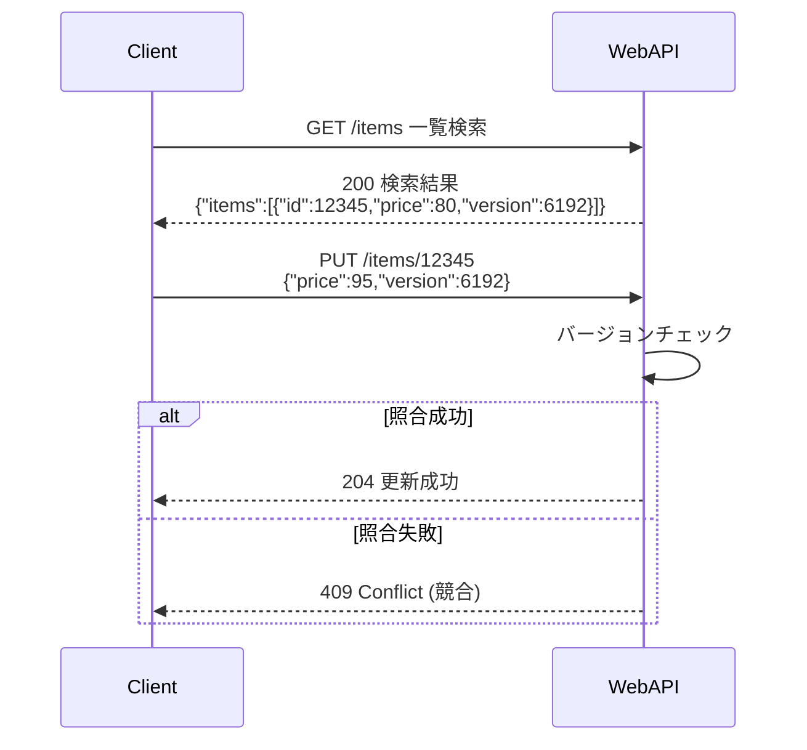

# Web API の排他制御（楽観ロック）

楽観ロックはバルク更新にも対応できるバージョン番号方式を採用し、競合時は 409 を返す。
Last-Modified を用いた排他制御は改ざんや時刻同期の課題があるため利用しない。
出典は [Web API設計ガイドライン](about.md) (CC BY 4.0) で、OKF の形式に合わせて分割、変更している。

## 排他制御

### 楽観ロック

楽観ロックは同一エンティティに同時に書き込みが発生し、データの整合性が失われることを防ぐために使用される。

「DB設計標準」より、排他制御のためにDB側の各テーブルにはバージョン番号が存在することを前提とする。この場合にREST APIで楽観ロックを実現する方法は、下表の通り。各方式の処理フローを図1〜図3に示す。

図1 （1）If-MatchヘッダーとETagヘッダー



図2 （2）結果エンティティにおけるETag



図3 （3）バージョン番号



|      |                      | （1）If-MatchヘッダーとETagヘッダー                                                                                    | （2）結果エンティティにおけるETag                                                          | （3）バージョン番号                                                        |
| :--- | :------------------- | :--------------------------------------------------------------------------------------------------------------------- | :----------------------------------------------------------------------------------------- | :------------------------------------------------------------------------- |
| 概要 | 処理フロー           | 図1（表の上）                                                                                                          | 図2（表の上）                                                                              | 図3（表の上）                                                              |
|      | 説明                 | 更新前に更新行を再取得し、レスポンスヘッダーのEtagでバージョンを取得。If-MatchヘッダーにETagで取得したバージョンを設定 | （1）一覧取得のボディからバージョンを取得し、If-Matchヘッダーに①で取得したバージョンを設定 | 一覧取得のボディからバージョンを取得し、リクエストボディにバージョンを設定 |
| 条件 | ETagヘッダー利用     | ✅️あり                                                                                                                 | ❌️無し                                                                                     | ❌️無し                                                                     |
|      | If-Matchヘッダー利用 | ✅️あり                                                                                                                 | ✅️あり                                                                                     | ❌️無し                                                                     |
| 性質 | REST思想             | ✅️                                                                                                                     | ⚠️部分的に適合                                                                             | ❌️                                                                         |
|      | API呼び出し数        | ❌️多くなる                                                                                                             | ✅️                                                                                         | ✅️                                                                         |
|      | バルク機能           | ❌️                                                                                                                     | ❌️できない                                                                                 | ✅️可能                                                                     |
|      | サマリ               | 開発生産性やUXとしては不利だが、REST原理主義を守りたい場合に採用                                                       | バルク更新が不要であれば、適度にREST思想を守っておりベターな選択                           | 一覧検索後、バルク更新が必要であれば採用すべき                             |

推奨は以下の通り。

- （3）を採用する。バルク更新にも対応できるため

> [!TIP]
> **「③バージョン番号方式」では、更新が競合した場合に412ではなく409を用いる**
>
> 412 Precondition Failed はIf-Unmodified-Since または If-None-Match ヘッダーを利用した場合にのみ発生するとされる。そのため、それらのヘッダーを用いない「③バージョン番号方式」の場合は409を用いることが自然である。
> もし、内部実装でRDBを用い、SELECT FOR UPDATEによる悲観ロックで更新する処理方式を採用している場合は、悲観ロック取得失敗も409で返すと考えられる。どちらも409であるため実装時の考慮ポイントが減り開発者フレンドリーでもある。

<!-- 前の注記と分ける -->

> [!TIP]
> **親子関係があるテーブルを更新する場合**
>
> ETag（バージョン番号）は親テーブル側の番号を利用することを推奨する。このとき、子テーブルだけしか更新が不要な場合でも、親子の両方のバージョン番号を更新すること。また、このルールは該当の親子テーブルを更新する全機能で守る必要がある。

<!-- 前の注記と分ける -->

> [!TIP]
> **DELETEメソッドの場合は、クエリパラメータにlock_noを指定する**
>
> DELETEメソッドで楽観ロックを提供する場合、If-Matchヘッダーで実装するほうがより標準に準拠できると考えられる。しかし、本ガイドラインでは設計の一貫性と実用性（lock_noがアクセスログに出力される点にも利便性がある）を鑑み、クエリパラメータ指定を推奨する。
>
> ```sh
> DELETE /items/12345?lock_no=6192
> ```

<!-- 前の注記と分ける -->

> [!WARNING]
> **楽観ロックかつ、1件更新のAPIを提供する場合は、If-Matchヘッダーで実装すべきか？**
>
> 2、3の選択は、バルク更新機能を提供するかどうかで決まる。もし、あるリソースはバルク更新を提供するので3、あるリソースは1件更新で事足りるため2を選択すると、実装方針に揺れが生じてしまう。こうした揺れはWeb API利用者の混乱を招き、品質統制上も課題になりやすいため防ぐべきである。ゆえに、システム内で3が存在するか将来的に対応する可能性がある場合は、一律3の方針を選択すべきである。

<!-- 前の注記と分ける -->

> [!TIP]
> **Last-Modifiedヘッダー を利用した楽観ロックは利用しない**
>
> バージョン番号を用いず、最終更新日付で排他制御する設計案も存在する。本ガイドラインではバージョン（ロック番号）を用いる前提であり、バッチ登録不可や時刻同期のハマりどころもあるため、非推奨である。
>
> これは以下のような処理フローである。
>
> 1. 一覧取得時に、Last-Modifiedヘッダーに取得時の日時を指定して返却
> 2. 更新時はIf-Unmodified-Sinceヘッダーに（1）で取得した日時を指定
> 3. 更新対象のリソースの更新日時が2の日時よりも前である場合は更新成功
>
> ```mermaid
> %%{init: {'sequence': {'mirrorActors': false}}}%%
> sequenceDiagram
>     participant Client
>     participant WebAPI
>
>     Client->>WebAPI: GET /items 一覧検索
>     WebAPI-->>Client: 200 検索結果<br>Last-Modified: Thu, 01 Oct 2024 10:00:00 GMT
>
>     Client->>WebAPI: PUT /items/12345<br>If-Unmodified-Since: Thu, 01 Oct 2024 10:00:00 GMT
>     WebAPI->>WebAPI: 更新日時チェック
>     alt 照合成功
>         WebAPI-->>Client: 204 更新成功
>     else 照合失敗
>         WebAPI-->>Client: 412 Precondition Failed (競合)
>     end
> ```
>
> Last-Modified及びIf-Unmodified-Sinceを用いると以下の特徴がある。
>
> | 観点 | 内容                                                                                                                                                                                                                                             |
> | ---- | ------------------------------------------------------------------------------------------------------------------------------------------------------------------------------------------------------------------------------------------------ |
> | Pros | ✅️RESTへの適応度が高い ✅️バージョン番号をDBで管理する必要がない                                                                                                                                                                                  |
> | Cons | ❌️リクエストヘッダーを改ざんして、容易に上書き可能 ❌️バルク更新に対応不可 ❌️APIサーバー側が複数インスタンスから構成される場合、厳密な時刻同期がなされていないと、正確に楽観ロックできない懸念 （※最終更新日をDBではなくWeb API側で取得する前提） |

<!-- 前の注記と分ける -->

> [!NOTE]
> **参考**
>
> - [REST API における楽観ロックの実装方法 \#Java \- Qiita](https://qiita.com/nannany_stores/items/c4585a2373c15d84c1d9)
> - [Zalando RESTful API and Event Guidelines](https://opensource.zalando.com/restful-api-guidelines/#optimistic-locking)
> - [Amazon S3が「条件付き書き込み」に対応。既にオブジェクトがある場合は上書きせず、分散アプリケーションでの利用が容易に](https://www.publickey1.jp/blog/24/amazon_s3_1.html)
