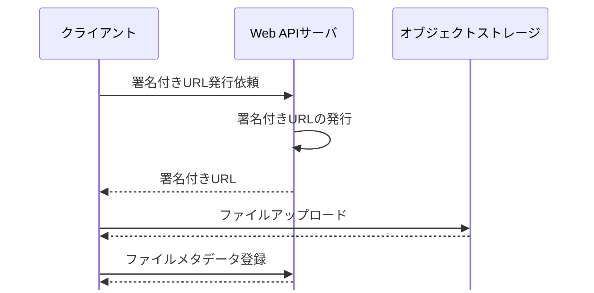
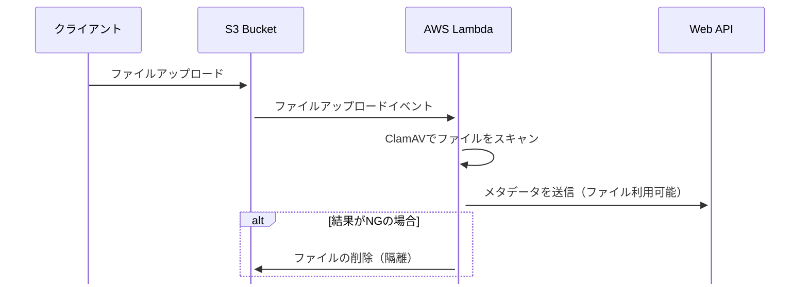
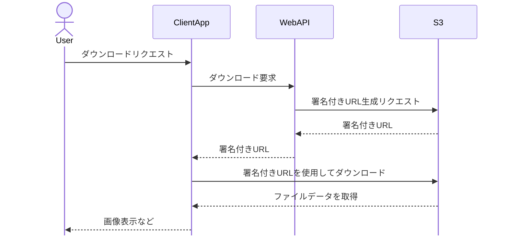
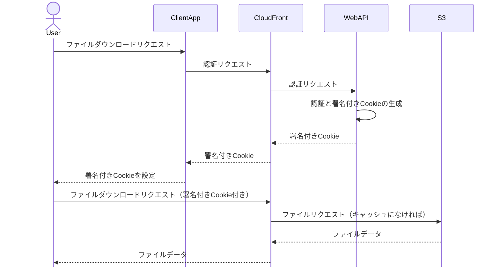

# Web API のファイル連携

小さなデータは Base64、それ以外は署名付き URL でアップロード・ダウンロードする。
署名付き URL は有効期限を短くし、HTTP メソッド・Content-Type・サイズを制限する。
出典は [Web API設計ガイドライン](about.md) (CC BY 4.0) で、OKF の形式に合わせて分割、変更している。

## ファイル連携

### ファイルアップロード

業務システムにおいても点検結果の写真や動画、WordやPDFなど非構造データをアップロードすることがしばしば求められる。クラウド環境では、アップロードされたコンテンツは通常、最終的にオブジェクトストレージに格納する。その手法には以下のパターンがある。

| #    | （1）multipart/form-data                       | （2）Base64                                                                      | （3）署名付きURL                                                                                                                                                                                                         |
| ---- | ---------------------------------------------- | -------------------------------------------------------------------------------- | ------------------------------------------------------------------------------------------------------------------------------------------------------------------------------------------------------------------------ |
| 説明 | RFC 2388でも定義された、古くから利用される方式 | ファイルをBase64形式にエンコードして、通常のフォームデータとして送信する方法     | オブジェクトストレージで特定の期間内にのみ有効な一時的なURLを生成し、そのURLを使用してアップロードを行う方法                                                                                                             |
| Pros | ✅️枯れている                                   | ✅️通常のリクエストボディでJSON要素の値として設定できるので楽                     | ✅️負荷をクラウドサービス側にオフロードできる ✅️Amazon API Gateway を利用する場合は、2023 年 6 月時点でペイロード上限が 10MB、AWS Lambda でもペイロード制限があるため、許容するファイルサイズによってはこの手法一択となる |
| Cons | ⚠️ブラウザ以外のクライアントからは扱いにくい   | ⚠️ファイルサイズが大きくなるため、モバイルなどのクライアントでは帯域の観点で懸念 | ⚠️メタデータ系の登録は、別途Web APIを叩く必要があるなど、クライアント側に手続きが発生                                                                                                                                    |

推奨は以下の通り。

- サムネイルなど小さなデータの場合（数KB程度を想定）は、（2）を利用する
- 上記以外の場合は、（3）を利用する

#### 署名付きURLのアップロード

署名付きURLを利用したアップロードの場合、その後でファイルに紐づかせるメタデータを登録する必要がある。例えば、参照可能な権限や検索用のタグなどである。メタデータの登録をもって、ファイルアップロードが完了するというフローにすることを推奨する。

#### 署名付きURLを利用する際の注意

注意点を下表にまとめる。

| 項目                                                         | 説明                                                                                                                                                                                                                                                                                   | 設定例                                    |
| :----------------------------------------------------------- | :------------------------------------------------------------------------------------------------------------------------------------------------------------------------------------------------------------------------------------------------------------------------------------- | :---------------------------------------- |
| 有効期限をなるべく短くする                                   | 署名付きURLは、そのURLを知っていれば誰でもアクセスできてしまうため、有効期限を短く設定することで、万が一漏洩した際のリスクを軽減する                                                                                                                                                   | 1～5分                                    |
| HTTPメソッドを指定する                                       | アップロードの場合はPOSTまたはPUT                                                                                                                                                                                                                                                      | POST                                      |
| 社内ネットワークからの利用に限る場合は、送信元IP制限を加える | AWS S3の場合はバケットポリシーでIP制限を行う                                                                                                                                                                                                                                           | ー                                        |
| Content-Typeを指定する                                       | アップロードしたいファイルの拡張子が適切か判定した上で、署名付きURLを生成する                                                                                                                                                                                                          | 例えば、.png, .jpeg, .webp などに絞るなど |
| Content-Lengthを指定する                                     | アップロードしたいファイルサイズが適切か判定した上で、署名付きURLを生成する                                                                                                                                                                                                            | 100MBまでなど                             |
| アップロードファイルの検証                                   | ファイルの拡張子などは偽装可能であるため、コンテンツの検証を行う必要がある場合も考えられる                                                                                                                                                                                             |                                           |
| EXIFの削除 / 抽出                                            | 画像データにおいて、EXIFは個人情報保護やセキュリティの観点から自動除外が望ましい                                                                                                                                                                                                       |                                           |
| ウィルスチェック                                             | 社内向けであれば不要だと考えられがちだが、万が一不正なファイルがアップロードされた場合のリスクアセスメント結果によっては、ウィルスチェックにより軽減策を講じる必要がある。例えば、ClamAVなどを用いて、オブジェクトアップロードイベントを元にチェック用のLambdaを起動させる方法がある。 |                                           |

ウィルスチェックの処理フロー例を以下に示す。

> [!NOTE]
> **参考**
>
> - [署名付きURLを利用したファイルアップロードWeb API設計の勘所 | フューチャー技術ブログ](https://future-architect.github.io/articles/20240705a/)
> - [AWS のサーバーレスと Amazon S3 署名付き URL、クライアントサイド JavaScript で大きなサイズの複数ファイルの一括アップロード・ダウンロード機能を実現する方法 | Amazon Web Services ブログ](https://aws.amazon.com/jp/blogs/news/large-size-files-transferring-by-serverless-s3presignedurl-and-clientside-javascript/)
> - [S3 バケットを AWS Lambda を使って、ウィルススキャンしてみた | DevelopersIO](https://dev.classmethod.jp/articles/s3-bucket-antivirus-lambda/)
> - [S3のメタデータを用いた攻撃](https://zenn.dev/p0n/articles/3a6139cce9fa17)

### ファイルダウンロード

推奨は以下の通り（ファイルアップロードと同様である）。

- サムネイルなど小さなデータの場合（数KB程度を想定）は、Base64でエンコードし、JSON項目の値に設定して返す
  - この場合は、URIでそのままimageタグに埋め込めるようにデータURIスキームで返す
  - 例えば、`` のようにsrcへ設定できる形式である
- 上記以外の場合は、署名付きURLを利用してダウンロード

#### 署名付きURLのダウンロード

署名付きURLを利用したファイルダウンロードの例を示す。

なお、画像参照のようにユーザー権限でダウンロードを絞り込む必要がなく、ログイン済みユーザーに対して一律参照を許容する場合は、CDN（CloudFront）を利用する構成案もある。CloudFrontは、ログイン済みユーザー（Cookieを持ったユーザー）だけに参照を許可できるため、署名付きURLが不要になる。

> [!NOTE]
> **参考**
>
> - [ファイルダウンロード完全マスター | フューチャー技術ブログ](https://future-architect.github.io/articles/20220621a/)
> - [CloudFrontの署名付きCookieでプライベートコンテンツの配信 | DevelopersIO](https://dev.classmethod.jp/articles/cloudfront-signed-cookie/)
