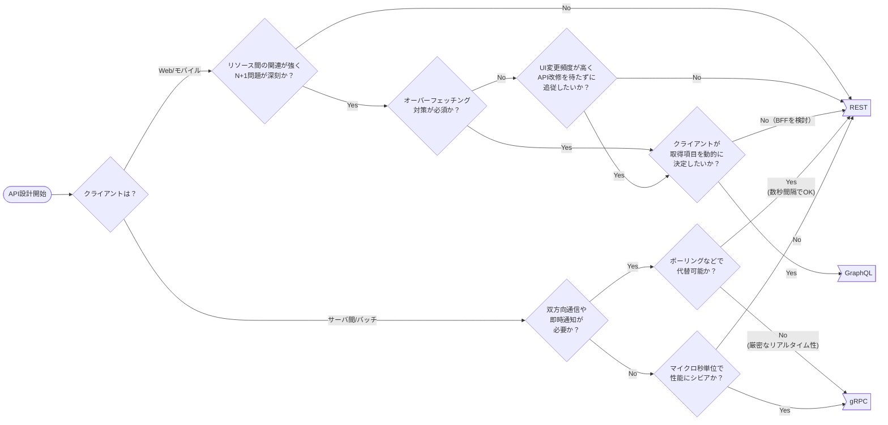

# Web API のアーキテクチャ選定とリソース設計

原則 REST を採用し、非機能要件やクライアント特性に応じて gRPC、GraphQL を選ぶ。
ホスト名やパスは kebab-case、JSON 項目は snake_case とし、リソースはネストとフラットを使い分ける。
出典は [Web API設計ガイドライン](about.md) (CC BY 4.0) で、OKF の形式に合わせて分割、変更している。

## アーキテクチャ選定フロー

Web APIの提供には、REST、gRPC、GraphQLなど複数の選択肢がある。

本ガイドラインでは原則、RESTを採用する。ただし、性能や通信量などの非機能要件やクライアント特性に応じて、以下のフローチャートに従いgRPC、GraphQLを選定する。



理由は以下の通り。

- REST
  - 以下の理由で第一の選択肢とする
    - HTTPのセマンティクス（キャッシュ、ステータスコード等）を最大限活用できるため
    - AWS（ALB, WAF, CloudFront）などのマネージドサービスとの親和性が高く、インフラ構成をシンプルに保てるため
    - エコシステムが成熟しており、開発・保守の知見が広く共有されているため
- GraphQL
  - 以下を満たす場合に最も有効であるため
    - モバイルアプリなど、帯域制限がある環境で必要なデータのみを最小限の通信で取得したい
    - UIの変更頻度が激しく、バックエンドAPIの改修を待たずにフロントエンド側で必要なデータを取得・整形したい
  - N+1問題や複雑なクエリ制限への対応など運用コストが高いため、できる限りRESTの利用を考えること
- gRPC
  - 以下のいずれかの条件を満たす場合に最も有効であるため
    - チャットやリアルタイム同期など、常時接続かつ双方向のデータ送受信が必要で、ポーリングでは負荷や遅延の要件を満たせない場合
    - マイクロサービス間通信などで、マイクロ秒単位の低遅延や高スループットが求められ、Protocol Buffersによるバイナリシリアライズが必須となる場合
- JSON-RPC
  - 原則採用しない。手続き的なRPCスタイルの通信が必要な場合は、REST APIの設計を少し崩して対応可能であるため

## スタイル

Web APIの各要素の表記は以下のルールとする。表記形式を統一し、設計時の考慮事項やWeb API利用時のミスを減らすことを目的とする。

| 対象                       | 推奨                | 例                      | 理由                                                                                                                                                                                             |
| :------------------------- | :------------------ | :---------------------- | :----------------------------------------------------------------------------------------------------------------------------------------------------------------------------------------------- |
| ホスト名                   | kebab-case          | api.foo-bar.example.com | RFC 952、RFC 1123ではホスト名へのアンダースコア（\_)の使用を許容していない。またRFC 1123では大文字と小文字を区別しなくても良いとある。必然的に、文字の区切りがハイフンであるkebab-caseを利用する |
| パス（リソース名）         | kebab-case \+複数形 | delivery-schedules      | ホスト名がkebab-caseであるため、それと整合性を取る。 また、REST志向という前提であるため、リソース名の最後は複数形にする                                                                          |
| リクエストヘッダー         | kebab-case          | x-debug-enabled         | ※1                                                                                                                                                                                               |
| クエリパラメータ           | snake_case          | order_id                |                                                                                                                                                                                                  |
| リクエストボディのJSON項目 | snake_case          | order_id                | ※2                                                                                                                                                                                               |
| レスポンスヘッダー         | kebab-case          | x-debug-logs            | ※1                                                                                                                                                                                               |
| レスポンスボディのJSON項目 | snake_case          | order_id                |                                                                                                                                                                                                  |

※1 ヘッダーフィールドについて。

[RFC 7540: Hypertext Transfer Protocol Version 2 (HTTP/2)](https://www.rfc-editor.org/rfc/rfc7540#section-8.1.2) によると、以下が記載されている。

- ヘッダーフィールドは大文字 / 小文字を区別しない（case-insensitive）
- HTTP/2へエンコーディングする前に、ヘッダーフィールドを小文字に変換する必要がある

また、 [HTTP ヘッダー \- HTTP | MDN](https://developer.mozilla.org/ja/docs/Web/HTTP/Headers) に記載の通り、以前は X- 接頭辞を使用していた。この慣習は、標準外のフィールドが標準になったときに不便なため、2012 年 6 月の RFC 6648（[日本語訳](https://tex2e.github.io/rfc-translater/html/rfc6648.html)） で非推奨になった。ただし、プライベートなWeb APIでは標準化されることはまずない。区別をわかりやすくするため、明示的に `x-` のプレフィックスを付与する。

※2 JSONフィールドの命名規則。

JavaScriptでの扱いを考えると、camelCaseの方が親和性は高いという考えもある。しかし現代のフロントエンドのエコシステムでは、Zodなどのライブラリを使用する前提で容易に変換可能であるため、snake_caseとする。

```js
// 要求例
https://api.example.com/delivery-schedules?order_id=12345
```

```json
// 応答例
{
  "order_id": "12345",
  "delivery_schedules": [
    {
      "schedule_id": "67890",
      "status": "shipped",
      "estimated_delivery_date": "2023-10-10",
      "carrier": "Delivery Service Provider Name",
      "tracking_number": "TRACK1234567890",
      "delivery_address": {...}
    },
    {
      "schedule_id": "67891",
      "status": "in transit",
      "estimated_delivery_date": "2023-10-12",
      "carrier": "Another Delivery Service Provider",
      "tracking_number": "TRACK0987654321",
      "delivery_address": {...}
    }
  ]
}
```

> [!NOTE]
> **参考**
>
> [HTTPヘッダーのX-は非推奨と言うけれど・・・](https://zenn.dev/ys/articles/a58b02e3cbc2f839f7f1)

## ホスティング戦略

### サブドメインとサブパス

Web APIのホスティング戦略とは、エンドポイントをどのように配置し、アクセス可能にするかの方針を指す。大きく以下の2方式がある。

| #        | （1）サブドメイン方式                                                     | （2）サブパス方式                                                                                              |
| :------- | :------------------------------------------------------------------------ | :------------------------------------------------------------------------------------------------------------- |
| 例       | `api.example.com`                                                         | `example.com/api`                                                                                              |
| 説明     | WebサイトとAPIが明確に分離でき、独立したAPIサービスを提供するときに適する | 同一ドメインで静的コンテンツとWeb APIを配信する際に利用する。画面とWeb APIの両方を作る場合に採用することが多い |
| DNS管理  | 追加する                                                                  | メインのドメインと共用                                                                                         |
| CORS設定 | 必要                                                                      | 不要                                                                                                           |

推奨は以下の通り。

- 同一ドメインで静的コンテンツ（HTML/CSS/JavaScript/画像など）を配信する、または配信する予定があるのであれば、 （2）を採用する
- APIサービスを独立して提供する想定であれば、`api.example.com` といった（1）を採用する。この場合 `/api` は不要とする

### マイクロサービス時の振り分け

マイクロサービス構成で、fooサービス、barサービスなど複数のWeb APIを提供する場合も、同様にサブドメイン方式 / サブパス方式のどちらを採用するか決める必要がある。

| #                    | （1）サブドメイン方式                     | （2）サブパス方式                         |
| :------------------- | :---------------------------------------- | :---------------------------------------- |
| 凡例                 | `api.{サービス名}.example.com`            | `example.com/api/{サービス名}`            |
| 具体例               | `api.foo.example.com api.bar.example.com` | `example.com/api/foo example.com/api/bar` |
| パス例               | `GET api.foo.example.com/v1/articles/123` | `GET example.com/api/foo/v1/articles/123` |
| DNS管理              | 追加する                                  | メインのドメインと共用                    |
| CORS設定             | 必要                                      | 不要                                      |
| Cookie認証実施の場合 | APIごとに必要                             | どれか1つの認証で事足りる                 |

推奨は以下の通り。

- 各マイクロサービスの独立性を高める考えであれば、（1）を採用する
- サービスの粒度管理や認証などの観点から、同一ドメインで提供する場合、またはAPIゲートウェイで集約して提供する場合は、（2）を採用する

## リソース表現

例えば、記事に対するコメントの表現には、リソースをネストさせるかフラットにするかという設計判断がある。

1. `/articles/1/comments/1` （ネスト）
2. `/comments/1` （フラット）

それぞれの特徴をまとめる。

| #                           | （1）ネスト表現                                                                | （2） フラット表現                                               |
| :-------------------------- | :----------------------------------------------------------------------------- | :--------------------------------------------------------------- |
| 説明                        | コメントが特定の記事に紐づくことが明示できる                                   | コメントというリソースの独立性を重視する場合に適している         |
| コメント一覧の取得          | `GET /articles/1/comments` で取得                                              | `GET /comments?article_id=1` で取得                              |
| コメントの削除              | `DELETE /articles/1/comments/1` で、article_idも必須項目である                 | `DELETE /comments/1` article_id無しで削除可                      |
| コメント追加                | `POST /articles/1/comments`                                                    | `POST /comments` リクエストボディにarticle_idの指定が必要        |
| DELETE /articles/1 時の挙動 | 紐づいたコメントも消えることが直感的                                           | 記事に関連したコメントが消えることは必ずしも直感的ではない       |
| まとめ                      | 親リソースに関連性が深い（一覧参照、削除時にカスケード削除される場合に適する） | 他のリソースと親子関係に無い、独立したリソースである場合に適する |

推奨は以下の通り。

- 【GET】親リソースに紐づいた子リソースを一覧検索で取得する可能性がある場合は、（1）を採用する
- 【POST】親リソースの配下にリソースを作成するのであれば、（1）を採用する
- 【DELETE】親リソースが削除された場合に、同時に子リソースも削除すべきであれば、（1）を採用する
- ネスト / フラットの両方を使い分けることはありえるが、両方のサポートは最小限とする
  - 機能数をなるべく減らし保守性を上げるため
  - 呼び出し元の実装を揺れさせないようにするため
  - 影響度調査を容易にするため

記事に対するコメントの例では、記事が削除された場合にコメントも合わせて削除することが自然であれば、（1）を採用する。もし、依存する親リソースがなく、独立しているのであれば、（2）を採用する。

ネスト表現 / フラット表現が混ざることは自然である。また、両方をサポートするパターンもある。この場合、開発の手間は増えるが、利用者側のユースケースが見えないときに使える。

以下に受注の例を挙げる。

- ネストのみで提供
  - 【POST】`/customers/{customer_id}/orders` 受注の作成
  - 【GET】`/customers/{customer_id}/orders` 取引先に紐づいた受注の検索
- フラットのみで提供
  - 【PUT】`/orders/{order_id}` 受注情報の編集
  - 【DELETE】`/orders/{order_id}` 受注の取り消し
- 両方で提供
  - 【GET】`/orders/{order_id}` 受注情報の取得
  - 【GET】`/customers/{customer_id}/orders/{order_id}` 本来不要にしても良いが、開発者体験のためにサポート

上記例では、以下を強調するためにネスト / フラットを混在させている。

- 受注の作成は取引先が必須
- 受注は取引先とのやり取りが停止になっても情報が残るため、リソースとして独立している
