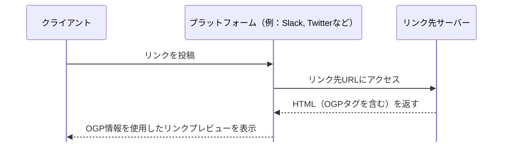
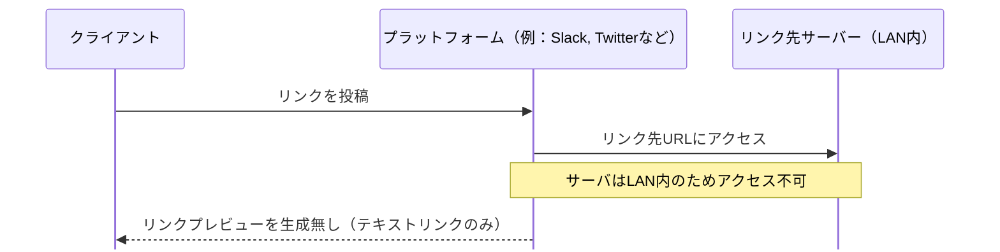

# WebフロントエンドのOGP

OGP の展開はプラットフォームのバックエンドが行うため、企業内システムや toB の SaaS では設定不要、toC 向けでは積極的に設定する。
出典は [Webフロントエンド設計ガイドライン](about.md) (CC BY 4.0) で、OKF の形式に合わせて分割、変更している。

OGP（Open Graph Protocol）は、ウェブページのメタデータを指定し、ソーシャルメディアプラットフォーム上でリンクが共有された際に、適切なタイトル、説明文、サムネイル画像などを表示できるようにするプロトコルである。以下のような `meta` タグを使用する。

```html
<meta property="og:title" content="ページのタイトル" />
<meta property="og:description" content="ページの説明" />
<meta property="og:image" content="画像のURL" />
<meta property="og:url" content="ページのURL" />
```

OGPにおいて、以下のような設計論点が存在する。

- **サムネイル画像**: アスペクト比や解像度要件
- **メタデータの一貫性**: 各ページで一貫したメタデータを設定するか、それともページごとに異なる内容を設定するか
- **多言語対応の是非**: 各言語に応じたOGPタグを設定するかどうか
- **優先度**: サイト全体のOGPタグと個別ページのOGPタグの使い分けについて、使い分けの運用ルール

OGPを用いたリンク情報の展開は、通常プラットフォームのバックエンド側で行われる（クライアントサイドでは無い）。



そのため、リンク先が例えばイントラネット内のコンテンツである場合、通常OGPの展開はできない（※プラットフォームがイントラネット内で構築されていれば別であるが、稀な構成だと思われる）。ネットワーク的に到達できたとしても、認証・認可済みでないと参照できないコンテンツの場合も同様に、プラットフォームはOGP情報を取得できないためプレビュー表示ができない。



推奨は以下の通り。

- 企業ネットワークでのみ利用されるサービスの場合、リンクをSNSに共有することは通常ない。そのためOGP設定は不要である
  - OGP設定があっても、SNSサービス側のバックエンドがリンク先に到達できないため意味がない
- toB向けのSaaSサービスを提供している場合、ほとんどのコンテンツはプライベートであり、権限が無いと参照できない。そのためOGP設定は不要である
- toC向けのサービスの場合は、SNS利活用のため積極的に利用すべきである

> [!TIP]
> **toC向けサービスの場合**
>
> [【2024年版】全SNSにオールマイティーなOGP画像サイズはこれだ！（X、Threads対応）](https://bluetraff.com/ogp_thumbnail/) によると、画像はJPG/PNG形式、サイズは1200✕630pxが最適とある。かつ画像はトリミングされた表示がなされるため、テキストなどの配置に注意すること。
