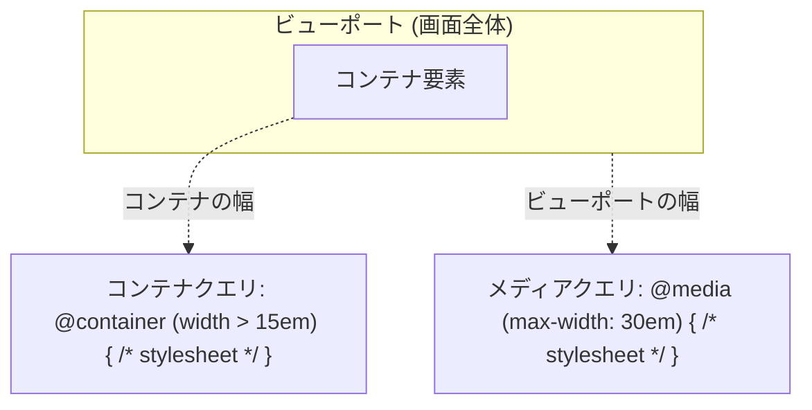

# Webフロントエンドのレスポンシブ対応

ブレークポイントはメディアクエリとコンテナクエリを特徴に応じて使い分け、Tailwind CSS ではデフォルトのプレフィックスを用いる。
CSS はモバイルファーストで定義する (プレフィックス無しをモバイルにする)。
出典は [Webフロントエンド設計ガイドライン](about.md) (CC BY 4.0) で、OKF の形式に合わせて分割、変更している。

スマートフォンやタブレット端末の普及により、システムには様々なデバイスからアクセスがなされるようになった。レスポンシブ対応には、以下のメリットがあるとされる。

- 様々なデバイスから利用が可能となりUX、ユーザー満足度が向上する
- PC用・モバイル用・タブレット用といった、デバイス別の機能を開発する必要がなくなり、コスト削減およびリードタイムを短くできる
- SEO対策になる（2021年3月からGoogleがPCでしか表示できないコンテンツをインデックスしないという声明を出しており、モバイルファーストの重要性が増している）
- 社内システムにおいて、モバイル対応でワークフロー承認などの対応速度が向上し、業務効率の向上が望める

レスポンシブ対応で主に必要な作業は以下がある。

- 視認性を上げるためのレイアウト調整
- タッチ操作（あるいはマウスクリック）に最適化するよう、ボタンやリンクの配置設計
- フォントサイズをデバイスごとの読みやすい大きさに設定
- 画像サイズの最適化
  - 解像度別に複数の画像を作成および、マークアップで設定
- CSS、JavaScriptのサイズ調整
  - モバイルでは特に表示速度が重要となるため、PCよりシビアに軽量化が求められる
  - 通信量を下げることにも繋がり、ユーザーに対するメリットもある

対応すべきデバイスを増やすほど、サポートする全てのデバイス・画面サイズでレイアウト崩れがないか確認するテスト工数も増える。対象を絞れるだけ絞った方が、開発期間を短くしつつ品質を上げやすい。追加開発のリリース速度にも当然ながら影響を与える。

## ブレークポイント

ブレークポイントとは、画面サイズに応じてコンテンツの表示レイアウトを変化させるポイントのことである。CSSを用いたブレークポイントは、下表の2つの方式のどちらかで設定される。

他の手法としては、以下が考えられる。

- JavaScript側で表示幅によってレイアウトを変化させる
- ユーザーエージェント（以下、UAとする）を元に異なるテンプレートを読み込む
- UAを元にサーバーサイドで応答を切り替える（SPAではなくNuxtやNext.jsなどが存在する想定）

これらの手法は実装コストが高いうえに、UAの信頼性の低さ（正確な判定が難しく、タブレットとデスクトップの境界定義も難しい）という課題がある。さらにSEOへの影響度把握が難しい点やリサイズに対しては非対応になる点、JavaScript方式はサーバーサイドレンダリングで利用できない点などの副作用もあり、比較からは除外する。

| #                | （1）メディアクエリ                                                                                            | （2）コンテナクエリ                                                                                        |
| :--------------- | :------------------------------------------------------------------------------------------------------------- | :--------------------------------------------------------------------------------------------------------- |
| 説明             | ビューポート（画面全体）のサイズ、デバイスの種類、解像度などの条件に基づいてスタイルを適用する方法             | 特定の要素（コンテナ）のサイズや属性に基づいてスタイルを適用する方法                                       |
| 適用箇所         | サイト全体のレイアウトやナビゲーション切り替えなど、画面サイズに基づき全体的な変更に適する。グローバルな視点。 | 特定のコンポーネント（グリッド内のアイテムなど）のサイズに応じての、スタイル変更に適する。ローカルな視点。 |
| ブラウザサポート | ✅️ほぼ全てのブラウザでサポート                                                                                 | ✅️2023年に主要ブラウザでサポート                                                                           |
| 例               | `media (max-width: 30em) {...}`                                                                                | `@container (width \> 15em){...}`                                                                          |

【メディアクエリ・コンテナクエリの動作概念】



※画像は [CSS コンテナークエリー | MDN](https://developer.mozilla.org/ja/docs/Web/CSS/CSS_containment/Container_queries) から引用。

推奨は以下の通り。

- 特性が異なるため、（1）、（2）は特徴に応じて使い分け（併用）する
- サイト全体の基本的なレイアウト調整の場合は、（1）を利用する。例えばサイト全体のブレークポイント（768px、1024pxなど）を設定し、大まかなレイアウトを決定する
  - 例
    - ナビゲーションバーを、モバイルではハンバーガーメニューに、デスクトップでは横並びにする
    - モバイルやPCでフォントサイズを調整する
    - 大きな画面で余白を大きくする
  - 理由: ビューポートサイズに基づいて調整する必要があるため
- （1）の調整の後、（2）のコンポーネント単位で調整する
  - カードやウィジェットなどをコンテナサイズに応じて調整する。表示項目が少なく、レイアウトがシンプルな画面であれば、（2）の調整が不要な場合もある
  - 例
    - ビューポートが768px以上でグリッドレイアウトを適用しつつ、グリッド内のアイテムはコンテナクエリで調整する

## Tailwind CSS を用いたブレークポイント

CSSフレームワークではこれらを表現した仕組みが用意されていることが多い。Tailwind CSS 4.0では、[メディアクエリに5つ](https://tailwindcss.com/docs/responsive-design#overview)、[コンテナクエリに13](https://tailwindcss.com/docs/responsive-design#container-size-reference)のデフォルト値が用意されている。

【例: Tailwind CSSのメディアクエリのプレフィックス】

| プレフィックス | 最小幅         | CSS                               |
| :------------- | :------------- | :-------------------------------- |
| `sm`           | 40rem (640px)  | `@media (width >= 40rem) { ... }` |
| `md`           | 48rem (768px)  | `@media (width >= 48rem) { ... }` |
| `lg`           | 64rem (1024px) | `@media (width >= 64rem) { ... }` |
| `xl`           | 80rem (1280px) | `@media (width >= 80rem) { ... }` |
| `2xl`          | 96rem (1536px) | `@media (width >= 96rem) { ... }` |

【例: Tailwind CSSのコンテナクエリのプレフィックス（抜粋）】

| プレフィックス | 最小幅        | CSS                                 |
| :------------- | :------------ | :---------------------------------- |
| `@3xs`         | 16rem (256px) | `@container (width >= 16rem) { … }` |
| `@2xs`         | 18rem (288px) | `@container (width >= 18rem) { … }` |
| `@xs`          | 20rem (320px) | `@container (width >= 20rem) { … }` |
| `@sm`          | 24rem (384px) | `@container (width >= 24rem) { … }` |
| `@md`          | 28rem (448px) | `@container (width >= 28rem) { … }` |
| `@lg`          | 32rem (512px) | `@container (width >= 32rem) { … }` |

【コンテナクエリの例（sm 以上で3列、lg 以上で4列のグリッドにするイメージ）】

```html
<div class="@container">
  <div class="grid grid-cols-1 @sm:grid-cols-3 @lg:grid-cols-4">
    <!-- コンテンツ -->
  </div>
</div>
```

コンテナクエリは rem や px 以外にも、Tailwind CSS特有ではなくCSSの機能として下表のような相対単位を指定できる（他にも cqmin や cqmax などがある）。

| 単位 | 名称                   | 説明                                                                                                    |
| :--- | :--------------------- | :------------------------------------------------------------------------------------------------------ |
| cqw  | Container Query Width  | コンテナの物理的な幅（水平方向）の1%                                                                    |
| cqh  | Container Query Height | コンテナの物理的な高さ（垂直方向）の1%                                                                  |
| cqi  | Container Query Inline | コンテナ要素のインラインサイズの1％。通常は幅だが、書字方向によって変化する。例えば縦書きでは高さになる |
| cqb  | Container Query Block  | コンテナ要素のブロックサイズの1％。通常は高さだが、書字方向によって変化する。例えば縦書きでは幅になる   |

Tailwindのデフォルト設定ではcqw cqh に直接対応するユーティリティが用意されていないため、tailwind.config.js でカスタマイズするか、インラインで直接指定する必要がある。

推奨は以下の通り。

- （Tailwind CSSを利用する前提で）個別の要件が無ければ、Tailwind CSSのデフォルトで用意されたプレフィックスを用いる
  - 命名規則も、メディアクエリの場合は sm md lg などに従う方が良い
- デフォルトのpx値などはCSSファイルで拡張できる。微調整が必要に応じて実施する
  - その際、 sm を 500にするなどの微修正に留め、意味合いが異なる混乱をもたらすような値にはしない（例えば、sm を 1280にするなど）
- もし、ブレークポイントを拡張する場合はプレフィックス名を明確にする
  - 例: メディアクエリの場合は 3xl を単純に追加するか、 mobile tablet desktop など簡潔で直感的に分かりやすい命名に置き換える
- 既存のプレフィックス名の上書きについて
  - Tailwind CSSにおいて、既存プレフィックス（smなど）への上書きは可能である。プロジェクト開発初期で対象デバイスが明確であれば上書する
  - もし、読みきれない場合は上書きを無くし、カスタム名で対応する（途中で変更すると影響範囲が大きいため、上書きしない方が良い）
- 性能について
  - コンテナクエリのネストも性能劣化の懸念がある（当然、保守性にも良くない）ため、ネスト数は1,2レベルに収めることが推奨
  - コンテナクエリは動的にコンテナサイズを監視する必要があるため、多用すると性能に悪影響がある
  - 使用するクエリの数は必要最低限にする
    - 必要なレイアウト変更をするときのみ、ブレークポイントを設定する
- コンテナクエリのブレークポイントを、絶対的な幅で指定したい場合は @3xs などのデフォルトプレフィックスを指定する。割合で指定したい場合は cqi cqb を用いる
- 将来的な多言語対応の可能性を考慮し、できるかぎり論理的な単位である cqi cqb を利用する

✅️プレフィックスを指定している例

```html
<div class="w-full sm:w-3/4 md:w-1/2 lg:w-1/4">...</div>

<p class="text-base sm:text-lg md:text-xl">...</p>

<div class="mt-2 sm:mt-4 md:mt-6">...</div>
```

❌️プレフィックスを未指定の例

```html
<div class="w-64">...</div>

<p class="text-lg">...</p>

<div class="mt-4">...</div>
```

✅️適切なブレークポイント（sm md lg のみに絞った運用）

```html
<div class="@container">
  <div class="@md:flex @lg:gap-4">最適化された適用</div>
</div>

<div class="@container">
  <div class="p-2 text-sm @md:text-lg @lg:flex @lg:gap-4 @lg:bg-blue-500">
    <p>このテキストとレイアウトはコンテナ幅で変わります。</p>
  </div>
</div>
```

❌️過剰なブレークポイント（コンテナの幅（cqw）と高さ（cqh）に基づくブレークポイントを過剰に設定した例。ここまで必要なケースは稀だと思われる）

```html
<div class="@container">
  <div
    class="p-2
              @[10cqi]:text-sm
              @[20cqi]:text-base
              @[30cqi]:text-lg
              @[40cqi]:text-xl
              @[50cqi]:text-2xl
              @[60cqi]:text-3xl
              @[70cqi]:text-4xl
              @[80cqi]:text-5xl
              @[90cqi]:flex
              @[100cqi]:gap-4
              @[50cqb]:bg-blue-500"
  >
    <p>このテキストとレイアウトはコンテナ幅で変わります。</p>
  </div>
</div>
```

## モバイルファースト

toC、toB向けのサービスでは、モバイル対応が必須と言っても良い。レスポンシブ対応としてはモバイルファーストのブレークポイントを設計すると、Tailwind CSSを含むCSSフレームワークと相性が良いことが多い。[Responsive design \- Tailwind CSS](https://tailwindcss.com/docs/responsive-design#targeting-mobile-screens) では以下のように、プレフィックス無しの定義をモバイルにし、より大きなブレークポイントで上書きするとある。

✅️プレフィックス無しをモバイルに、より大きなブレークポイントで上書き

```html
<div class="text-center sm:text-left"></div>
```

❌️sm をモバイルターゲットに利用

```html
<div class="sm:text-center"></div>
```

Tailwindを扱う上では、こうしたポリシーに従いレイアウトを構築することが望ましい。

業務システムに対してもDX、働き方改革などのテーマでモバイルから行える業務を増やしたいという要望は根強い。しかし、業務システムの特徴として、扱う項目数の多さが課題になりやすい。表示項目や入力項目が多いため、ナビを隠したりフォントサイズを調整したりする程度では、モバイル対応として十分ではない画面が存在しうる。これに対してはいくつかの方針が考えられる。

| #        | （1）hidden切り替え                                                                                | （2）別画面（セパレート化）                                                                                                                                                                                                                 | （3）モバイルアプリ                                                                                                                                                                       |
| :------- | :------------------------------------------------------------------------------------------------- | :------------------------------------------------------------------------------------------------------------------------------------------------------------------------------------------------------------------------------------------ | :---------------------------------------------------------------------------------------------------------------------------------------------------------------------------------------- |
| 説明     | PCではテーブル、モバイルではリスト表示といったタグ構造レベルの切り替えをhiddenで表示制御する方式。 | 一部の画面のみ、モバイル専用として構築するケース。表示項目を細かく調整することが多いため、いっそ別画面として切り出すほうが、開発コストを下げられ、保守性も良くなる場合がある。URLベース切り替えや、UAベースなど複数の実装パターンが存在する | モバイルで行うべき業務ユースケースに特化しようとすれば、通知、オフライン対応、GPS、カメラ操作などが必要になることが多い。そうした将来性を見越してモバイルアプリとして開発しておくパターン |
| 難易度   | ✅️ページ内に閉じて開発可能                                                                         | ⚠️個別に画面遷移を調整するなど、サイト全体の方針設計も必要                                                                                                                                                                                  | ❌️モバイルに適したユースケースの抽出、設計が必要となる                                                                                                                                    |
| 開発量   | ✅️最も抑えられる可能性がある                                                                       | ⚠️技術スタックとしては一般的なWebアプリケーション開発と同様                                                                                                                                                                                 | ❌️モバイル領域の技術スタックが新しく追加されるため、非常に重い対応となる。対応すべきデバイス種別数でさらに工数増                                                                          |
| 保守量   | ✅️一箇所にまとめられる                                                                             | ⚠️本来同じ機能を持つ画面を複数保守する必要があり、何かの変更で2画面以上の修正が必要となる                                                                                                                                                   | ❌️Webともバイルで二重に修正が必要                                                                                                                                                         |
| UX       | ✅️（2）と同等の自由度がある                                                                        | ✅️任意に作り込み可能                                                                                                                                                                                                                        | ✅️任意に作り込み可能                                                                                                                                                                      |
| 性能     | ⚠️hiddenで表示されないHTMLも応答するため、性能劣化の懸念                                           | ✅️必要最小限                                                                                                                                                                                                                                | ✅️                                                                                                                                                                                        |
| テスト性 | ✅️同一画面なので、レイアウトのテストが行いやすい                                                   | ⚠️画面が別であるためテスト対象も増大                                                                                                                                                                                                        | ⚠️アプリ審査などが入るため、Webとモバイルのリリースタイミングのズレから、テスト                                                                                                           |

推奨は以下の通り。

- toB、toC向けサービス、業務システムを問わず、モバイルファーストでCSSの定義する（モバイル要件が無くても、プレフィックス無しはモバイルとする）
- PC想定だった業務システムをモバイル対応する際、できる限り表示項目を減らすなどの手法で考えられないかまず考える
- 表示項目を減らすなどの方針で対応できない場合は、（1）の方式の導入を検討する（方式（1）～（3）の中で工数が低くなると考えられるため）
- （1）で対応できない場合は、（2）の導入を検討する。ページの概念として別画面化がふさわしい場合のみ（2）を選択する
- （3）は、モバイル特化したユースケースの存在が出てきた場合にのみ検討する

> [!TIP]
> **PC画面のモバイル対応の是非**
>
> 扱う項目数が多い業務システムに対しては、レスポンシブ対応ではなくモバイルで行う補助的な業務のニーズがあるかという点が重要である。全業務ユースケースをモバイルに最適化するのではなく、モバイル化で業務効率化がなされ投資対効果に見合うかで判断する。ユースケースを達成するために必要な画面遷移上の画面のみ、モバイルに最適化していくと良い。その際、既存の構成に大きな影響が入らない、（1）案は有力なアプローチである。
