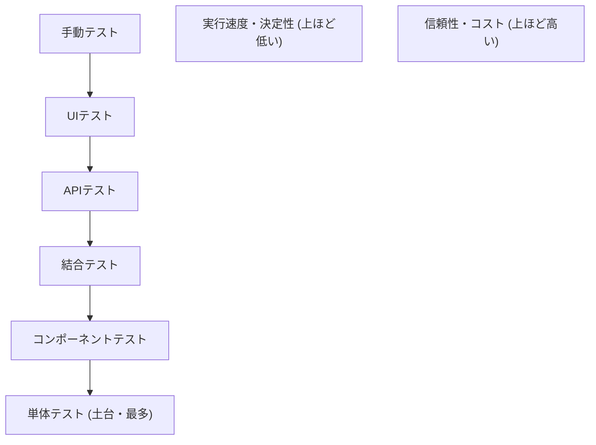
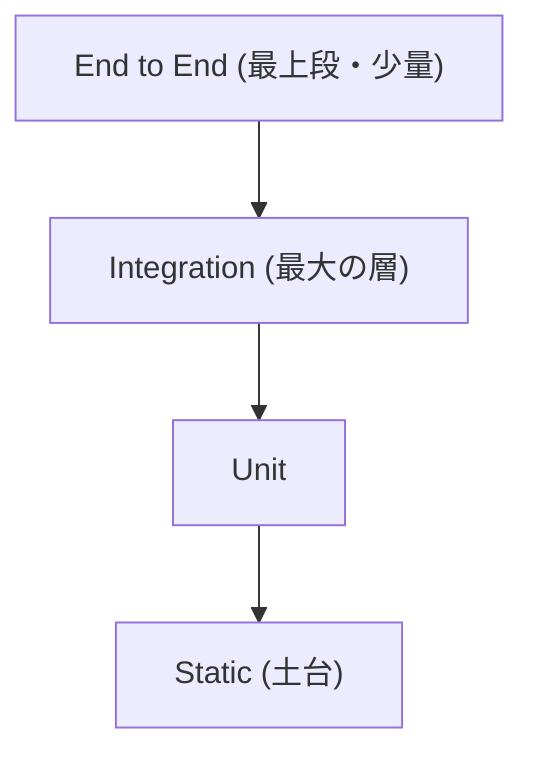
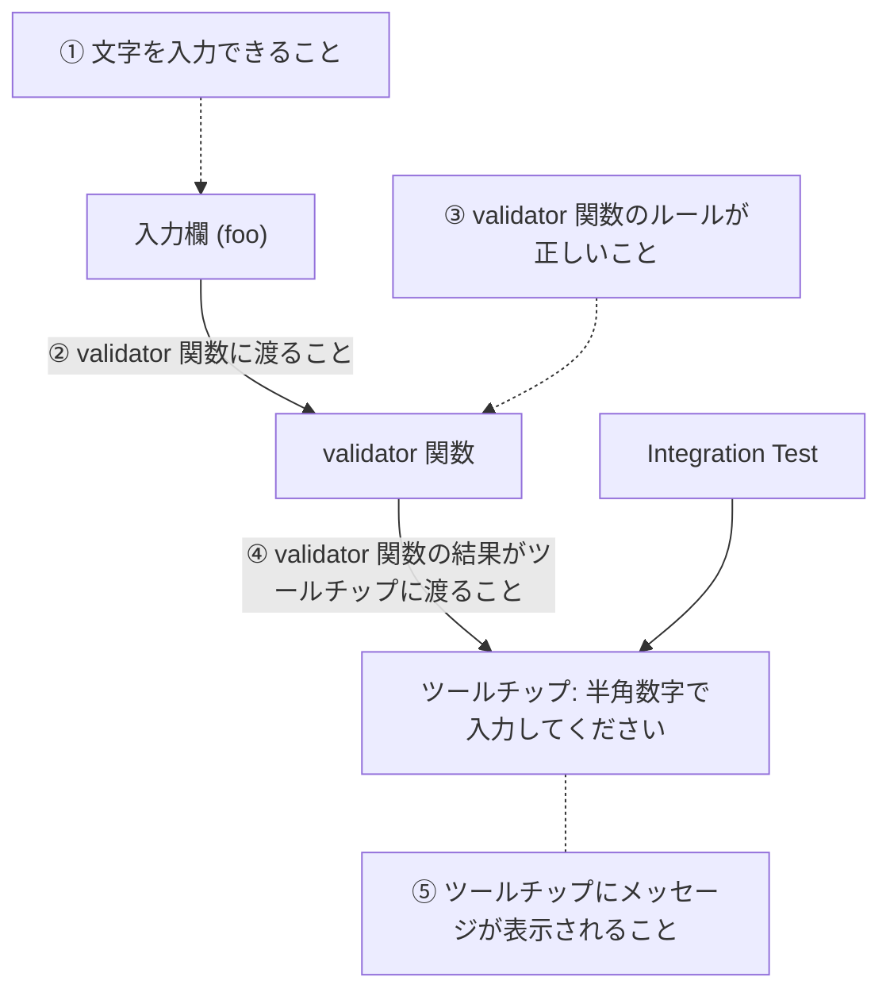

# Webフロントエンドのテスト

テストはテストトロフィーの考えに則り、種別に偏重せず価値の高いテストを目指す。
ユニットは vitest、コンポーネントは Testing Library、E2E は Playwright を使い、A11y テストは axe-core 等で自動化する。
出典は [Webフロントエンド設計ガイドライン](about.md) (CC BY 4.0) で、OKF の形式に合わせて分割、変更している。

## テスト方針

テスト方針を決めるうえで、「テスティングピラミッド」や、より現代的な解釈である「テスティングトロフィー」の考えは重要である。どちらも、テストコードの実行速度・保守運用性・信頼性などのバランスをどのように扱うべきかを示している。

| #    | （1）テストピラミッド                                                                                                                                        | （2）テストトロフィー                                                                                                                                                                              |
| :--- | :----------------------------------------------------------------------------------------------------------------------------------------------------------- | :------------------------------------------------------------------------------------------------------------------------------------------------------------------------------------------------- |
| 図   | 図1（表の下）                                                                                                                                                | 図2（表の下）                                                                                                                                                                                      |
| 説明 | 高速なユニットテストを土台に、より結合度の高いコンポーネント/インテグレーションテスト、最も高価で実行速度の遅い E2E テストを少数行う方式。単体テストを重視。 | コンポーネント/インテグレーションテスト（ユーザー視点での動作を検証すること）をより重視する。ユニットテストは実装の詳細に依存し脆いことと、E2Eテストはコストが高いため、過度に依存しないようにする |
| 参考 | [Test Pyramid](https://martinfowler.com/bliki/TestPyramid.html)                                                                                              | [The Testing Trophy and Testing Classifications](https://kentcdodds.com/blog/the-testing-trophy-and-testing-classifications)                                                                       |

図1

図2

本ガイドラインでは、フロントエンド開発と相性が良いとされる（2）のテストトロフィーの考えに則る。あるテスト種別に偏重せず、それぞれのメリットを最大限に引き出すようにバランスを取り、より価値が高いテストの作成を目指す。

推奨は以下の通り。

- `vitest` を利用し、テストトロフィーにおけるユニットテストを実施する
  - 外部入出力が無い、純粋なビジネスロジックの関数は単体テスト対象とする
  - ビジネスロジックをテストしやすいように、フックやコンポーザブルにできる限り切り出す
- `React Testing Library` や `Vue Testing Library` を利用し、コンポーネントテスト（インタラクションテスト）を実施する
  - ユーザーの視点からテストする。コンポーネントが「どのように」動作するかではなく、「何をするか」に焦点を当てて、レンダリングとインタラクションをテストする。例えば、コンポーネントのStateや内部関数をテストせず、UIをテストする
    - 例: ユーザーがボタンをクリックしたときの挙動を再現し、表示がXからYに変化することを確認する
  - 外部サービスに依存する部分は、できる限り書かない。どうしても必要な場合はモックを利用する
- `Playwright`を用いてE2Eテストを実施する
  - 作成・実行・保守が高コストであるため、ユニットテスト・コンポーネントテストでカバーできる部分には導入しない
  - 以下のような画面に導入を検討する
    - 複雑な画面（複数のAPI呼び出し・複数コンポーネント・状態変更が多い）で、組み合わせることで動作の壊れるリスクが高い場合
    - 業務上、最も根幹なユースケース（クリティカルなユーザージャーニー）に必要な画面
  - ページング・ページ遷移を伴うテストは、E2Eテストでカバーする（コンポーネントテストでは確認しにくいため）
  - VRT (Visual Regression Test)
    - （作成予定）
- A11yテスト
  - [axe-core](https://github.com/dequelabs/axe-core) などを用いてコンポーネントテスト、E2Eテストを組み合わせて自動化する
    - ただし、100％は目指さない
    - axe-coreを使用すると、 WCAG (Web Content Accessibility Guidelines) 準拠の問題（HTMLの構文、ARIA属性の使用方法、基本的な色のコントラスト、フォーム要素のラベル付けなど）を平均57％自動的に検出できるとREADMEにある
  - スクリーンリーダーテスト、キーボードナビゲーションテストは、手動確認を検討する

テスト観点の例を下表に挙げる。どのテストで何を確認するか整理しておくことを推奨する（フロントエンドに閉じず、テスト計画として準備しておく）。

| 分類                   | テスト観点                                                                    | Unit | Integration                                                  | E2E                                      | 手動テスト |
| ---------------------- | ----------------------------------------------------------------------------- | ---- | ------------------------------------------------------------ | ---------------------------------------- | ---------- |
| ビジネスロジック       | ビジネスロジック、ユーティリティ関数                                          | ✅   |                                                              |                                          |            |
|                        | カスタムフック、状態管理などの内部ロジック                                    | ⚠️   | ✅ロジックを利用するコンポーネント経由でテストすることを推奨 |                                          |            |
| ユーザー向けの振る舞い | インタラクション（クリック、入力等）による表示の変化                          |      | ✅                                                           |                                          |            |
|                        | コンポーネント間の状態連携とUI変化                                            |      | ✅                                                           | ⚠️                                       |            |
|                        | ページ遷移と表示確認（Integrationの場合はモックルーターを利用）               |      | ✅                                                           |                                          |            |
|                        | API用いたデータ取得/更新フロー（Integrationの場合はAPIモックを利用）          |      | ⚠️ロジックが入る場合に記述                                   | ⚠️APIの問い合わせが重要な場合はE2Eで確認 |            |
| シナリオ               | 主要なユーザーストーリー (ログイン、商品購入など)で、複数ページ遷移を含む場合 |      |                                                              | ✅                                       |            |
| A11y                   | HTML構造のチェック                                                            |      | ✅                                                           | ✅                                       | ✅         |
|                        | キーボード操作                                                                |      | ✅                                                           | ✅                                       | ✅         |
|                        | スクリーンリーダー                                                            |      |                                                              |                                          | ✅         |

【参考】例えば、下図の（1）→（5）の一連の流れはコンポーネントテストで確認する（※画像は [フロントエンドでTDDを実践する（理論編）- Qiita](https://qiita.com/taneba/items/48db2ad9cf10ad644908) より）

> [!NOTE]
> **参考**
>
> [テストピラミッド万歳 | POSTD](https://postd.cc/long-live-test-pyramid/)

## このリポジトリの E2E の方針

ここまでは原文に沿う。この節は、このリポジトリの方針で、原文にはない。理由と比べた案は [ADR 0039](../adr/0039-e2e-playwright-gate-and-ai-for-authoring.md) にある。

### 道具と AI の使い方

- CI のゲートになる E2E は、Playwright の決定的なコード (`.spec.ts`) で書く。実行時にモデルが判定するテストはゲートにしない。
- AI は E2E を「書く」側に使い、CI では決定的なコードだけを流す。
- e2e (tester.army) は、E2E を書く前に実アプリを動かして確かめる用途に限る。CI のゲートにせず、e2e の API で書いたテスト (`*.e2e.ts`) は CI に置かない。確認の後に残すテストは、Playwright の `.spec.ts` に書く。Kiro で動くことを確かめてから正式に採る。
- 見直す条件は、e2e が 1.0 に届くこと、Playwright の `page` を公開すること、axe-core を入れられること。

### PR の CI で流す範囲

- E2E は PR の必須チェックにする。範囲は少数の重要な導線 (ログイン、主要な書き込み 1〜2 本) と Chromium だけにする。広い網羅は merge 後と定期の実行に回す。
- AWS の実物には依存させない。AWS に依存する導線は、検証環境の `@smoke` だけにする。
- retry は 1 回までにし、`flaky` の分類を見る。隔離したテストには、期限か数の上限を付ける。

### 起動とログイン

- 結合テストと同じ起動 (testcontainers の `postgres:18`、プロセスの中のテスト用 IdP の `oidc-provider.ts`、同じ migrate と bootstrap) を、Playwright の `globalSetup` から使う。build 済みの API と web は `webServer` で起動する。compose は足さない。
- ログインのテストだけがテスト用 IdP の画面を通す。業務の導線は、Better Auth の `testUtils` で作ったセッションの Cookie から始める ([ADR 0022](../adr/0022-better-auth-cookie-bff.md))。

### 検証環境との分担

- 1 つの Playwright のスイートを、タグで分ける。毎 PR の CI で全部を流し、検証環境 ([検証環境の流れ](../tooling/verification-environment.md)) では `@smoke` だけを流す。
- 流す先は `PLAYWRIGHT_TEST_BASE_URL` で切り替える。

### 日時の表示のテスト

`apps/web` の Vitest は browser mode で、Playwright の Chromium を使う。`contextOptions.timezoneId` を `America/New_York` にして流すので、表示が業務のタイムゾーン (`Asia/Tokyo`) でなくブラウザのタイムゾーンに頼っていれば、テストが落ちる。設定が効いていることは `apps/web/src/lib/date-time.test.ts` が確かめる。理由は [ADR 0043](../adr/0043-instants-in-utc-business-calendar-in-tokyo-with-temporal.md)。手元で Chromium を入れるには `pnpm --filter @agent-software-factory/web exec playwright install --with-deps chromium` を実行する。
